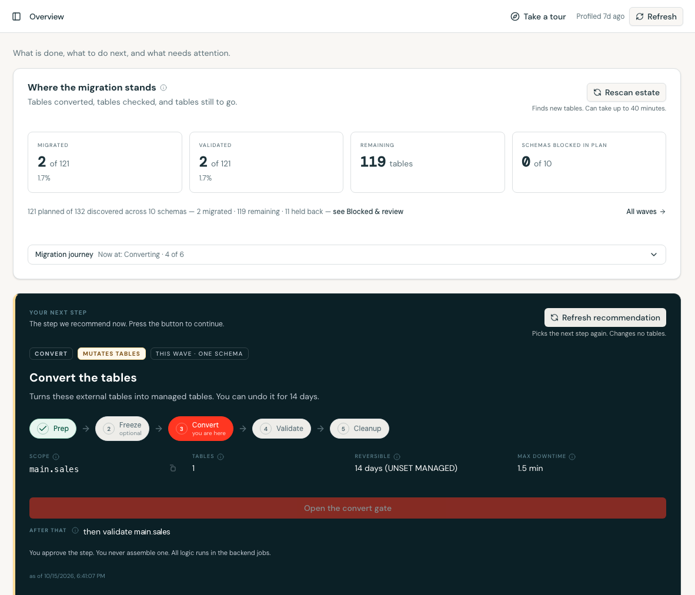
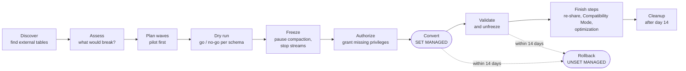
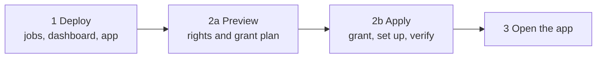
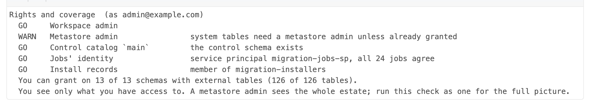
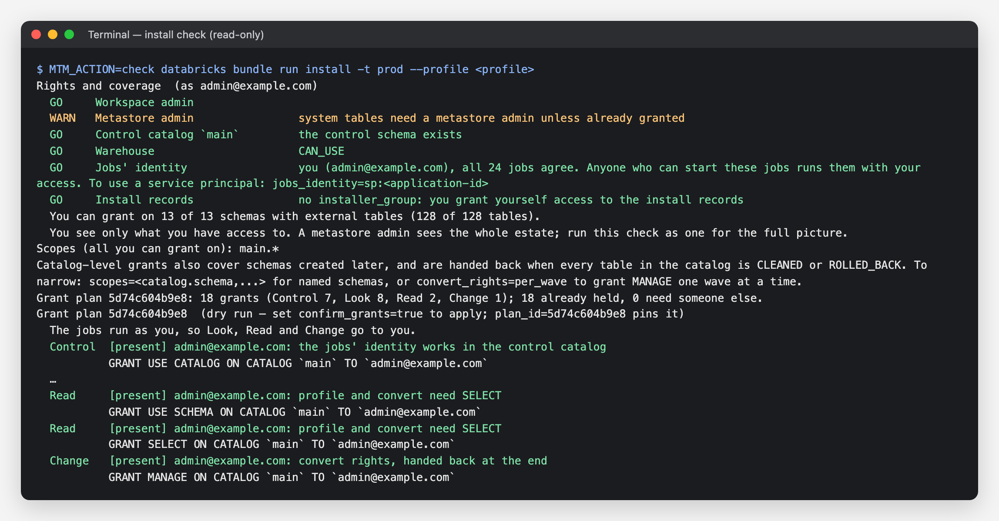
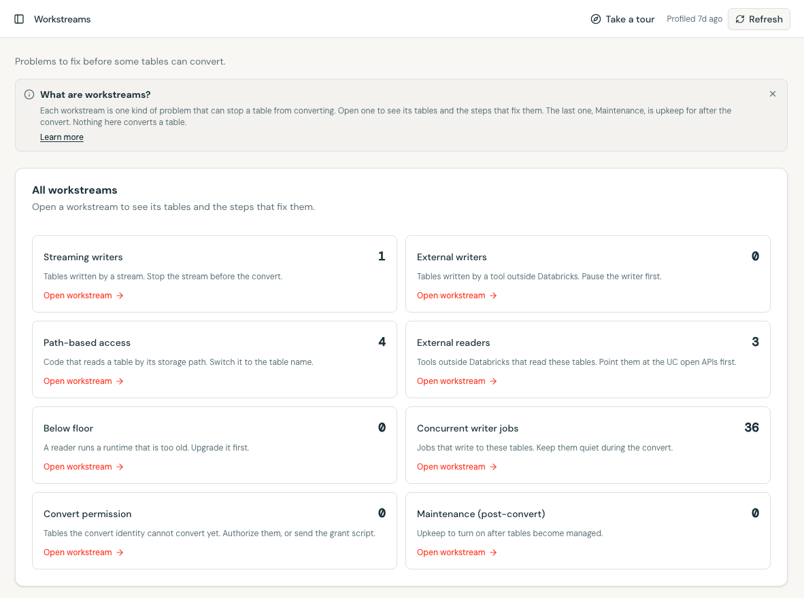
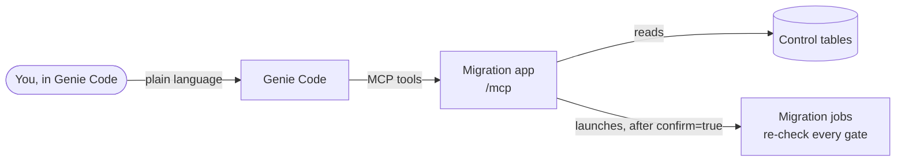
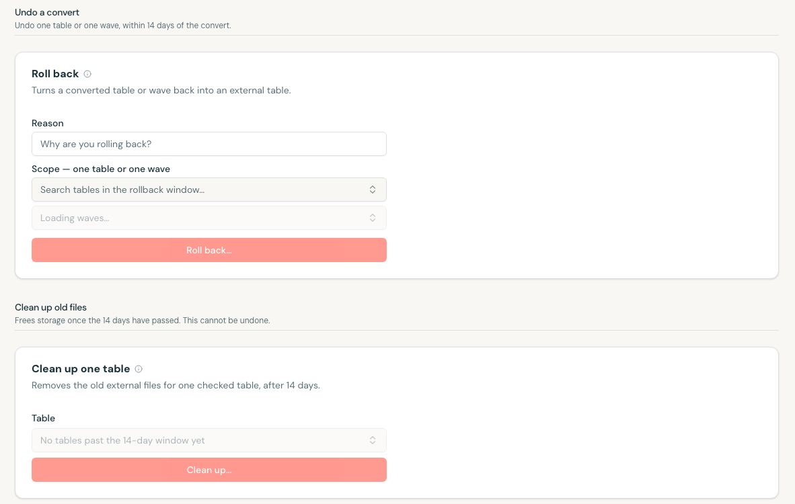

# External → Managed Table Migration

[](https://github.com/databricks-solutions/managed-table-migration-accelerator/releases)
[](./LICENSE.md)
· [Changelog](./CHANGELOG.md)

Convert Unity Catalog **EXTERNAL** tables to **MANAGED** tables with
`ALTER TABLE ... SET MANAGED`, safely and at estate scale. One Databricks Asset Bundle discovers
your external tables, finds what would break, plans the conversion in waves, converts them, and
lets you roll back for 14 days. A person approves every change. Drive it from the app, the
notebooks, or in plain language with **Genie Code**: the app doubles as an MCP server.



**[Install](#install)** · **[Your first migration](#your-first-migration)** ·
**[Drive it with Genie Code](#drive-it-with-genie-code)** · **[Documentation](./docs/README.md)**

## Who it is for

Platform and data teams that own a Unity Catalog estate with many external Delta tables and want
them managed: Predictive Optimization, automatic liquid clustering, and less storage to look after.

Converting one table is a single statement. Converting thousands is not: streams must be stopped
and restarted, compaction and `VACUUM` jobs paused, Delta shares re-shared, external engines and
path-based readers found, and every table tracked through a 14-day rollback window. This tool does
that bookkeeping from one control table (the **manifest**) and records every action in an audit
log.

> [!IMPORTANT]
> **Nothing converts on its own.** The tool recommends; a person triggers each conversion from a
> deployed job or the app, and every job re-checks its safety gates before it changes a table.
> Never run `SET MANAGED` against production from an editor.

## How it works

Each table moves through the same lifecycle. Every step is a Databricks job; the read-only steps
are safe to re-run at any time.



Freeze and Authorize are optional: the tool recommends them only when a table has compaction,
streams or writers to pause, or when the job identity is missing a privilege. The architecture
behind it is in [Architecture](./docs/02-architecture.md).

There is one engine and three ways to drive it. All three run the same jobs and read the same
control tables.

| Drive it from | Best for | Guide |
|---|---|---|
| **The app** (a Databricks App) | Most teams. It shows where the migration stands, recommends the next step, and launches it. | [Using the app](./docs/12-using-the-app.md) |
| **Notebooks and jobs** | Running without the app, scripting, or CI. `09_cockpit` is a guided notebook. | [Using the notebooks](./docs/11-using-notebooks.md) |
| **Genie Code** (MCP), built into the app | Asking in plain language: "what's next?", "what blocks this schema?", "convert this wave". Changes still need `confirm=true`. | [Drive it with Genie Code](#drive-it-with-genie-code) |

## Prerequisites

| You need | Why |
|---|---|
| A Unity Catalog-enabled workspace | The tables, grants and system tables all come from Unity Catalog. |
| Serverless compute, or Databricks Runtime 17.3 LTS+ | `SET MANAGED` and `UNSET MANAGED` require it. The jobs run on serverless. |
| A SQL warehouse | The app, the AI/BI dashboard and the Genie space query through it. |
| A managed storage location on each target schema, its catalog, or the metastore | Converted data needs somewhere to go. Tables without one are blocked, not guessed. |
| Workspace admin, for the one-time install, ideally also metastore admin | The install binds the jobs and warehouse to the app and grants across the estate; with both roles nobody else has to act ([recommended installer](./docs/00-installation.md#recommended-installer)). Day-to-day users need neither. |
| The Databricks CLI, 1.3.0 or later (CLI install only; not needed from the workspace) | The bundle uses the direct deployment engine. |

Readers and writers of the converted tables should run Databricks Runtime 15.4 LTS or later; the
profiler flags any that do not.

## Permissions

Elevated rights are needed **once, by whoever installs**: a workspace admin who owns, or has
`MANAGE` on, the catalog for the control tables. People who run the migration day to day need only
`CAN_USE` on the app. The migration jobs run as you, the person who deploys them (switching them
to a service principal is one installer option). The installer grants them what they need in one
plan you review first, and a person hands the convert rights back after cleanup. Ownership of your tables never
changes. Every identity, privilege and grant statement is in
[Who needs which permissions](./docs/00-installation.md#who-needs-which-permissions).

## Install

Installing takes two steps, and changes no table:

1. **Deploy** the bundle. This creates the jobs, the dashboard and the app.
2. **Run the installer.** It checks your rights, previews every grant, grants them once you
   confirm, sets up the control tables, profiles your estate and checks the app. If you cannot
   grant something, it says who can.



**Have these ready:**

- Workspace admin rights, and ownership of (or `MANAGE` on) the catalog for the control tables.
- The ID of a SQL warehouse you can use: the last part of its URL, or of the HTTP path under the
  warehouse's **Connection details**.
- Where the control tables should live. The default is `main.migration`.
- Nothing about scopes. By default the installer plans every catalog with external tables that
  you can grant on, as `catalog.*`, and prints how to narrow it to named schemas.

### Install from the workspace (no local tools)

1. **Clone** this repository into a **Git folder** (**Workspace → Create → Git folder**).
2. **Set your warehouse.** Open `databricks.yml` in the Git folder. Under `targets:` → `dev:` →
   `variables:`, set `warehouse_id` to your warehouse ID. To keep the control tables somewhere
   other than `main.migration`, uncomment `manifest_catalog` and `manifest_schema` there and set
   them too.
3. **Deploy.** With `databricks.yml` open, click the **Deployments** icon, pick the `dev` target
   and click **Deploy**. It takes a few minutes.
4. **Preview.** Open `backend/notebooks/install.py` from the same Git folder and click
   **Run all**. Nothing is granted. The run prints one GO, WARN or NO-GO line per requirement,
   the scopes it will grant on (every catalog you can grant on), and the grant plan with its
   `plan_id`. To narrow, set the `scopes` widget to `catalog.schema` entries and click **Run all**
   again.
5. **Apply.** Set `confirm_grants` to `true` and `plan_id` to the printed value, then click
   **Run all**. The installer grants, reads every grant back, sets up the control tables,
   profiles your estate and ends with `VERIFY PASSED` and the app URL. Expect 30 to 45 minutes,
   even for a few schemas: most of it is the profiling job.



A WARN line does not stop the install. Above, metastore admin is a WARN: without it, the jobs can
read system tables only if a metastore admin has already granted them.

### Install with the CLI

You need the Databricks CLI 1.3.0 or later and a profile for the workspace
(`databricks auth login`). The workspace comes from `--profile`.

```bash
git clone https://github.com/databricks-solutions/managed-table-migration-accelerator.git
cd managed-table-migration-accelerator

# Settings for every command below. Add BUNDLE_VAR_manifest_catalog and
# BUNDLE_VAR_manifest_schema if the control tables should not live in main.migration.
export BUNDLE_VAR_warehouse_id=<warehouse-id>

# 1. Deploy.
databricks bundle deploy -t dev --profile <profile>

# 2. Preview: the rights check and the grant plan for every catalog you can grant on.
#    Grants nothing.
databricks bundle run install -t dev --profile <profile>

# 3. Apply exactly the plan you previewed.
MTM_PLAN_ID=<plan_id> MTM_CONFIRM_GRANTS=true \
  databricks bundle run install -t dev --profile <profile>
```



On a terminal with no scopes stored yet, the installer lists what it will cover, with table counts,
and asks which to keep (Enter keeps all). To narrow without the prompt, set `MTM_SCOPES='sales.orders,finance.*'` on both commands. Once scopes are
stored, a later run keeps them. `MTM_ACTION=check` runs only the rights check. Deploy only with `databricks bundle deploy`, never
`databricks apps deploy`.

### Open the app

Open the app URL the installer printed. The first time, the app asks you to allow it to act for
you: approve it. Then go to **Connection & policy** (Settings): every check should be green. If
something is red, see [Troubleshooting](./docs/00-installation.md#troubleshooting).

After this first install, the app's **Connection & policy → Permissions** carries on where the
installer left off: add schemas, grant convert rights wave by wave, and hand them back after
cleanup, all as you and after a confirm. It cannot do the first install: until the installer
has run, there are no control tables for it to read.

To upgrade later, pull the new version and deploy again, then run `job_08_conductor` once so the
app's views catch up ([Upgrade](./docs/00-installation.md#upgrade)). The full guide covers every
option, production (`-t prod`: the jobs run as you there too, unless you choose a service
principal), Genie Code, handing convert rights back
and uninstalling: [Installation](./docs/00-installation.md).

## Your first migration

Start with one small **pilot** schema. The app's Overview page always shows the one step it
recommends next; following it walks you through these steps in order.

1. **Profile the estate.** Click **Rescan estate**, or run `job_00_profiler`. It finds every
   external table and marks each one eligible, blocked, or needing review.
2. **Plan waves.** `job_02_wave_planner` groups tables into waves and picks a pilot schema of up to
   15 tables. Streaming tables always get their own waves.
3. **Clear what blocks.** The **Workstreams** page groups the problems (streams, path-based
   readers, external engines, missing privileges), each with the steps that fix it.
4. **Dry run.** `job_03_dry_run` gives a go or no-go for the schema and changes nothing.
5. **Freeze and authorize, if recommended.** `job_03c_freeze` pauses compaction jobs and stops
   streams for the wave; `job_03d_lease_ownership` (Authorize) grants any missing privilege. Both
   default to a dry run until you set `confirm_execute=true`.
6. **Convert.** `job_04_convert` converts the schema's ready tables. It refuses to start while
   anything unsafe is still open.
7. **Validate and finish.** `job_05_validate` checks every converted table and
   `job_05b_unfreeze_verify` restarts what the freeze stopped. Then re-share Delta shares, set up
   external readers, and turn on optimization if the app recommends it.



The same steps from the CLI:

```bash
databricks bundle run job_00_profiler     -t dev --profile <profile>
databricks bundle run job_02_wave_planner -t dev --profile <profile>
databricks bundle run job_03_dry_run      -t dev --profile <profile> \
  --params catalog_filter=<catalog>,schema_filter=<schema>
databricks bundle run job_04_convert      -t dev --profile <profile> \
  --params target_schema=<catalog.schema>,confirm_compaction_paused=true
databricks bundle run job_05_validate     -t dev --profile <profile> \
  --params catalog_filter=<catalog>,schema_filter=<schema>
```

After the pilot, scale out wave by wave, or convert several non-conflicting waves at once with
[Bulk convert](./docs/14-bulk-convert.md). The end-to-end runbook is the
[Estate migration playbook](./docs/13-estate-migration-playbook.md).

## Drive it with Genie Code

The app is also an **MCP server**, so Genie Code, the Databricks assistant, can run the migration
for you in plain language. It ships with the bundle; there is nothing else to install.



**Connect it** (no account admin needed): in Genie Code, open **Settings → Custom MCP server**,
choose `mcp-managed-table-migration` (or paste the app's `/mcp` URL) and save. It signs in as you,
so anyone with `CAN_USE` on the app can connect, and each run records who asked for it.

**Then ask**, for example:

- "Where does the migration stand, and what should I do next?"
- "What is blocking `main.sales`, and who needs to fix it?"
- "Can I convert `main.sales`?" (it runs a preflight first and tells you what is still open)
- "Freeze, convert and validate the next wave." (each step waits for your confirmation)

Reading is free. Every tool that changes something needs an explicit `confirm=true`, and the job
re-checks every safety gate exactly as it does when you click in the app. To allow reads and
non-mutating stages only, deploy with `--var="mcp_tier=v1"`. Full guide:
[Genie Code MCP](./docs/15-genie-code-mcp.md).

> [!TIP]
> Genie Code is not the app's **Ask Genie** button. Ask Genie answers questions about the control
> tables from a Genie space; Genie Code calls the migration's tools and can launch its jobs.

## Rollback and the 14-day window

A converted table can go back to EXTERNAL with `ALTER TABLE ... UNSET MANAGED` for **14 days**
after the convert. `job_06_rollback` does it for one table or a whole wave, with a reason you
supply, and puts any jobs and streams the freeze paused back exactly as they were. After day 14, Predictive Optimization removes
the old external files (or `job_07_post_convert_cleanup` runs `VACUUM` if it is off), and rollback
is no longer possible. The tool never runs `VACUUM` inside the window.



More in [Rollback and cleanup](./docs/09-rollback-and-cleanup.md).

## Documentation

| I want to... | Read |
|---|---|
| Install, configure, or troubleshoot | [Installation](./docs/00-installation.md) |
| Understand what the migration is and its safety rules | [Overview](./docs/01-overview.md) |
| Migrate a whole estate step by step | [Estate migration playbook](./docs/13-estate-migration-playbook.md) |
| Use the app, the notebooks, or Genie Code | [App](./docs/12-using-the-app.md) · [Notebooks](./docs/11-using-notebooks.md) · [Genie Code](./docs/15-genie-code-mcp.md) |
| Know what the profiler detects and why a table is blocked | [Discovery and signals](./docs/03-discovery-and-signals.md) · [Streaming](./docs/04-streaming.md) · [External access](./docs/05-external-access-and-buckets.md) |
| Understand waves, freezing, permissions, and the convert gates | [Wave planning](./docs/06-wave-planning.md) · [Freeze](./docs/07-freeze-bracket.md) · [Permissions](./docs/07b-convert-permissions.md) · [Convert and validate](./docs/08-conversion-and-validation.md) |
| Finish, roll back, or clean up | [Post-convert maintenance](./docs/08c-post-convert-maintenance.md) · [Rollback and cleanup](./docs/09-rollback-and-cleanup.md) |
| Use the dashboard and Genie space | [Dashboard and Genie](./docs/16-dashboard-and-genie.md) |
| Look up every job parameter or control-table column | [Jobs contract](./backend/docs/contracts/jobs.md) · [Control tables contract](./backend/docs/contracts/control-tables.md) |

The full table of contents is [docs/README.md](./docs/README.md).

## Repository layout

```text
databricks.yml       the one bundle: variables, targets (dev / e2e / prod), includes both halves
backend/             the migration tooling; runs on its own, with no app deployed
  resources/         one job per stage (file number = run order), plus the dashboard
  notebooks/         stage notebooks and install.py
  src/migration/     pure, unit-tested logic used by the notebooks
  src/tests/         pytest suite; needs no cluster or Spark
  docs/              contracts (jobs, control tables), architecture, operations, reference
app/                 the Databricks App (React + TypeScript on AppKit) and its MCP server
docs/                the operator documentation (site/ builds it into the docs website)
scripts/release.py   local release tooling
.github/workflows/   CI and the docs-site deploy
```

The app talks to the tooling only through the control tables and job parameters, documented in
[backend/docs/contracts/](./backend/docs/contracts/).

## Contributing

```bash
make test   # backend unit tests (fast, no cluster)
make ci     # the full pre-merge gate: backend tests, the docs site build, app typecheck, tests and lint
```

Run `make ci` before opening a pull request; GitHub Actions runs the same checks on it. Read [AGENTS.md](./AGENTS.md)
first: it holds the safety rules and engineering conventions for people and coding agents alike.
Add a line under `[Unreleased]` in [CHANGELOG.md](./CHANGELOG.md) for any user-visible change.
Releases follow "Cutting a release" in AGENTS.md. Usage telemetry and how to turn it off are
described in [backend/docs/operations/telemetry.md](./backend/docs/operations/telemetry.md).

## How to get help

Databricks support doesn't cover this content. For questions or bugs, please open a
[GitHub issue](https://github.com/databricks-solutions/managed-table-migration-accelerator/issues)
and the team will help on a best effort basis. To report a security vulnerability, see
[SECURITY.md](./SECURITY.md).

## License

&copy; 2026 Databricks, Inc. All rights reserved. The source in this repository is provided
subject to the [Databricks License](https://databricks.com/db-license-source) (see
[LICENSE.md](./LICENSE.md)). All included or referenced third party libraries are subject to the
licenses set forth below.

<details>
<summary>Third-party libraries</summary>

| library | description | license | source |
|---------|-------------|---------|--------|
| `databricks-sdk` | Databricks SDK for Python (provided by the Databricks Runtime) | Apache-2.0 | https://github.com/databricks/databricks-sdk-py |
| `pyspark` | Apache Spark Python API (provided by the Databricks Runtime) | Apache-2.0 | https://github.com/apache/spark |
| `@databricks/appkit` | Databricks Apps framework (server) | Apache-2.0 | https://github.com/databricks/appkit |
| `@databricks/appkit-ui` | Databricks Apps framework (UI components) | Apache-2.0 | https://github.com/databricks/appkit |
| `@databricks/sdk-experimental` | Databricks SDK for JavaScript | Apache-2.0 | https://github.com/databricks/databricks-sdk-js |
| `@modelcontextprotocol/sdk` | Model Context Protocol TypeScript SDK | MIT | https://github.com/modelcontextprotocol/typescript-sdk |
| `clsx` | Conditional className strings | MIT | https://github.com/lukeed/clsx |
| `driver.js` | Guided product tours | MIT | https://github.com/nilbuild/driver.js |
| `embla-carousel-react` | Carousel component | MIT | https://github.com/davidjerleke/embla-carousel |
| `lucide-react` | Icon library | ISC | https://github.com/lucide-icons/lucide |
| `next-themes` | Light/dark theme switching | MIT | https://github.com/pacocoursey/next-themes |
| `react` | UI library | MIT | https://github.com/facebook/react |
| `react-dom` | React DOM renderer | MIT | https://github.com/facebook/react |
| `react-resizable-panels` | Resizable panel layouts | MIT | https://github.com/bvaughn/react-resizable-panels |
| `react-router` | Client-side routing | MIT | https://github.com/remix-run/react-router |
| `tailwind-merge` | Tailwind class merging | MIT | https://github.com/dcastil/tailwind-merge |
| `tailwindcss-animate` | Tailwind animation plugin | MIT | https://github.com/jamiebuilds/tailwindcss-animate |
| `tw-animate-css` | Tailwind v4 animation utilities | MIT | https://github.com/Wombosvideo/tw-animate-css |
| `zod` | Schema validation | MIT | https://github.com/colinhacks/zod |

</details>
