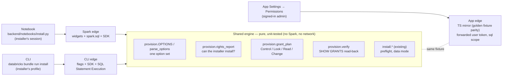
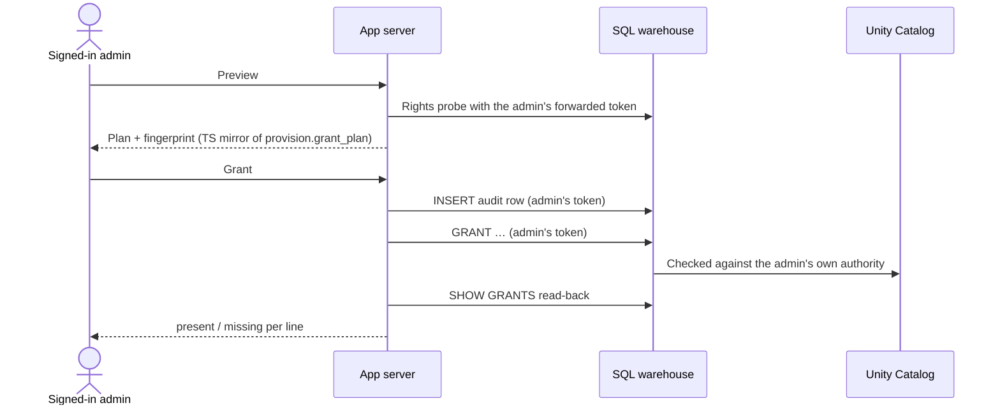
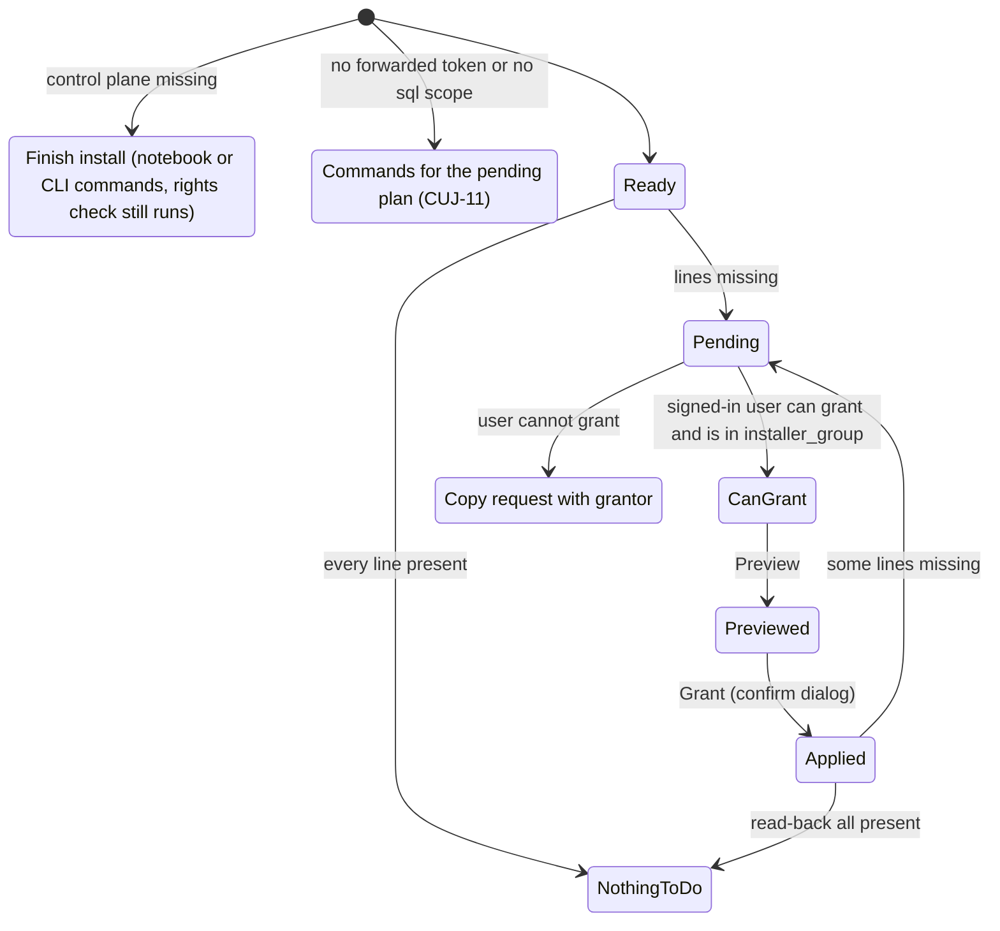

# Design: frictionless install and permissions

**Status:** built (2026-10-26) and validated live on every front door. Where the build differs
from this design, [section 23](#23-as-built-where-the-build-differs) says how and why.
**Changes:** how separation of duties applies at install time, when convert rights are granted
and handed back (all at once by default, per wave as the stricter option), who the jobs run as
(now the customer's choice), and a third front door: the app's Settings page, which grants as the
signed-in admin. The app's own identity gains no new authority.
**Related:** [`app/docs/app-sp-grants.md`](../../app/docs/app-sp-grants.md) (identity model and
grant tiers), [`operations/privileges.md`](./operations/privileges.md) (what the profiler needs),
[`docs/00-installation.md`](../../docs/00-installation.md) (today's install guide).

**How to read this.** Sections 1–16 are the design: the tested facts, the permission model, the
rules and the build plan. Sections 17–22 show it from the outside: who uses it (17), their
critical journeys (18), who accesses what and when (19), and the three flows step by step, with
wireframes and sample output (20 notebook, 21 CLI, 22 app). New readers may start at section 17.

## 1. Goal

One privileged installer, one sitting, a working app at the end, by any of three front doors:

| Front door | Suits | What the installer does |
|---|---|---|
| **Notebook** | Workspace-only customers, no local tools | Clone into a Git folder, click **Deploy** once, open `backend/notebooks/install.py`, **Run all** |
| **CLI** | Engineers, scripted or repeatable installs | `databricks bundle deploy -t <t> --profile <p>`, then `databricks bundle run install -t <t> --profile <p>` |
| **App Settings** | Admins who already opened the app; adding scopes or handing rights back later | **Settings → Permissions**: check, pick scopes, preview, **Grant**. Runs as the signed-in admin (section 8) |

The deploy and the first install are always the notebook or the CLI: the app cannot exist before
the deploy, and it cannot launch the setup job (`job_99_setup` is not one of its bound resources,
which are at the 20-resource cap). After the first install, every grant step is available from all
three doors. All three use **one
engine** for checking rights, planning grants, applying them and verifying them, so they cannot
drift: the notebook and CLI call the Python engine directly, and the app uses a TypeScript mirror
pinned by a shared golden fixture. Every door records what it did in the same control tables
(`migration_scope`, `ownership_ledger`, `audit_log`), so you can start in one and finish in
another.

Ease of install and ease of permissioning are the product requirement. Every step either succeeds,
says "already done", or stops with one sentence naming what is missing and who can fix it.

## 2. Where install stalls today

**Deployment**

1. **Two deploys.** The AppKit `genie` plugin needs the Genie space ID when the app boots
   (`app/server/server.ts` reads it once, before `createApp`). The space cannot exist at deploy
   time: `job_99_setup` creates it after the control tables exist, because the Genie create API
   validates the tables. So the app must restart after setup, and only a bundle deploy restarts
   it with its environment intact.
2. **A view refresh after every deploy.** Until `job_08_conductor` recreates `wave_status`, the
   Waves and Convert boards fail on unresolved columns. That is easy to forget and every upgrade
   hits it.
3. **A circular prod identity.** `prod` sets `run_as` to `var.prod_run_as_sp`, which must be the
   app's service principal, and that principal only exists after the first deploy.

**Permissions**

4. **`USE CATALOG` on a shared control catalog** (default `main`) often exceeds the setup
   identity's authority. `job_99_setup` prints the statement for someone else.
5. **The app SP's target-schema grants (Tier 2) are not automated.** In `prod` the jobs run as the
   service principal, so it needs `USE CATALOG`, `USE SCHEMA`, `SELECT` and `MANAGE` on every
   target schema. The Settings page generates the SQL and a person copies it into a SQL editor.
   This is the biggest stall on a new workspace.
6. **Per-table convert-permission gaps** that Authorize cannot close go into a downloaded
   `convert-permissions.sql`.

Two structural findings sit underneath:

- **`job_99_setup` runs as the app SP in `prod`.** `prod` sets one `run_as` for every job, so
  setup's "grant the app SP access" step is the service principal granting itself. That works only
  if it already has the authority. **No job can be the installer's grant step**; it has to run as
  a person.
- **"The app never runs a GRANT" is not written down.** The grant code cites SR12 and
  `control_plane.md` §0.2. SR12 is "no send transport", and the §0.2 SQL-runner row lists only
  `SET MANAGED`, `UNSET MANAGED` and `VACUUM`. The rule is real in practice; section 9 states it.

Dev hides all of this: `dev` and `e2e` jobs run as the deployer, whose own rights usually cover
everything, so the service principal path is first exercised in production.

## 3. What a read-only profiler identity actually needs (tested)

The plan was to give the service principal **permission to look** estate-wide, metadata only, so
the profiler finds everything with no data access. Before relying on `READ METADATA` for that, it
was tested on a serverless FEVM workspace against two real EXTERNAL Delta tables from the e2e
estate.

**Method.** A throwaway service principal ran every read the profiler and the convert-permission
check issue, through a serverless SQL warehouse, under one privilege set at a time. Each result was
compared against the same read as an admin. The workspace's `account users` group already held
`READ METADATA ON METASTORE`, so every configuration ran with metastore-level `READ METADATA` in
effect (the installer could not grant it directly: `GRANT ... ON METASTORE` needs a metastore
admin). `READ METADATA` granted directly on the catalog was tested as well. The principal and every
grant were removed afterwards.

**Results**

| Read (who issues it) | `READ METADATA` (metastore or catalog), no usage | + `USE CATALOG` | + `USE SCHEMA` | + `SELECT` |
|---|---|---|---|---|
| `system.information_schema.tables` (profiler discovery) | OK, full count | OK | OK | OK |
| `information_schema` owners and `*_privileges` (convert-permission facts) | OK | OK | OK | OK |
| `SHOW GRANTS ON TABLE` (convert-permission facts) | OK | OK | OK | OK |
| `<catalog>.information_schema.tables`, `row_filters`, `column_masks` | denied: `USE CATALOG` | OK | OK | OK |
| `DESCRIBE DETAIL` (profiler enrichment) | denied: `USE CATALOG` | denied: `USE SCHEMA` | **denied: `SELECT`** | OK |
| `DESCRIBE HISTORY` (streaming, compaction, write cadence) | denied | denied | **denied: `SELECT`** | OK, 200 rows with `job` and `userName` |
| `DESCRIBE TABLE [EXTENDED ... AS JSON]` (layout) | denied | denied | **denied: `SELECT`** | OK |
| `SHOW TBLPROPERTIES` | denied | denied | **denied: `SELECT`** | OK |
| `SELECT * ... LIMIT 1` (control) | denied | denied | denied | OK |

**Conclusion: `READ METADATA` is not enough for the profiler.** It covers discovery and the
convert-permission facts, but every per-table read the profiler uses to assess a table
(`DESCRIBE DETAIL`, `DESCRIBE HISTORY`, `DESCRIBE TABLE`, `SHOW TBLPROPERTIES`) requires
`SELECT` on the table, even with `USE CATALOG`, `USE SCHEMA` and `READ METADATA` all held.
`READ METADATA` on the catalog only widened what the privilege views returned; it unlocked no
`DESCRIBE`.

**Not isolated by this test** (recorded so nobody over-reads it):

- `BROWSE` alone: the ambient metastore `READ METADATA` could not be removed, so `BROWSE`'s own
  contribution to `system.information_schema` visibility was not separated. The documented
  behavior (BROWSE exposes metadata in `information_schema` without usage privileges) is assumed.
- Row-filter and column-mask *contents*: the test estate has no such tables, so only readability
  of the views was shown.
- Discovery columns beyond name and type (for example `storage_path`) under metadata-only access.
- System tables: `account users` held `SELECT` on the `system` catalog in this workspace, so the
  system-table tier was not exercised.

**Second test: can the jobs' identity give back the `MANAGE` it was granted?** Same workspace, a
fresh throwaway service principal, and a scratch schema with one table, all dropped afterwards. The
schema owner granted the principal `USE CATALOG`, `USE SCHEMA`, `SELECT` and `MANAGE` on the
schema; the principal then ran the cleanup sequence on itself.

| Statement, run by the principal holding schema `MANAGE` | Result |
|---|---|
| `GRANT MODIFY ON TABLE …` to itself (what Authorize does) | OK |
| `REVOKE MODIFY ON TABLE …` from itself (what `07` does) | OK |
| `GRANT` / `REVOKE MANAGE ON TABLE …` (a child of the schema) | OK |
| `REVOKE SELECT ON SCHEMA …` from itself | OK |
| **`REVOKE MANAGE ON SCHEMA …` from itself** | **Denied**: "does not have MANAGE on Schema", although it held it |
| `REVOKE MANAGE ON SCHEMA …`, run by the schema owner | OK |

**Conclusion:** a principal cannot give up `MANAGE` at the level it holds it. `MANAGE` covers
everything below that level, including other principals' privileges there, but removing it takes
authority from above: the owner of the schema or its catalog, `MANAGE` on the catalog, or a
metastore admin. The error message is misleading, so the tool must explain it, as
`authority.explain_failure` does for `SET MANAGED`. Section 6 changes cleanup accordingly.

**Third test: can the app grant on the signed-in user's behalf?** An app sees a signed-in user
through a forwarded token narrowed to the app's declared user scopes. The question is whether a
token narrowed to the `sql` scope can run `GRANT` and `REVOKE` through the warehouse. Same
workspace, a fresh throwaway service principal holding `MANAGE` on a scratch schema (all removed
afterwards). It requested OAuth tokens narrowed to one scope at a time and ran the same three
statements with each.

| Token scope | `SELECT 1` | `GRANT SELECT ON TABLE …` | `REVOKE SELECT ON TABLE …` |
|---|---|---|---|
| `sql` | OK | **OK** | **OK** |
| `sql:restricted-query` | OK | denied: "not supported in read-only session mode" | denied: same |
| `catalog.tables:read` (control: no SQL scope) | denied: 403 | denied: 403 | denied: 403 |
| `all-apis` (control) | OK | OK | OK |

**Conclusion:** a `sql`-scoped token grants and revokes with its identity's own Unity Catalog
authority, and nothing more; the scope limits are enforced. The read-only `sql:restricted-query`
scope cannot grant. This used a service principal's scoped token as a stand-in for a forwarded
user token. Unity Catalog authorizes by identity, so the result should carry over, but the build
confirms it on a deployed app before shipping (section 15).

## 4. The permission model: four grant sets

Access splits into four sets. Only the last two touch data, and only the last one can change
anything.

| Set | Purpose | Grants | Scope | Granted when | Who can grant |
|---|---|---|---|---|---|
| **Control** (today's Tier 1) | Read the control plane; write `migration_actions` | `USE CATALOG`, `USE SCHEMA`, `SELECT` on the control schema; `MODIFY` on `migration_actions` | Control schema | Install | The jobs' identity, as owner of the control tables (setup grants it, as `job_99_setup` does today); otherwise owner or `MANAGE` on the control catalog |
| **Look** | Read owners and grants; read lineage and job history | `READ METADATA ON METASTORE` **or**, per catalog, `BROWSE` (+ `READ METADATA` for grant visibility); `USE CATALOG` on `system` + `SELECT` on `system.access`, `system.compute`, `system.lakeflow` | Estate-wide, metadata only | Install | Metastore admin (metastore form); catalog owner or `MANAGE` (per-catalog form); a metastore admin or the `system` owner for system schemas |
| **Read** | Profile a table (`DESCRIBE DETAIL` / `HISTORY` / `TABLE`) | `USE CATALOG`, `USE SCHEMA`, `SELECT` | Each schema the installer picks | Install | Schema or catalog owner, `MANAGE` holder, metastore admin |
| **Change** | Convert and roll back | `MANAGE` on the schema; `MODIFY` per table through Authorize | The chosen scopes (default), or the schemas of one wave (stricter option) | At install (default), or before each wave converts | Same as Read |

Who receives each set is in section 5: Control goes to the app's service principal, and the other
three go to the identity the jobs run as.

Why **Read** cannot be avoided: `SET MANAGED` needs `SELECT` + `MODIFY` unless the identity owns the
table (`authority.py`, pinned by `convert_authority_cases.json`). Anything the tool will convert
needs `SELECT` anyway, so granting it to the migration scope at install adds no access the convert
would not need.

Why **Change** is granted once, at install, by default: the only convert right a person must grant
is `MANAGE` (or ownership, which the tool never changes). `MANAGE` lets its holder grant any
privilege on the schema, so a job can never give it to itself; once it is held, Authorize
(`job_03d`) grants the `MODIFY` it still needs and `07` revokes it. Granting it once for the whole
migration scope means one approval, no person between waves, and one hand-back at the end. The
trade-off is a wider standing right: the jobs' identity holds `MANAGE` on schemas that may not
convert for weeks. Every convert is still gated by the dry run, the wave pin and the live
`convert_authority` re-check in `04`, so holding the right does not convert anything by itself.

**Per wave is the stricter option** (`convert_rights=per_wave`). The tool already knows each
wave's exact gap (`convert_authority.grant_sql`), so a security team that will not approve
`MANAGE` on the whole scope can approve it one wave at a time instead. Section 6 covers both.

`READ METADATA` exposes grants, masks, policies, view definitions and credential names. Every
surface that proposes it says so in one line before the installer confirms.

## 5. Who runs what, and who the customer may choose

Two identities matter, and they need not be the same:

- **The app's identity** reads the control plane and launches jobs. It is always the app's own
  service principal; Databricks creates it with the app and does not let you substitute another.
- **The jobs' identity** runs every job. A job runs as its `run_as` whoever launches it (an app
  button, the Jobs UI or `databricks bundle run`); the launcher needs only run permission on the
  job.

The installers run as the person at the keyboard: the notebook session, the CLI profile, or the
admin signed in to the app.

**Every job uses the same jobs' identity**, including the ones that orchestrate other jobs:

| Jobs | Identity |
|---|---|
| Profiler, source scan, compaction rescan (`00`, `01`, `03b`) | Jobs' identity |
| Planner, dry run, freeze, Authorize, convert, validate, unfreeze, rollback, cleanup (`02`–`07`) | Jobs' identity |
| Conductor (with its schedule and focus-pin task), re-share, Compatibility Mode, optimize (`08`, `08b`, `08c`) | Jobs' identity |
| Get-started cockpit, campaign (`09`, `10`) | Jobs' identity |
| Bulk freeze, convert, validate, unfreeze, cockpit (`11`–`11e`) | Jobs' identity |
| Setup (`99`) | Jobs' identity |

The campaign and bulk jobs launch the stage jobs through `run_job_task`; each child runs as its
own `run_as`, which is the same identity. It has to be one identity: the profiler, the dry run and
the conductor each evaluate convert authority *as the identity they run as*, and `04` re-checks it
as itself. If the jobs disagreed, every verdict would describe the wrong principal. The rights
check (section 10) fails when the deployed jobs do not agree.

**What each identity needs, and who sets it up:**

| Identity | Needs | Set up by |
|---|---|---|
| App's service principal | `CAN_USE` on the warehouse and `CAN_MANAGE_RUN` on the jobs (bundle resources); the Control set; `CAN_RUN` on the Genie space | The deploy (bundle resources), then the installer (Control) and setup (Genie) |
| Jobs' identity | `USE CATALOG` + `CREATE SCHEMA` on the control catalog (it creates and owns the control schema and tables, so it needs nothing more there); the Look, Read and Change sets. The stage jobs run on job compute, so no warehouse permission is needed except `CAN_USE` for setup, which creates the Genie space on the warehouse | The installer |
| App users | `CAN_USE` on the app; to grant from Settings, the same Unity Catalog authority as any installer | A workspace admin |

Workspace permissions on other teams' resources (`CAN_MANAGE` on their OPTIMIZE / VACUUM jobs and
pipelines for the freeze bracket, share ownership for re-share) are not granted by the installer.
They stay MANUAL actions on the runbook, as today.

Today `dev` and `e2e` run jobs as the deployer, and `prod` requires `var.prod_run_as_sp` to be the
app's service principal ([`app-sp-grants.md`](../../app/docs/app-sp-grants.md), "one service
principal does everything"). That requirement is a design choice, not a platform rule: the backend
is already identity-agnostic (every `convert_authority` verdict records the identity the job
actually ran as), and the only code that assumes the two are the same is the app's grants panel,
which addresses `SELECT current_user()`.

**The jobs' identity becomes the customer's choice in every target.**

| Jobs' identity | Suits | Watch out for |
|---|---|---|
| **A dedicated service principal** the customer names or the installer creates (recommended for production) | Production | Creating one needs a workspace admin; whoever deploys needs the **Service Principal User** role on it |
| **A group** (`run_as.group_name`) | Teams that already govern a migration group | Newer platform feature; deploying needs membership of the group or its **Assume** permission. Untested here for `SET MANAGED` and for the Jobs and Pipelines API calls of the freeze bracket |
| **A named person** (`run_as.user_name`) | Pilots, or one operator who is also the only app user | Every app user who can launch a job acts with **all** of that person's rights, not just migration rights. Jobs break when the person leaves or loses access. A non-admin can only name themselves |
| **The app's service principal** (today's `prod`) | Kept for compatibility | Deleted with the app, taking every grant with it mid-migration. Its credentials sit in the app's runtime, so anyone who can deploy app code can act with its data rights |

**Why a dedicated service principal is the recommended default:**

1. **It outlives the app.** Databricks deletes an app's service principal when the app is deleted.
   A migration runs for weeks and rollback depends on the same rights for 14 days after each
   convert; recreating the app would orphan every grant and every `ownership_ledger` row.
2. **It keeps data rights out of the app.** The app's credentials are injected into its runtime.
   With a separate jobs' identity, the app holds only Control and run permission on the jobs, and
   every data action goes through job code fixed at deploy time, which re-checks every gate. That
   is "the app reflects; the job enforces" applied to identity.
3. **It removes the circular production identity** (section 2, item 3): the principal exists
   before the first deploy.
4. **It is the customer's principal**: their name, their rotation, their audit trail.

**Where the choice lives.** One complex bundle variable, `jobs_run_as`, set on every job at the job
level (`run_as: ${var.jobs_run_as}`). Validated with CLI 1.20.0: a job-level `run_as` taken from a
complex variable resolves for `service_principal_name`, `group_name` and `user_name`. A complex
variable cannot come from a `BUNDLE_VAR_` environment variable; it is set per target in the
`variable-overrides.json` file or in `databricks.yml`. The installer writes the choice for you
(section 7, `jobs_identity`). A target-level `run_as` from a variable did not resolve, so the
per-job form is required, with a guard test that every job carries it. Deploy-time checks of the
roles above were not exercised.

**Grantee rule.** Control goes to the app's service principal. Look, Read and Change go to the
jobs' identity **as deployed**: the installer reads it from the jobs' `run_as`, never from a typed
value, and names its kind (service principal, group or person) in the plan before you confirm.

**Changing the jobs' identity is a deploy, not a setting.** The bundle owns each job's `run_as`;
a change made in the Jobs UI or by the app would be reverted by the next `bundle deploy`. So the
app's Settings page **shows** the current identity, its kind and its warnings, and generates the
notebook or CLI command that changes it; the change itself is the installer's `jobs_identity`
option plus a redeploy. After the redeploy, the installer moves the Look, Read and Change grants
to the new identity (grant to the new one, verify, then revoke from the old one only what the tool
recorded as `added`).

## 6. Day-one flow: one ask at install, convert rights handed back at the end

1. **Rights and coverage check.** Read-only. Says whether this installer can install, how much of
   the estate they can grant on, and who to ask for the rest (section 10).
2. **Pick the scopes.** The engine lists the schemas with EXTERNAL tables **the installer** can see
   (`system.information_schema.tables`, as the installer), with table counts and whether the
   installer can grant on each (owner or `MANAGE`). The proposed default is every schema the
   installer can grant on; the installer confirms or edits it. Schemas they can see but not grant
   on are listed with their grantor. The installer's own view is the right inventory: they can only
   grant on schemas they own or manage, and those they can always see. No profiler run is needed
   to choose. The confirmed scope is stored in `migration_scope` (below).
3. **Grant Control + Look + Read + Change** in one dry run, then one confirm. Change is `MANAGE` on
   each scope (catalog-level when the scope is `catalog.*`). Each Change grant is recorded as a
   `GRANT` row in `ownership_ledger` (`added = true`, `leased_by` = the installer) and every grant
   is read back.
4. **Profile once**, then plan and dry run. All of this is read-only.
5. **Convert, wave by wave, with no person in between.** Authorize grants the `MODIFY` each wave
   still needs; the convert runs.
6. **Cleanup, then a person takes `MANAGE` back.** The second test in section 3 rules out the jobs'
   identity revoking its own schema `MANAGE`. So:
   - `07`, as the jobs' identity, revokes what Authorize added (table-level `MODIFY`, and any
     table-level `MANAGE`), which works because schema `MANAGE` covers the tables below it.
   - Once the schema's last table is `CLEANED` or `ROLLED_BACK` (after the 14-day window, because
     `UNSET MANAGED` needs the same rights), `07` marks that schema's `MANAGE` row ready to hand
     back and opens the existing `RESTORE_OWNERSHIP` action with the exact `REVOKE`. That kind is
     already the post-convert partner of `LEASE_OWNERSHIP` and never holds a wave.
   - The installer runs `action=revoke_convert`, from any front door. It revokes every still-held
     `added` row for the ready schemas, in undo order (table privileges, then schema `MANAGE`),
     reads each back, stamps `revoked_at`, and closes the action. In the app this is one button
     on the open `RESTORE_OWNERSHIP` item.

**Stricter option: convert rights per wave** (`convert_rights=per_wave`). Step 3 grants Control,
Look and Read only. Before each wave converts, the installer runs `action=grant_convert` with the
wave. It reads that wave's schemas from the current `wave_plan` (pinned to its `plan_run_id`; drift
stops before any grant) and the latest `convert_authority` verdicts, and plans `MANAGE` on each
schema still missing it: one dry run, one confirm, recorded with the `wave_id` and handed back the
same way. The app's convert-permission panel offers the same step as a button.

**Changing your mind at any time.** Convert rights are not a stored setting; they are grants, and
every gate reads them live (`convert_authority` is refreshed by the dry run, and `04` re-checks it
before any mutation). So the customer can move between the two whenever they like:

| You want | Do this | What the tool does with it |
|---|---|---|
| All at once from now on | Re-run the installer (any door) with `convert_rights=all_at_once` | Grants `MANAGE` on every scope not yet covered; recorded, so it is handed back at the end |
| All at once, granted your own way | Run `GRANT MANAGE ON SCHEMA …` (or `ON CATALOG …`) yourself | Counts immediately. Not in `ownership_ledger`, so it is treated as held before and never revoked: your standing choice |
| Per wave from now on | Run `action=revoke_convert` for the schemas with no convert in progress, then use `grant_convert` per wave | Revokes only what the tool granted. It refuses a schema with a table still inside its 14-day rollback window, because rollback needs those rights |
| One more wave now | `action=grant_convert` with the wave | As the per-wave option |

A grant made outside the tool can never be revoked by it: `07` and `revoke_convert` touch only rows
the tool recorded as `added` (the existing `prior_held` / `added` rule).

**The scope is stored, so the front doors can hand off.** A new control table,
`migration_scope`, holds one row per chosen catalog or schema: the scope, who added it, when,
through which door (`notebook` / `cli` / `app`), which sets were granted on it, and whether it was
removed (rows are flagged, never deleted). Every door reads and writes it through the same engine.
That is what makes "install from the CLI, carry on in the app" work: the app's Settings page lists
the stored scopes with their grant status (read back live), and adding a schema there is the same
operation as re-running the installer with a wider `scopes`. It also gives the rights banner
(section 10) a definite list to check. The profiler is unchanged: it still takes its own
`catalog_filter` / `schema_filter`, and the Settings page offers "profile the new scope" after a
scope is added.

**Adding or removing schemas later:** from any door. Adding grants Read (and Change, under the
default) and stores the row; removing is refused while a table in it is between convert and
`CLEANED` / `ROLLED_BACK`, and otherwise revokes only what the tool added.
**Safety net:** a table outside the granted scope is held `NEEDS_REVIEW` with the existing
`convert_identity_cannot_read` blocker (`eligibility.describe_detail_denied`), never failed.

**Fallback when Look cannot be granted** (the installer is neither metastore admin nor catalog
owner): Control and Read still apply; the convert-permission facts for each table then come from
the jobs' identity's own grants, and verdicts read `UNKNOWN` or `NEEDS_GRANT` until Read lands,
which already blocks the convert.

## 7. Installer options: one option set, three front doors

Every choice is declared once, in `provision.OPTIONS` (name, allowed values, default, help text).
The notebook builds its widgets from that list, and the CLI builds its flags from it. Both hand the
raw values to the pure `provision.parse_options`, which validates them and returns one sentence per
problem. The names map mechanically: widget `confirm_grants` is flag `--confirm-grants` and
environment variable `MTM_CONFIRM_GRANTS`. The app's Settings page reads the same list from the
golden fixture and shows each option as a form control, with **Preview** as the dry run and
**Grant** as the confirm. A guard test checks every notebook widget, every CLI flag and every
Settings control against `provision.OPTIONS`, so a switch cannot exist on one door only.
`jobs_identity` is the one option the app shows but does not apply (section 5).

| Option | Values (default first) | Notebook widget | CLI flag (run directly; through the bundle, `MTM_<NAME>`) | What it does |
|---|---|---|---|---|
| `action` | `install`, `check`, `grant_convert`, `revoke_convert`, `uninstall` | dropdown | `--action` (`--check-only` = `check`) | Full install; the rights and coverage report alone; the per-wave Change grant (section 6, stricter option); handing Change back (step 6); or revoking everything the tool granted before `bundle destroy` (CUJ-12). The app offers every action except `uninstall` |
| `plan_id` | blank, or the fingerprint a dry run printed | text | `--plan-id` | Apply only if the plan still matches the one reviewed; a changed plan stops and shows the difference (CUJ-5) |
| `jobs_identity` | `keep`, `sp:<application-id>`, `group:<name>`, `user:<email>`, `create` | text | `--jobs-identity` | Who the jobs run as (section 5). `keep` uses what is deployed; `create` makes a dedicated service principal when the installer is a workspace admin. A change is written to the target's variables and needs a redeploy, which the CLI offers and the notebook prints |
| `scopes` | blank, or `catalog.schema` / `catalog.*`, comma-separated | text | `--scopes` | The schemas to add to `migration_scope` and grant Read (and Change) on. Blank: use the stored scopes; with none stored, list the candidates and stop before Read |
| `convert_rights` | `all_at_once`, `per_wave` | dropdown | `--convert-rights` | `all_at_once` grants Change on the scopes at install, handed back at the end; `per_wave` leaves it to `grant_convert` |
| `wave_id` | blank, or a wave of the current plan | text | `--wave-id` | Required by `grant_convert` |
| `plan_run_id` | blank, or the plan the wave was reviewed in | text | `--plan-run-id` | Pins `grant_convert`: a newer wave plan stops it before any grant |
| `grantee_group` | blank, or a group containing the grantee | text | `--grantee-group` | Grant to the group instead of the principal; checked before use |
| `confirm_grants` | `false`, `true` | dropdown | `--confirm-grants` | `false` prints the plan and runs nothing |
| `data_mode` | `real`, `fixture`, `none` | dropdown (exists) | `--data-mode` | Unchanged |
| `app_name` | blank | text (exists) | from `var.app_name` | Unchanged |
| `catalog`, `schema`, `target` | deploy values | text (exists) | from the bundle (`MTM_*` env) | Must match the deploy; the CLI cannot get them wrong |
| `yes` | off | none | `--yes` | CLI only: skip the confirm before redeploying with the production identity (section 11) |
| `output` | `text`, `json` | none | `--output` | CLI only: `json` prints the rights report and plan as one JSON document for scripts and change tickets (section 21) |

**Notebook experience.** Widgets are ordered by when you need them. **Run all** with the defaults
checks rights, lists candidate scopes and prints the plan, changing nothing. The candidate list ends
with a ready-to-paste `scopes` value. `scopes` is a text widget, not a multiselect: a multiselect's
choices are fixed when the widget is created and become unwieldy at hundreds of schemas, while text
takes `catalog.*`. Set `confirm_grants=true` and run all again to apply.

**CLI experience.** On a terminal, a blank `scopes` shows a numbered list and asks. A
non-interactive run (no terminal, or `yes=true`) needs `scopes` and never guesses. A bundle script
takes no arguments, so through the bundle every option is an `MTM_<NAME>` environment variable;
`python3 backend/scripts/install.py --help` lists the same options as flags for a direct run.

```bash
# 1. Can I install, and how much of the estate can I grant on? (read-only)
MTM_ACTION=check databricks bundle run install -t prod --profile <p>
# 2. Preview, then apply, the install grants (convert rights included by default)
MTM_SCOPES='sales.orders,finance.*' databricks bundle run install -t prod --profile <p>
MTM_SCOPES='sales.orders,finance.*' MTM_PLAN_ID=<plan_id> MTM_CONFIRM_GRANTS=true \
  databricks bundle run install -t prod --profile <p>
# 3. After cleanup, hand convert rights back
MTM_ACTION=revoke_convert MTM_PLAN_ID=<plan_id> MTM_CONFIRM_GRANTS=true \
  databricks bundle run install -t prod --profile <p>

# Stricter option: convert rights per wave
MTM_SCOPES=sales.orders MTM_CONVERT_RIGHTS=per_wave MTM_CONFIRM_GRANTS=true \
  databricks bundle run install -t prod --profile <p>
MTM_ACTION=grant_convert MTM_WAVE_ID=w003 MTM_PLAN_RUN_ID=<plan_run_id> MTM_CONFIRM_GRANTS=true \
  databricks bundle run install -t prod --profile <p>
```

**App experience.** **Settings → Permissions** shows the rights and coverage report for the
signed-in user, the stored scopes with their read-back status, and the same options. **Preview**
prints the plan; **Grant** runs it as the signed-in user. An admin who is not allowed to grant a
line sees it with its grantor, exactly as the notebook prints it. When the app cannot act for the
user (section 8, "When the app cannot grant"), the page shows the notebook and CLI commands
instead.

The first build step confirmed that a bundle script cannot take arguments, so the options come from
the environment (`MTM_SCOPES=... databricks bundle run install`). `parse_options` reads either form,
and a flag wins over its environment variable on a direct run. The deploy-fixed values (`catalog`,
`schema`, `target`, the deployment name, the app name and the warehouse) are set by the bundle's
`scripts.install.env` and cannot be overridden.

## 8. Architecture: three front doors, one engine



- **`backend/src/migration/provision.py` (new, pure).** The option set; the four grant sets built
  from the existing `grants.py` specs; the rights report from probe results; `SHOW GRANTS`
  read-backs parsed into `present` / `missing` / `unknown` (an unreadable grant is never
  `present`). Matching `backend/src/tests/test_provision.py`.
- **`backend/src/migration/install.py` (extended).** Keeps preflight and data mode;
  gains the step sequence every front door follows.
- **Notebook edge.** `backend/notebooks/install.py` executes through `spark.sql` in the
  installer's interactive session.
- **CLI edge.** `backend/scripts/install.py`, invoked by a bundle `scripts:` entry (the CLI in use,
  1.20.0, supports top-level `scripts:`; `env` values may reference `${bundle.*}`, `${workspace.*}`
  and `${var.*}`, so the script reads the same catalog, schema and warehouse the deploy used). It
  executes through the SQL Statement Execution API on `var.warehouse_id`, as the CLI profile's
  identity. It needs Python and the Databricks SDK locally; when either is missing it prints the one
  install command and stops.
- **App edge.** A Settings route executes the plan with the signed-in user's forwarded token
  (`x-forwarded-access-token`, the same header `GET /api/estate/obo-discovery` already uses)
  through the SQL Statement Execution API on the app's warehouse. The token carries the app's
  declared user scopes, so `app/resources/app.yml` `user_api_scopes` gains `sql` (tested in
  section 3: it can grant; `sql:restricted-query` cannot). The plan comes from the TypeScript
  mirror of `provision.grant_plan`, pinned to the Python engine by the shared golden fixture, so
  the app can only run statements the engine would also produce. The app's own service principal
  is never used for a grant: a request with no forwarded token is refused, never retried as the
  app.
- **`make install`** stays as a thin alias. The documented CLI path is the two `databricks`
  commands.

**When the app cannot grant.** Three cases, each detected before the page offers **Grant**:

1. **The workspace blocks the `sql` user scope.** Workspace admins can restrict which user scopes
   apps may request, and some presets leave `sql` out. The app then cannot act for the user. The
   Settings page says so in one sentence and shows the notebook and CLI commands.
2. **The user has not consented, or consented before `sql` was added.** Each user consents to the
   app's scopes once; adding `sql` asks again on next sign-in. Until then the page shows the
   commands.
3. **The signed-in user lacks the authority.** Same as any installer: the line shows its grantor.

So the notebook and CLI stay the guaranteed paths, and the app is the convenient one wherever the
workspace allows it.

```yaml
# databricks.yml (shape only; final keys settled in the build)
scripts:
  install:
    content: python backend/scripts/install.py
    env:
      MTM_TARGET: ${bundle.target}
      MTM_CATALOG: ${var.manifest_catalog}
      MTM_SCHEMA: ${var.manifest_schema}
      MTM_WAREHOUSE_ID: ${var.warehouse_id}
      MTM_APP_NAME: ${var.app_name}
```

## 9. Separation of duties, made explicit

Add to the safety list in [`app/docs/control_plane.md`](../../app/docs/control_plane.md) §0.4 and
repoint the code comments that cite SR12 for grants:

- **SR15 — the app's own identity never grants (now written).** The app's service principal
  never issues `GRANT` or `REVOKE` and never changes an owner. A signed-in admin may grant
  *through* the app, with their own forwarded token, under SR17; that adds no authority to the app,
  because Unity Catalog checks the admin's rights, not the app's.
- **SR16 — the convert identity grants only through Authorize (unchanged).** `job_03d` grants only
  what it may grant itself, records each in `ownership_ledger`, and `07` revokes only what was added.
- **SR17 — the installer may grant, under seven conditions (new).**
  1. **As the human installer**: the interactive notebook session, the CLI profile, or the admin
     signed in to the app (their forwarded token). Never a job's `run_as`, never the app's service
     principal.
  2. **From a closed plan**: the four sets in section 4, built by `provision.grant_plan`. Never
     `ALL PRIVILEGES`, never an ownership change, never metastore admin.
  3. **To the grantee rule's principal** (section 5): the app's service principal for Control, the
     jobs' identity as deployed for the rest, or a designated group that contains them (checked
     before use). A person receives grants only when the customer deployed the jobs to run as that
     person, and the plan says so before you confirm.
  4. **On explicit scopes only**: the control schema, the Look set, the scopes stored in
     `migration_scope`, and Change only on those scopes (all at once) or for a named wave (per
     wave).
  5. **Dry run by default.** The plan prints with the reason for each grant; executing needs
     `confirm_grants=true` (notebook widget), `--confirm-grants` (CLI), or **Grant** after
     **Preview** (app).
  6. **Audit first.** An `INSTALL_GRANT` row in `audit_log` is written before each statement; each
     grant is then read back with `SHOW GRANTS`.
  7. **Never routed around.** A grant the installer cannot issue is printed once with its grantor
     (the `authority.grantors` order) and never retried under another identity.

**Why this keeps separation of duties.** The person who runs the statement is the person with
authority, the same one we hand the SQL to today; the tool removes the copy and paste, not the
approval. That holds in the app too: the statement runs under the signed-in admin's identity, so
an app user without authority cannot grant anything by clicking. The app's identity and the jobs
gain no authority, and `SET MANAGED` is still gated by a live `convert_authority` re-check in
`04`.

**Standing vs. bracket grants.** Control, Look and Read are standing: cleanup does not revoke them,
and uninstall prints the matching `REVOKE` statements (`bundle destroy` does not run them). Change
is a bracket wherever it comes from: the installer's `MANAGE` and Authorize's `MODIFY` both land in
`ownership_ledger` with `added = true`. `07` revokes Authorize's grants; the installer's
`revoke_convert` revokes the schema `MANAGE`, which the jobs' identity cannot give up itself
(section 3).

Guard tests enforce where grant execution may appear: in the backend, the notebook and CLI
installer edges and `03d`; in the app, the one Settings grant route, which must use the forwarded
token.

**The app's read-only guard gains one narrow exception.** Today
`app/server/authorityReadOnly.guard.test.ts` forbids the app from probing privileges, ownership
or group membership, and from composing its own "who can grant this" sentence, with one
parity-pinned exception (`convertAuthority.pure.ts`). That rule protects the **convert** verdict,
which only `authority.py` computes and which describes the jobs' identity. The installer's rights
check asks a different question, "can *this signed-in person* grant?", which no job can answer
because no job runs as them. So the Settings route may run the rights probe as the signed-in user
and feed it to the TypeScript mirror of `provision.rights_report`, which becomes the guard's second
listed exception, pinned to the Python engine by the golden fixture. It still never reads or
writes `convert_authority` and never shows a convert verdict of its own; every other app file stays
under the existing guard.

## 10. The upfront rights check: one check, four moments

**Before install — "Can you install this, and how much of the estate can you grant on?"**
Read-only; runs first from every door, and alone with `action=check` / `--check-only` / the
Settings page on load. Every probe runs **as the installer** (notebook session, CLI profile, or the
signed-in user's forwarded token); the pure `provision.rights_report` turns the results into one
go or no-go line per check, and every gap names who to ask.

| Check | How | Why it matters |
|---|---|---|
| Workspace admin | SCIM `Me`: membership of `admins` | Needed to create a dedicated service principal and to grant workspace permissions |
| Metastore admin | `system.information_schema.metastores.metastore_owner` + `is_account_group_member` | Enables the Look set's one-step metastore form; a metastore admin can grant on every schema |
| Estate size | `system.information_schema.tables`, EXTERNAL tables grouped by catalog and schema | The denominator for coverage |
| Can grant on each schema | Owner (directly or through a group), `MANAGE` on the schema or its catalog, or metastore admin: Unity Catalog effective-permissions API (counts group inheritance; plain `SHOW GRANTS` shows direct grants only) | Coverage; the default scope |
| Control catalog | `CREATE SCHEMA` grantable on it, or the control schema already exists | The jobs' identity creates the control tables there |
| `CAN_USE` on the warehouse | Permissions API on `warehouses/<id>` | Every SQL step |
| Managed location on each chosen scope | `locations.effective_managed_location` (existing) | `SET MANAGED` has nowhere to write without it |
| Jobs' identity | The deployed jobs' `run_as` (all jobs must agree), its kind, and whether it still exists and is active | The grantee for Look, Read and Change |
| Can deploy as that identity | **Service Principal User** role on the chosen service principal, or membership / **Assume** on the chosen group | Changing the identity (section 5) |
| App can grant for you (app door only) | The forwarded token is present and carries `sql` | Section 8, "When the app cannot grant" |

**The coverage report** is the headline of the check. Example wording:

> You can grant on **38 of 52** schemas with external tables (1,140 of 1,610 tables).
> 14 schemas need someone else: 9 in `finance` (ask the owner, `finance-admins`, or a metastore
> admin), 5 in `hr` (owner `hr-data-owners`).
> You can only see schemas you have access to. A metastore admin sees the whole estate; run this
> check as one for the full picture.

The last line is the honest limit of any check run as a non-admin: a schema the installer cannot
see does not appear in the denominator. Below 100% coverage, the install still proceeds on the
schemas the installer can grant on; the rest are listed with their grantor and can be added later,
from any door, by whoever holds the rights.

**After install — "Did the app get what it needs?"** Today's verify step, extended to the four sets:
`SHOW GRANTS` read-back per grant, the exact statement for anything missing, and its grantor.

**Before a wave converts — "Does the convert identity have the rights?"** The existing
`convert_authority` verdicts. Under the default these are already `AUTHORIZED` or
`SELF_AUTHORIZABLE`. Under per wave, the app's convert-permission panel offers **Grant convert
rights for this wave** (as the signed-in user) and the copy-ready installer command
(`action=grant_convert`, both forms) next to the SQL it shows today.

**In the app, always — "Is the app under-privileged right now?"** A slim banner on every page when
the Control set is missing or a scope in `migration_scope` lacks its grants, linking to Settings.
It reads the same verification the Settings page runs; the banner itself never grants.

## 11. Deployment fixes

1. **One deploy.** The app looks the Genie space up when a request needs it, instead of once at
   boot: read `genie_space_id` per request (as `genie_space_configured` already is) and call the
   Genie conversation API through the SDK rather than registering the AppKit `genie` plugin at
   startup. The order becomes deploy, run the installer, open the app.
2. **The view refresh rides along.** Every installer run ends with `job_08_conductor`; the upgrade
   guide becomes "re-run the installer".
3. **The jobs' identity is a guided step.** `jobs_identity` (section 7) writes the choice to the
   target's variables; the CLI then shows the redeploy command and asks (`--yes` skips the prompt),
   and the notebook prints it. Changing who jobs run as is a security change, so it is never silent.
4. **Lock the production deploy folder.** `prod` deploys to `/Shared/.bundle/...` with no bundle
   `permissions:`, and `bundle validate` warns that this path is writable by all workspace users.
   Anyone who can edit those notebooks can make the jobs' identity do anything its grants allow.
   Deploy `prod` to a restricted folder and set top-level `permissions` (`CAN_MANAGE` for an admin
   group, `CAN_RUN` for operators and the app's service principal); the rights check flags a
   writable deploy folder.

The Genie space can now be a bundle resource (`genie_spaces` is in the 1.20.0 bundle schema), but
that does not fix a fresh install: the space needs the control tables, and the bundle cannot create
tables. A per-request lookup removes the second deploy without that dependency.

## 12. Showing it: visuals in the README and the install guide

Install and permissions are where a new user decides whether this tool is easy. When this plan is
implemented, the docs must **show** each step, not only describe it.

**`README.md`** (the short front door) gains an **Install** section with:

- one diagram of the whole permission journey: choose the jobs' identity, check rights and
  coverage, install grants Control + Look + Read + Change, profile once, plan and dry run,
  Authorize, convert, cleanup, hand Change back;
- the three front doors side by side, one line each;
- a screenshot of the notebook installer's widget panel, set for a first run;
- a screenshot of the coverage report, showing one go and one no-go line with its grantor;
- the CLI commands from section 7 as a copyable block;
- a link to the full guide for everything else.

**`docs/00-installation.md`** (the full guide) carries the complete set, in install order:

| Step | Screenshot | Code snippet |
|---|---|---|
| Deploy from the workspace | The **Deployments** panel with a target picked | `databricks bundle deploy -t <t> --profile <p>` |
| Rights and coverage check | The go / no-go report with the coverage headline, notebook, terminal and Settings | `MTM_ACTION=check` |
| Pick scopes | The candidate list with counts and the ready-to-paste value; the Settings scope picker | `MTM_SCOPES` (both forms) |
| Grant plan (dry run) | The printed plan with a reason per grant; the Settings **Preview** | The `GRANT` statements it prints |
| Apply and verify | The read-back with `present` / `missing` | `MTM_CONFIRM_GRANTS=true` |
| Carry on in the app | Settings → Permissions listing scopes added from the CLI, with their door and status | none |
| Choose the jobs' identity | The four choices with their warnings, and the redeploy prompt | `MTM_JOBS_IDENTITY=sp:<application-id>` |
| Per wave (stricter option) | The app's convert-permission panel with **Grant convert rights for this wave** | `MTM_ACTION=grant_convert MTM_WAVE_ID=<w>` |
| Hand Change back | The open `RESTORE_OWNERSHIP` runbook item, its button, and the revoke read-back | `MTM_ACTION=revoke_convert` |
| When the app cannot grant | The Settings message for a blocked `sql` scope, with the fallback commands | The notebook and CLI commands |
| Under-privileged banner | The app banner and the Settings page it links to | none |
| Production identity | The `run_as` mismatch prompt | The redeploy command with `BUNDLE_VAR_prod_run_as_sp` |

**Rules for every visual:**

- Images live in `docs/images/` and every reference carries alt text that says what the image
  shows, matching the README's existing screenshots.
- Captured from the e2e estate, with the workspace host, workspace ID, profile names, principal
  names and email addresses cropped or replaced. Tracked files never carry them (AGENTS.md).
- Snippets use placeholders (`<p>`, `<t>`, `<w>`, `catalog.schema`) and are copied from real runs,
  not typed from memory; the output shown matches the build's actual wording.
- The diagram is mermaid in the Markdown, so it changes with the text.
- A screenshot that no longer matches the UI is a docs bug: re-capture it in the same change that
  alters the screen.

## 13. Decisions

| # | Question | Decision |
|---|---|---|
| 1 | Grantee: the SP or a group? | The grantee rule's principal directly by default (section 5); optional `grantee_group`, used only after checking membership. |
| 1a | Who do the jobs run as? | The customer's choice (`jobs_run_as`, per job): a dedicated service principal (recommended), a group, a named person, or the app's service principal (compatibility). The app's identity holds no data rights unless it is chosen. |
| 2 | How is the scope chosen before the first scan? | From the installer's own view of schemas with external tables, defaulting to those they can grant on. No discovery-only profiler run (it cannot reveal a schema the installer could grant on but not see). |
| 3 | Prod `run_as` mismatch | Detect and guide: the CLI asks before redeploying (`--yes` for scripts); the notebook prints the value. Never silent. |
| 4 | Where the rules live | SR15–SR17 in `control_plane.md` §0.4; grant-code comments repointed from SR12. |
| 5 | CLI entry point | `databricks bundle run install` via a bundle `scripts:` entry; `make install` remains an alias. |
| 6 | When are convert rights granted? | **All at once at install by default** (`convert_rights=all_at_once`), handed back at the end; per wave (`convert_rights=per_wave` + `action=grant_convert`) as the stricter option; or the customer's own `GRANT` at any time. The tool records and hands back only what it granted: `07` revokes Authorize's grants, and `action=revoke_convert` revokes the schema `MANAGE` (tested: the jobs' identity cannot). |
| 7 | How do the front doors expose choices? | One `provision.OPTIONS` list feeds notebook widgets, CLI flags and the Settings form; a guard test keeps them identical. |
| 8 | How is install documented? | Diagram, screenshots and snippets in `README.md` and `docs/00-installation.md` (section 12). |
| 9 | Can the app grant? | **Yes, as the signed-in admin** (forwarded token with the `sql` user scope; tested in section 3), never as its own service principal. Notebook and CLI remain the guaranteed paths when the workspace blocks the scope. |
| 10 | How do the doors share state? | The `migration_scope` control table holds the chosen scopes; `ownership_ledger` and `audit_log` hold what was granted. Any door can pick up where another stopped. |
| 11 | Can the UI change who the jobs run as? | No. The bundle owns `run_as`, so the app shows the identity and generates the change; the installer applies it with a redeploy (section 5). |
| 12 | Who may write the install records? | Members of `installer_group`, granted by setup (section 19.4). Blank falls back to the installer granting themselves the access. Only members can **Grant** in the app. |
| 13 | How is an approved plan pinned? | An optional `plan_id` fingerprint over the intended grants at every door; a manual grant after review does not invalidate it (CUJ-5). |
| 14 | How is the tool uninstalled? | `action=uninstall`, notebook and CLI only: dry run first, revokes only what the tool recorded as added, refused inside any 14-day window, never touches data; then `bundle destroy` (CUJ-12). |

## 14. Contract and doc changes this implies

- **`backend/docs/contracts/control-tables.md`:**
  - New table `migration_scope`: one row per catalog or schema (`scope`, `scope_kind`,
    `added_by`, `added_at`, `front_door`, `sets_granted`, `convert_rights`, `removed_at`,
    `removed_by`), written by the installer engine from any door, MERGE on `scope`, never deleted.
    Created by `bootstrap.ensure_control_plane` like the other control tables.
  - `audit_log` gains the `INSTALL_GRANT` action (and `INSTALL_GRANT_SKIPPED` for a grant the
    installer could not issue), with the front door recorded.
  - `ownership_ledger` `GRANT` rows can now come from the installer: `added` means "the tool ran
    the grant", from Authorize or `grant_convert`; `leased_by` names who. `07` marks a schema
    `MANAGE` row ready to hand back and `revoke_convert` stamps `revoked_at`. No new column.
- **`databricks.yml` and every job resource:** `jobs_run_as` (complex) on each job, replacing the
  target-level `prod` `run_as`; `prod_run_as_sp` kept as the compatibility default. A restricted
  `prod` root path with top-level `permissions`.
- **App:** the grants panel addresses the jobs' identity (read from the jobs' `run_as`), not
  `SELECT current_user()`. [`app-sp-grants.md`](../../app/docs/app-sp-grants.md) "one service
  principal does everything" becomes "the app's identity and the jobs' identity", and its line
  "`run_as` also cannot be a group" is out of date.
- **`app/resources/app.yml`:** `user_api_scopes` gains `sql`, so existing users are asked to
  consent again on next sign-in. One new Settings grant route; the read-only guard's second
  exception (section 9). No new app resource binding (the app is at its 20-resource cap; the
  route uses the warehouse it already holds).
- **`backend/docs/contracts/jobs.md`:** none (the installer is not a job); document the bundle
  `install` script and its options alongside the jobs.
- **`databricks.yml`:** a `scripts:` block; optional `grantee_group` variable; the
  `installer_group` variable (section 19.4); `CAN_MANAGE_RUN` on every job for the
  jobs' identity (section 19.4).
- **`audit_log` `INSTALL_GRANT` rows** carry the `plan_id`, and `action=uninstall` reads them
  back (CUJ-5, CUJ-12).
- **Telemetry:** the `install` stage gains outcomes for check-only, grants applied, grants skipped
  and convert grants, plus the front door and a coverage band (closed vocabulary; never
  principals, scopes or SQL). The app pings only from `triggerAlias` today, so the build decides whether the Settings
  grant route gets its own ping or stays silent.
- **Docs:** `README.md` and `docs/00-installation.md` (section 12), `operations/privileges.md`
  (the tested matrix), `app/docs/app-sp-grants.md` (four sets replacing the two tiers' wording).

## 15. Build order

1. **Shared engine:** `provision.py` (options, rights and coverage report, grant plan with its
   `plan_id`, verify), the `migration_scope` table, who writes the install records
   (`installer_group`, section 19.4), tests and the golden fixture.
2. **Notebook path:** widgets from `provision.OPTIONS`; rights check first, then grants under SR17
   (Change included by default), then today's steps, ending with the conductor.
3. **CLI path:** `backend/scripts/install.py` + the bundle `scripts:` entry; confirm argument
   passing; the widget/flag guard test.
4. **Jobs' identity:** `jobs_run_as` on every job, the `jobs_identity` option, the grants panel
   reading the jobs' `run_as`, the locked `prod` folder, and `CAN_MANAGE_RUN` on every job for the
   jobs' identity (prove a cockpit's `run_now` and a stage's conductor tail work under a dedicated
   service principal). Probe a group `run_as` against `SET MANAGED` and the freeze bracket's API
   calls before documenting groups as supported.
5. **Hand-back, per wave and uninstall:** `action=revoke_convert`, `07` opening
   `RESTORE_OWNERSHIP`; `convert_rights=per_wave` with `action=grant_convert`; `action=uninstall`;
   the `ownership_ledger` rows.
6. **App front door:** first confirm on a deployed app that a forwarded user token with the `sql`
   scope grants as section 3 predicts (stop here if it does not). Then the `sql` user scope, the
   TypeScript mirror and its parity test, the Settings → Permissions page, the per-wave and
   hand-back buttons, the "when the app cannot grant" fallback, and the guard-test exception.
7. **One deploy:** per-request Genie lookup in the app.
8. **In-app banner** over the same verification.
9. **Rules and docs:** SR15–SR17, contract updates, then the README and install guide with their
   visuals, captured from the built steps.

Each step is independently shippable. Steps 1–5 work with no app change beyond the grants panel;
steps 4 (grants panel), 6 and 7 change app runtime behavior.

## 16. Risks and open items

- **Metastore admin availability.** The Look set's one-step form needs a metastore admin. Many
  customers can provide one at install; where they cannot, the per-catalog form multiplies grants
  by catalog count, and the fallback in section 6 applies.
- **`READ METADATA` sensitivity.** Some security teams will refuse it estate-wide. `BROWSE` per
  catalog still gives discovery; the convert-permission facts for tables the jobs' identity cannot
  read then come from its own grants only (verdicts read `UNKNOWN` or `NEEDS_GRANT` until Read
  lands, which already blocks the convert).
- **Handing `MANAGE` back needs a person.** Tested: the jobs' identity cannot revoke its own
  schema `MANAGE`, so the end of a migration has one human step (`revoke_convert`). If nobody runs
  it, the `RESTORE_OWNERSHIP` action stays open on the runbook; nothing else is held.
- **A wider standing right under the default.** All at once leaves the jobs' identity holding
  `MANAGE` on every scope until the hand-back, including schemas that convert late or never.
  Mitigations: the scope is explicit and stored, every convert still passes the dry run, the wave
  pin and the live re-check in `04`, and removing a scope hands its rights back. A security team
  that wants less can choose per wave at install or switch later (section 6, "Changing your
  mind").
- **The app door depends on workspace settings.** A workspace that restricts app user scopes, or
  a preset that leaves out `sql`, turns the Settings page into "here are the commands". Adding
  `sql` also asks every existing user to consent again. Neither blocks install: the notebook and
  CLI do not depend on it.
- **The app door was tested by stand-in.** Section 3 used a service principal's scoped token, not
  a forwarded user token; build step 6 confirms on a deployed app first.
- **Group and person identities.** Group `run_as` is a newer platform feature and was not tested
  with `SET MANAGED` or the Jobs and Pipelines API calls; a person as the jobs' identity lends that
  person's full rights to every app user who can launch a job. The installer states both before
  confirming.
- **Untested corners** listed in section 3; re-run the probe where a customer's configuration
  differs (no ambient `READ METADATA`, real row filters, restricted system tables).
- **Bundle-script behavior:** argument and environment passing, and whether a script may call
  `bundle deploy` itself (which would make the CLI path one command), are unconfirmed.
- **Screenshots go stale.** Section 12 makes a mismatched screenshot a docs bug fixed in the same
  change; nothing checks it automatically.
- **Workspace permissions on other teams' resources** (`CAN_MANAGE` on OPTIMIZE and VACUUM jobs and
  pipelines, share ownership) stay out of scope; a later SR17 extension could cover installers who
  are workspace admins.
- **Two gaps found while writing the journeys** (section 19.4): who may write the install records
  (decided: `installer_group`, built in step 1), and the jobs' identity needing run permission on
  its own jobs (how to express it from `jobs_run_as` is settled in step 4).

## 17. Who is involved

| Who | What they are | Typically holds | Uses |
|---|---|---|---|
| **Installer** | A platform or Unity Catalog admin who sets the tool up | Workspace admin; metastore admin, or owner of the catalogs in scope | The notebook or CLI for the first install, then any door |
| **Data owner** | Owns a catalog or schema the installer cannot grant on | Ownership or `MANAGE` on their own schemas | Grants for their schemas from the app, or runs the SQL they were sent |
| **Security reviewer** | Approves access before it is granted | Nothing in this tool | Reads the dry-run plan (printed, downloaded, or `--output json`) |
| **Operator** | Runs the migration day to day | `CAN_USE` on the app; no Unity Catalog privileges | The app, or the Jobs UI |
| **Viewer** | Follows progress | Access to the published dashboard | The estate dashboard |
| **App's service principal** | The app's machine identity | Section 5 | Reads the control plane, launches jobs |
| **Jobs' identity** | The machine identity every job runs as | Section 5 | Profiles, converts, rolls back, cleans up |

The app has no roles of its own. Anyone with `CAN_USE` on the app can launch every job bound to
it; each launch is attributed to them (`x-forwarded-email`), and each job re-checks its own gates.
So `CAN_USE` on the app **is** the operator permission. Give viewers the dashboard, not the app.

## 18. Critical user journeys

| # | Journey | Who | Door | Done when |
|---|---|---|---|---|
| CUJ-1 | First install, workspace only | Installer | Notebook | The app opens on its next step; every grant reads back `present` |
| CUJ-2 | First install, scripted for production | Installer | CLI | Same, with the reviewed plan saved for the change ticket |
| CUJ-3 | Install from the CLI, carry on in the app | Installer, another admin | CLI, then app | The app lists the CLI's scopes and adds one more |
| CUJ-4 | The installer can grant on only part of the estate | Installer, data owners | Any | Each uncovered schema is named with its grantor; owners grant theirs |
| CUJ-5 | Security review before any grant | Reviewer, installer | Any | What was applied is exactly what was approved |
| CUJ-6 | Day-to-day operation | Operator | App | No grant prompt unless something is missing; then a banner names who to ask |
| CUJ-7 | Stricter option: convert rights per wave | Installer, reviewer | Any | Each wave's `MANAGE` is approved and granted just before it converts |
| CUJ-8 | Hand convert rights back at the end | Installer | Any | Every tool-added grant revoked and read back |
| CUJ-9 | Move production off the app's service principal | Installer | Notebook or CLI | Jobs run as the new identity; the old one holds nothing the tool added |
| CUJ-10 | Upgrade to a new release | Installer | Notebook or CLI | Redeploy plus one installer run; nothing re-granted that was already there |
| CUJ-11 | The workspace blocks the `sql` scope | Installer | App, then notebook or CLI | The app explains and hands over the exact commands |
| CUJ-12 | Uninstall | Installer | Notebook or CLI | Every tool-added grant revoked; `bundle destroy` run; data untouched |

### CUJ-1 · First install from a notebook

**Start:** the repo is in a Git folder. The installer is a workspace admin and owns the catalogs
to migrate.

1. **Deploy.** Open `databricks.yml`, the **Deployments** panel, pick the target, **Deploy**.
2. **Look first.** Open `backend/notebooks/install.py` and **Run all** with the defaults. It checks
   rights and coverage, lists the candidate scopes ending in a ready-to-paste `scopes` value, and
   prints the grant plan with its fingerprint. Nothing changes.
3. **Choose.** Set `jobs_identity` (for production, `create` or `sp:<application-id>`), paste
   `scopes`, set `confirm_grants=true`.
4. **Apply.** **Run all** again. If the jobs' identity changed, the notebook stops at that cell and
   asks for one more **Deploy**; the next **Run all** resumes there.
5. **Finish.** The grants are applied and read back, setup runs, the profiler and planner run
   (`data_mode=real`), and the last cell prints the app's URL.

**Done when:** the app opens on its recommended next step and Settings shows every grant `present`.
**If it goes wrong:** the run stops only when the control catalog grant or the jobs' identity
cannot be set up, because nothing works without them. Everything else proceeds on what this
installer can grant, and the rest is listed with who can grant it (CUJ-4).

### CUJ-2 · First install from the CLI, scripted for production

```bash
databricks bundle deploy -t prod --profile <p>
MTM_ACTION=check MTM_OUTPUT=json databricks bundle run install -t prod --profile <p> > rights.json
MTM_JOBS_IDENTITY=sp:<application-id> MTM_SCOPES='sales.*,finance.orders' MTM_OUTPUT=json \
  databricks bundle run install -t prod --profile <p> > plan.json
# after approval of plan.json (its plan_id is inside):
MTM_JOBS_IDENTITY=sp:<application-id> MTM_SCOPES='sales.*,finance.orders' \
  MTM_PLAN_ID=<fingerprint> MTM_CONFIRM_GRANTS=true MTM_YES=true \
  databricks bundle run install -t prod --profile <p>
```

**Done when:** exit code 0 and the summary reads every grant `present`. Re-running the same command
changes nothing and says "already done".
**If it goes wrong:** a non-zero exit code (section 21) and the same one-line explanations the
notebook prints.

### CUJ-3 · Install from the CLI, carry on in the app

The CLI stored `sales.*` and `finance.orders` in `migration_scope`. Weeks later another admin opens
**Settings → Permissions**. Both scopes are listed as "added from the CLI by <name>, <date>", with
their grants read back live. The admin ticks `finance.billing` in "What you can see", presses
**Preview**, then **Grant**. The new row records door `app`, and the page offers **Profile the new
scope**. The admin needs to know nothing about the earlier CLI run; the reverse handoff (app, then
CLI) works the same way, because the CLI reads the stored scopes when `scopes` is blank.

### CUJ-4 · The installer can grant on only part of the estate

The check reads "You can grant on 38 of 52 schemas…". The installer installs on the 38. For the
other 14, Settings lists each schema with its grantor and a **Copy request** button (the exact SQL
plus who can run it, ready for a message or ticket). A data owner then either:

- signs in to the app, where their schemas now read "You can grant this", and presses **Grant**
  (recorded under their name, so the tool hands it back at the end); or
- runs the SQL themselves. It counts at the next read-back, and because the tool did not run it,
  the tool never revokes it.

**Done when:** coverage reaches what the migration needs. A schema nobody grants on is never
converted; a table found there is held `NEEDS_REVIEW` with `convert_identity_cannot_read`.

### CUJ-5 · Security review before any grant

The installer produces the plan with a dry run: the notebook printout, **Download plan** in the app,
or `--output json`. Each line carries its set (Control, Look, Read, Change), grantee, securable,
privilege and reason, and the plan has a fingerprint (`plan_id`). The fingerprint covers the
**intended** grants, before already-present ones are subtracted, so a grant someone makes by hand
after the review does not invalidate it; it is simply skipped as present. The reviewer approves
that fingerprint. Applying with `plan_id` (optional at every door) refuses to run if the intended
grants changed since (a new scope, a changed jobs' identity, a release that changes the plan
rules) and prints the difference. After
applying, `audit_log` holds one `INSTALL_GRANT` row per statement with who ran it, through which
door, and the `plan_id`, so the reviewer can check applied against approved.

### CUJ-6 · Day-to-day operation

The operator has `CAN_USE` on the app and no Unity Catalog privileges. While everything is in
place they never see a permission prompt. When something goes missing (a scope loses Read, Control
is revoked, a wave reaches a schema outside the stored scope), a banner on every page says what is
missing and who can fix it, linking to Settings. There the operator sees the same lines with **Copy
request**, but no **Grant** button: the rights check runs as them, and they cannot grant.

### CUJ-7 · Stricter option: convert rights per wave

Installed with `convert_rights=per_wave`. When a wave is ready, the convert gate dialog shows
"Convert rights not granted for this wave" with **Grant convert rights for this wave** for a
signed-in user who can grant it, or the installer command for anyone else. The plan for that wave
can be reviewed like CUJ-5. Nothing else changes: Authorize still grants `MODIFY` and `04` still
re-checks every table.

### CUJ-8 · Hand convert rights back at the end

As each schema's last table reaches `CLEANED` or `ROLLED_BACK`, `07` opens a `RESTORE_OWNERSHIP`
item. **Do by hand** lists them with **Hand back** (or `--action revoke_convert`). The revoke runs as
the signed-in installer, is read back, and closes the item. A schema with a table still inside its
14-day rollback window is refused with that reason and the date it becomes possible.

### CUJ-9 · Move production off the app's service principal

Existing production installs run the jobs as the app's service principal.

1. Between waves (refused while any table is `CONVERTING` or `ROLLING_BACK`), run the installer with
   `jobs_identity=sp:<application-id>` (or `create`) and redeploy.
2. The installer grants Look, Read and Change to the new identity, reads them back, then revokes
   from the app's service principal only what the tool recorded as `added`. Grants made by hand to
   it are listed as `REVOKE` statements for the installer to decide on.
3. The next dry run refreshes `convert_authority` for the new identity. Tables converted under the
   old identity can still be rolled back: the rights sit on the schemas, not with whoever converted.

### CUJ-10 · Upgrade to a new release

Pull the release, redeploy, run the installer with the defaults. It checks, finds nothing new to
grant ("already done"), and refreshes the views through the conductor. A release that needs a new
grant (for example, the app reading a new control table) shows it as a plan line to confirm.

### CUJ-11 · The workspace blocks the `sql` scope

Settings says: "This workspace does not let apps act for you, so the app cannot grant. Run one of
these instead." It shows the notebook widget values and the CLI command for the exact pending plan,
with its fingerprint. Everything else in the app works as before.

### CUJ-12 · Uninstall

`action=uninstall` (notebook or CLI only) dry-runs a list of every grant the tool made that is still
held, from `audit_log` and `ownership_ledger`, and revokes them on confirm. It refuses while any
table is inside its 14-day rollback window. It does not touch data: converted tables stay MANAGED,
and the control schema stays until someone drops it. Then `databricks bundle destroy` removes the
jobs, dashboard and app (and with the app, its service principal).

## 19. Access patterns

### 19.1 People

| Who | Workspace permissions | Unity Catalog | In the app |
|---|---|---|---|
| Installer | Write on the bundle's deploy folder; **Service Principal User** on the jobs' identity; `CAN_MANAGE` on the app | Authority to grant on the control catalog and the scopes; member of `installer_group` (19.4) | Everything an operator can do, plus **Grant** and **Hand back** |
| Data owner | `CAN_USE` on the app, if they grant from it | Owner or `MANAGE` on their own schemas; member of `installer_group` to grant through the app | **Grant** for their own schemas only |
| Operator | `CAN_USE` on the app | None | Launch jobs, edit action assignees and notes, read everything |
| Viewer | Access to the published dashboard | Whatever the dashboard's publishing mode requires | No app access |
| Security reviewer | None | None | No app access; reads the plan |

Operators need no data access because nothing the app does runs as them, except the read-only
estate discovery (`GET /api/estate/obo-discovery`, with the catalog-read scopes it already has) and
the grants an installer chooses to run.

### 19.2 Machines: what each job touches

Every row runs as the jobs' identity.

| Jobs | Reads | Changes | Platform calls | Covered by |
|---|---|---|---|---|
| Profiler, source scan, compaction rescan (`00`, `01`, `03b`) | `system.information_schema`, lineage, compute and job-run system tables, `DESCRIBE` on in-scope tables, shares, notebooks it scans | Control tables only | Workspace export (source scan) | Look + Read; workspace read on scanned code (else `NOT_COVERABLE`) |
| Planner, dry run, conductor and its focus-pin task (`02`, `03`, `08`) | Control tables, managed locations, convert-permission facts | Control tables only | None | Look + Read |
| Freeze, unfreeze (`03c`, `05b`) | Job and pipeline settings | Pauses/resumes other teams' jobs and pipelines, Predictive Optimization on schemas | Jobs and Pipelines APIs | Change (schema PO); `CAN_MANAGE` on each job or pipeline, else the item stays MANUAL |
| Authorize (`03d`) | Grants | `GRANT` on in-scope tables | None | Change |
| Convert, rollback (`04`, `06`) | Tables | `SET MANAGED`, `UNSET MANAGED` | None | Read + Change |
| Validate (`05`) | Tables | Control tables only | None | Read |
| Cleanup (`07`) | Ledger | `REVOKE` of Authorize's grants; post-window `VACUUM` when PO is off | None | Change |
| Re-share, Compatibility Mode, optimize (`08`, `08b`, `08c`) | Shares, table properties | `ALTER SHARE`, table properties, clustering | Jobs API (retire checks) | Change; share ownership, else MANUAL |
| Get-started, campaign, bulk, cockpits (`09`, `10`, `11`–`11e`) | Control tables | Nothing directly | Launches other jobs (`run_now`, `run_job_task`) | Run permission on the bundle's jobs (19.4) |
| Setup (`99`) | Control tables | Creates the control schema and tables, the Genie space; grants Control to the app's service principal | Genie API | `CREATE SCHEMA` on the control catalog; `CAN_USE` on the warehouse |

### 19.3 Rights over time

| Phase | App's service principal | Jobs' identity | Installer |
|---|---|---|---|
| After deploy | `CAN_USE` warehouse, `CAN_MANAGE_RUN` on its 19 jobs | Nothing yet | Deploy rights |
| After install | + Control | + control catalog, Look, Read, Change (default) | Nothing new; their grants are recorded |
| During waves | Same | + `MODIFY` per table from Authorize | Nothing (per-wave option: grants Change before each wave) |
| Day 14+ per schema | Same | − Authorize's grants (`07`) | Runs **Hand back**: − Change |
| Uninstall | Removed with the app | − everything the tool added | Runs `uninstall`, then `bundle destroy` |

### 19.4 Two gaps the journeys exposed

**Who writes the install records.** The engine writes an `INSTALL_GRANT` audit row before each
grant, a `migration_scope` row per scope, and `ownership_ledger` rows for Change. Those tables are
owned by the jobs' identity, but the installer is a person. Decided: a deploy-time variable
`installer_group` (an account group). Setup, as owner of the control tables, grants that group
`SELECT` on the control schema and `MODIFY` on exactly those three tables. The rights check gains
a row "can write install records" (membership of `installer_group`), and only members can
**Grant** in the app. The record then names the person who ran the grant, whichever door they
used. **Blank `installer_group`** falls back to the installer granting themselves that access: the
plan's first line is the self-grant, which works when they own or hold `MANAGE` on the control
catalog; otherwise the rights check prints the one statement the control catalog's owner must
run. Two edges: the very first grant (the control catalog to the jobs' identity) happens before
the tables exist, so the engine records it right after setup creates them, with its read-back as
evidence. And `MODIFY` lets members edit or delete those rows too (Unity Catalog has no
append-only privilege). That is accepted: the table's Delta history still shows who changed what,
and members already hold the authority the records describe.

**The jobs' identity needs run permission on its own jobs.** The cockpits call `run_now`, and most
stage jobs end with a `run_job_task` to the conductor. Dev hides this (the deployer owns the jobs),
and so does today's `prod` (the app's service principal holds `CAN_MANAGE_RUN` through the app's
bindings). A dedicated service principal, group or person does not. The bundle must grant the
jobs' identity `CAN_MANAGE_RUN` on every job, and the rights check verifies it. How to express that
from the complex `jobs_run_as` variable is settled in build step 4.

### 19.5 What one button press does

```mermaid
sequenceDiagram
  actor Op as Operator (CAN_USE on app)
  participant App as App server<br/>(app's service principal)
  participant Jobs as Jobs API
  participant Job as Stage job<br/>(runs as jobs' identity)
  participant UC as Unity Catalog
  Op->>App: Press "Convert wave w003"
  App->>Jobs: run_now (CAN_MANAGE_RUN), operator recorded
  Jobs->>Job: Start as run_as
  Job->>UC: Re-check gates and convert authority (as itself)
  UC-->>Job: Allowed or refused
  Job->>UC: SET MANAGED (only if every gate passed)
  Job-->>App: Writes control tables; app reads them back
```

And one grant from the app:



## 20. Notebook installer flow

`backend/notebooks/install.py` keeps its current shape (preflight, setup, data, verify) and gains
the permission cells. Cells, in order (new ones marked):

| Cell | What it does | Changes anything? |
|---|---|---|
| 0 · Widgets | Built from `provision.OPTIONS` (section 7) | No |
| 1 · Bootstrap | Imports, clients, logger (exists) | No |
| 2 · Preflight | Proves the app and jobs were deployed (exists) | No |
| 3 · Rights and coverage (new) | The section 10 report as the notebook user | No |
| 4 · Jobs' identity (new) | Shows the deployed `run_as`; on a change, writes the variable and stops for a **Deploy** | Only `variable-overrides.json` |
| 5 · Scopes (new) | Candidates with counts and grantors; stored scopes; the ready-to-paste value | No |
| 6 · Grant plan (new) | The plan with reasons and `plan_id` | No |
| 7 · Apply and verify (new) | Runs only when `confirm_grants=true`; audit row first, then grant, then read-back | Grants |
| 8 · Provision | Runs setup (exists) | Control tables, Genie, Control grant |
| 9 · Data | Per `data_mode` (exists) | Profiles |
| 10 · Verify and next steps | Read-back summary, app URL, the conductor's next step (exists, extended) | No |

**The widget panel, first run:**

```text
┌ install.py ─────────────────────────────────────────────────────────────────┐
│ action          [ install        ▾]   confirm_grants [ false ▾]              │
│ jobs_identity   [ keep                                  ]                    │
│ scopes          [                                       ]  (blank = list)    │
│ convert_rights  [ all_at_once    ▾]   wave_id        [            ]          │
│ plan_id         [                ]    grantee_group  [            ]          │
│ data_mode       [ real           ▾]   app_name       [            ]          │
│ catalog [ main ]   schema [ migration ]   target [ prod ]                    │
└─────────────────────────────────────────────────────────────────────────────┘
```

**Cell 3 output, first run (illustrative):**

```text
Rights and coverage  (as alice@corp.example)
  GO     Workspace admin
  NO-GO  Metastore admin          Look will use the per-catalog form (3 grants instead of 1)
  GO     Control catalog `main`   you own it
  GO     Warehouse                CAN_USE
  GO     Jobs' identity           service principal mtm-jobs (active), all 24 jobs agree
  GO     Install records          member of mtm-installers
  You can grant on 38 of 52 schemas with external tables (1,140 of 1,610 tables).
  14 need someone else:  finance (9) ask finance-admins   hr (5) ask hr-data-owners
  You see only what you have access to; run as a metastore admin for the full estate.
```

**Cell 6 output (dry run):**

```text
Grant plan 7f3c9a  (dry run — set confirm_grants=true to apply; plan_id=7f3c9a pins it)
  Set      Grantee        Statement                                              Why
  Control  app SP         (granted by setup as table owner)                       app reads the control plane
  Look     mtm-jobs       GRANT BROWSE ON CATALOG `sales` TO `…`                  find tables, owners, grants
  Read     mtm-jobs       GRANT SELECT ON SCHEMA `sales`.`orders` TO `…`           profile and convert need SELECT
  Change   mtm-jobs       GRANT MANAGE ON SCHEMA `sales`.`orders` TO `…`           convert rights, handed back at the end
  … 112 more lines.  Already in place: 9.  You cannot grant: 0 in this scope.
```

**Re-running** is always safe. Each cell reports "already done" for what is in place; a stopped run
(for example, waiting for a **Deploy**) resumes at the first cell with work left.

## 21. CLI flow

The CLI front door is a bundle script (section 8), so the deploy and the install share the target
and profile.

**Interactive, first run:**

```text
$ databricks bundle run install -t prod --profile <p>
Rights and coverage (as alice@corp.example)
  GO  Workspace admin   NO-GO  Metastore admin   GO  Control catalog   …
  You can grant on 38 of 52 schemas (1,140 of 1,610 tables). 14 need someone else (listed above).
No scopes stored yet. Schemas you can grant on:
   1  sales.orders        212 tables
   2  sales.returns        48 tables
   …
Pick scopes (numbers, ranges, or catalog.*; Enter = all 38): 1-2,finance.orders
Grant plan 7f3c9a: 118 grants (Control 0, Look 3, Read 57, Change 58). Show it? [y/N] y
  …
Apply these grants now? [y/N] y
  applied 118, already present 9, failed 0. Read-back: all present.
Next: open the app at https://<app-url>, or run `databricks bundle run job_00_profiler -t prod`.
```

**Non-interactive** (no terminal, or `MTM_YES=true`): nothing is guessed. `MTM_SCOPES` is required
unless scopes are stored, and applying needs `MTM_CONFIRM_GRANTS=true`. `MTM_OUTPUT=json` prints one document with
`rights`, `coverage`, `plan`, `plan_id` and, after applying, `results`.

**Exit codes**, so scripts and change pipelines can branch:

| Code | Meaning |
|---|---|
| 0 | Done (or, for a dry run, a plan was produced with nothing blocking) |
| 1 | A no-go that stops install: the control catalog or the jobs' identity cannot be set up |
| 2 | Invalid options (one line per problem from `parse_options`) |
| 3 | Applied with gaps: some lines could not be granted; each is listed with its grantor |
| 4 | `plan_id` no longer matches; the difference is printed and nothing ran |
| 5 | Waiting on a redeploy (the jobs' identity changed) |

**Prerequisites:** the Databricks CLI (it already ran the deploy), Python 3.10+ and the Databricks SDK.
A missing piece prints the one install command and exits 1.

## 22. App UI flow

**Where it lives.** The navigation's **Connection & policy** page (`/settings`) keeps its
Connection and Query health cards. Its **Permissions the app needs** panel (`GrantsPanel`, today
generate and copy only) becomes **Permissions**, with five parts in this order:

1. **Can you grant here?** The rights and coverage report for the signed-in user.
2. **Who runs the jobs.** The jobs' identity, its kind and warnings; **Change** opens the command
   generator (section 5), never an in-app change.
3. **Migration scope.** The stored scopes with door, who and when, and per-set status
   (`present` / `missing` / `can't read`), plus **Add schemas** (today's "What you can see"
   picker).
4. **Convert rights.** All at once or per wave, the schemas holding `MANAGE` from the tool, and
   **Hand back** where ready.
5. **Plan.** The pending plan with **Preview**, **Grant**, **Download plan** and **Copy request**.

**How the page decides what to show:**



**Permissions panel, an admin with work pending:**

```text
┌ Permissions ────────────────────────────────────────────────────────────────┐
│ Can you grant here?                                                         │
│   You can grant on 38 of 52 schemas with external tables.  [See who to ask] │
│                                                                             │
│ Who runs the jobs     mtm-jobs · service principal · all 24 jobs   [Change] │
│                                                                             │
│ Migration scope                                              [Add schemas]  │
│   sales.*          CLI · alice · Oct 26     Control ✓ Look ✓ Read ✓ Change ✓ │
│   finance.orders   CLI · alice · Oct 26     Control ✓ Look ✓ Read ✓ Change ✓ │
│   finance.billing  app · bob   · Nov 12     Read missing · Change missing    │
│                                                                             │
│ Convert rights    All at once · handed back at the end   [Switch to per wave]│
│                                                                             │
│ Plan  2 grants to apply                 [Preview] [Download plan] [Grant]   │
└─────────────────────────────────────────────────────────────────────────────┘
```

**The Grant confirm dialog** repeats what will run, as whom, and the fingerprint:

```text
┌ Grant 2 permissions? ─────────────────────────────────────────┐
│ These run as you (bob@corp.example), with your own rights.     │
│   GRANT SELECT ON SCHEMA `finance`.`billing` TO `mtm-jobs`     │
│   GRANT MANAGE ON SCHEMA `finance`.`billing` TO `mtm-jobs`     │
│ Plan 4b81e2. Each grant is recorded, then checked.             │
│ MANAGE lets the jobs convert this schema. It is handed back    │
│ at the end.                                  [Cancel] [Grant]  │
└───────────────────────────────────────────────────────────────┘
```

**An operator on the same page** sees the same lines with **Copy request** in place of **Grant**:
"You can't grant these. finance-admins can." Elsewhere in the app:

- **The banner** on every page when Control or a stored scope is missing a grant: "The migration is
  missing permissions on 1 schema. [Open Permissions]". It never grants.
- **The convert gate** (per-wave option only): "Convert rights not granted for this wave" with
  **Grant convert rights for this wave** or the command.
- **Do by hand:** each ready `RESTORE_OWNERSHIP` item gains **Hand back**, which opens the same
  confirm dialog with the `REVOKE` statements.
- **Before install** (control plane missing): the existing "Not available yet" state on data pages;
  Settings shows **Finish install** with the notebook path and the CLI command, and still runs the
  read-only rights check so the admin knows in advance what they will be able to grant.

All copy follows the app's existing voice (short, plain sentences, one action per button). The
wireframes here are layouts, not final text; the build exports each state in both themes for
review, and section 12 turns them into the install guide's screenshots.

## 23. As built: where the build differs

The build follows sections 1–22, with these differences. Each was found while validating on a live
workspace, and each is covered by a test or a live check.

| Area | As designed | As built, and why |
|---|---|---|
| CLI options | `databricks bundle run install -- --flags` | A bundle script takes no arguments, so through the bundle every option is an `MTM_<NAME>` environment variable (`MTM_ACTION=check databricks bundle run install …`). Run directly, `backend/scripts/install.py` takes the same options as flags. The deploy-fixed values come from `scripts.install.env` and cannot be overridden. |
| Which app the installer checks | The app named by the bundle | The app name comes from this deployment's `99 setup` job parameter (`app_name`), so a target that renames its app is verified against its own app, not another target's. |
| Notebook output in a job run | Every cell keeps its output | `dbutils.notebook.exit` replaces the output of the cell it runs in. A cell that prints a plan or remediation and then stops records the exit, and the next cell takes it, so a job run keeps what was printed. A guard test checks that every such cell is followed by one. |
| CLI and notebook apply time | A few minutes | With `data_mode=real`, apply waits for `99 setup` and the profiling job, about 30 minutes on a fresh serverless estate. `data_mode=none` skips the data step. |
| Convert gate after a grant | Shows the new rights at once | The convert gate shows the stored `convert_authority` verdict, which the jobs write. The app grants, but it never writes a verdict, so the gate updates on the next dry run, Authorize, or Refresh the next step. |
| Folder and jobs permission lines | Read back like the SQL grants | The app cannot read workspace permissions for you, so those two lines read "can't read" in Settings and name who can grant them. The notebook and CLI read them back. |
| Jobs count in the rights check | "all N jobs agree" | The app counts the jobs it is bound to (19), the notebook and CLI count every job of the deployment (24). Both check the same identity. |
| Hand-back plan id | One plan id format | A hand-back or uninstall plan has its own fingerprint (`revoke=True`), so a grant plan id can never apply a revoke. |
| Hand-back with no scopes | Revokes what cleanup marked ready | As designed, and an empty plan now says which grants are still held and why ("Still held, not ready yet … name it in scopes"). Settings shows the same reason in one line. |
| Re-running cleanup | Marks ready schemas once | `07` also reopens a closed hand-back action when a schema is ready again (a grant re-added after a hand-back). |
| Re-installing over a held grant | Recorded once | A re-install keeps `added = true` on a grant the tool already added, so the hand-back still revokes it. |
| Runbook Hand back | Shows "Handed back" | The refresh closes the action and its row leaves the list, so the confirmation goes with it. The audit row and the ledger record the revoke. |
| After a deploy | The app is ready | `bundle deploy` can finish while the app is still starting. Check `databricks apps get` for `RUNNING` and an active deployment before using it. |
| Screenshots | Captured by `e2e_app_ui.py --docs-shots` and Playwright on the notebook | The app images come from the live journeys in `backend/.e2e/e2e_install_permissions.py --shots`, redacted in the page before capture (`E2E_SHOT_REDACT`). The notebook, CLI and MCP images are rendered from real run output by `backend/.e2e/render_transcript.py`, with the same redaction. The "app cannot act" state was validated but not photographed: it needs the app redeployed without its `sql` scope and back. |
