# 00 - Installation

This page takes you from a fresh clone to a running migration control plane: the jobs, the
dashboard, the Genie space and the app, all deployed by one Databricks Asset Bundle. The root
[README](../README.md#install) has the short version.

Installing takes two steps, and changes no table:

1. **Deploy** the bundle. This creates the jobs, the dashboard and the app.
2. **Run the installer.** It checks your rights, previews every grant, grants them once you
   confirm, sets up the control tables, profiles your estate and checks the app.

Do the first install [from the workspace](#install-from-the-workspace-recommended-no-local-cli)
(no local tools) or [with the CLI](#install-with-the-cli). After that, the app's Settings page
[carries on](#carry-on-in-the-app): add schemas, grant convert rights per wave, hand them back.
Nothing here runs `SET MANAGED`; a person does that later, from the deployed jobs.

## Before you start

| You need | Why |
|---|---|
| A Unity Catalog workspace | Every table this tool converts is a Unity Catalog EXTERNAL table. |
| Databricks Runtime 17.3 LTS+ or serverless | `SET MANAGED`, `UNSET MANAGED` and the day-14 `VACUUM` need it. Every stage job runs on serverless; on a classic-cluster workspace, give each job a cluster pinned to one 17.3+ runtime so convert and rollback never drift. |
| Workspace admin, and owner of (or `MANAGE` on) the control catalog | Workspace admin covers the app's job and warehouse bindings and the job permissions the install sets. Creating the control schema and granting access to it needs the catalog. Day-to-day users need neither ([recommended installer](#recommended-installer), [who needs what](#who-needs-which-permissions)). |
| A SQL warehouse you can use, and its ID | Powers the app, the AI/BI dashboard and the Genie space (`warehouse_id`). The ID is the last part of the warehouse's URL. |
| A managed storage location on each target schema, catalog or metastore | Converted data is written there. The convert refuses a table without one (`no_managed_location`). |
| The Databricks CLI, CLI path only | 1.3.0 or later: the bundle uses the direct deployment engine (`bundle.engine: direct`). |

### Recommended installer

The install grants across the whole estate, so do it as someone who is **both a workspace admin
and a metastore admin**, ideally through a group (Databricks recommends a group as the metastore
admin). Those two roles cover every grant the install makes, so nobody else has to act:

- **Workspace admin, for the workspace side.** Workspace admins hold `CAN MANAGE` on every job,
  so they can read and set the jobs' permissions, including an OPTIMIZE or VACUUM job someone else
  owns that the freeze pauses. Binding the warehouse and the jobs to the app needs Can Manage on
  each of them and on the app. Workspace admins also manage the deploy folder.
- **Metastore admin, for the Unity Catalog side.** A metastore admin can grant privileges on any
  object in the metastore: the control catalog, the system schemas the profiler reads, and every
  catalog you migrate. A workspace admin can't grant on catalogs or schemas it doesn't own.
- **Not needed: account admin**, unless you create or rotate a service principal. One caveat:
  Databricks documents that granting access to the system tables takes an admin who is both a
  metastore admin and an account admin. If the installer's system-schema lines fail, ask one, or
  skip them when the jobs' identity can already read `system.access`, `system.compute` and
  `system.lakeflow`.

The admin roles are for the install and the grants only. Every stage job runs as the jobs'
identity (a service principal, `prod_run_as_sp`, on `prod`), and operators need only `CAN_USE` on
the app.

Without both roles, install with what you hold: the installer grants what it can and names who
must grant the rest, and the app's Settings page lists those lines with a **Copy request** for
each grantor.

### Decide first

Each has a default, so you can take them as they come:

| Decision | Default | Where you set it |
|---|---|---|
| Where the control tables live | `main.migration` | `manifest_catalog` / `manifest_schema` in the `dev` target ([Configure the bundle](#configure-the-bundle)). Changing it later starts a new, empty control plane. |
| Which schemas to migrate | none yet: the installer lists the ones you can grant on | The installer's `scopes`; add more later from the app |
| Convert rights at install, or wave by wave | at install (`all_at_once`) | The installer's `convert_rights`; switch at any time ([What the installer grants](#what-the-installer-grants)) |
| Who the jobs run as | you, the deployer | The installer's `jobs_identity`; a service principal is recommended for production |

## Install from the workspace (recommended, no local CLI)

1. **Clone** this repository into a Databricks **Git folder** (**Workspace → Create → Git folder**).
2. **Set your warehouse.** Open `databricks.yml` in the Git folder and find the `dev` target:

   ```yaml
   targets:
     dev:
       mode: development
       default: true
       variables:
         warehouse_id: ""
         # manifest_catalog: main
         # manifest_schema: migration
   ```

   Set `warehouse_id` to your SQL warehouse ID. To keep the control tables somewhere other than
   `main.migration`, uncomment `manifest_catalog` and `manifest_schema` and set them. There is no
   host to set: the workspace is the one that holds the Git folder.
3. **Deploy.** With `databricks.yml` open, click the **Deployments** icon, pick the `dev` target
   and click **Deploy**. In a few minutes this creates the stage jobs, the setup job, the
   dashboard and the app. A blank `warehouse_id` stops the deploy with
   `dashboard warehouse_id is required`.
4. **Preview.** Open `backend/notebooks/install.py` from the same Git folder and click
   **Run all**. With the default widgets (`confirm_grants=false`) nothing is granted. The run
   explains each widget first (here with `action=check`, which stops after the plan):

   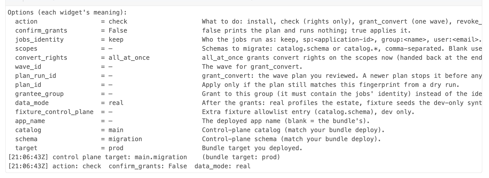

   The rights check gives one GO, WARN or NO-GO line per requirement and how much of the estate
   you can grant on ([what each means](#check-that-it-worked)):

   

   With no scopes yet, the run lists the schemas with external tables you can grant on and prints
   a line to paste. Paste it (or your own `catalog.schema` / `catalog.*` list) into the `scopes`
   widget and click **Run all** again. Now the run prints the grant plan, every grant with its
   set, grantee, reason and status, ending with the `plan_id` that pins it:

   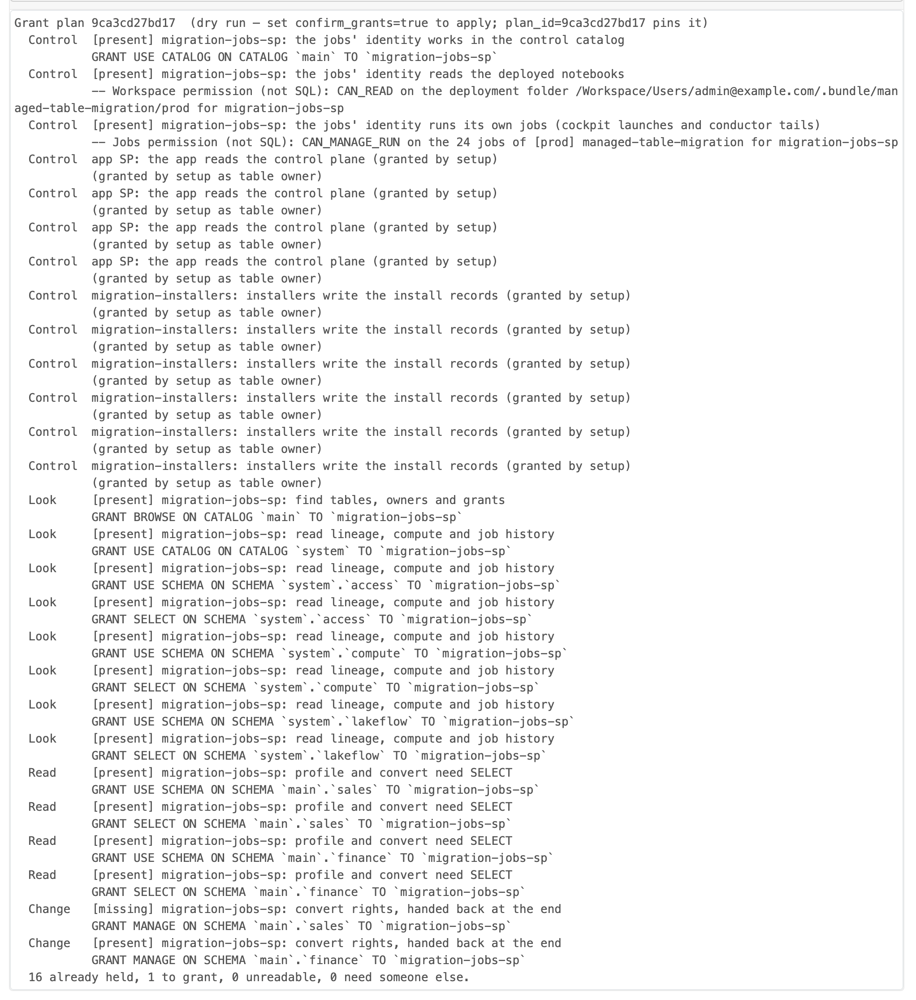

   Leave `target`, `catalog` and `schema` as they are unless you changed them in step 2: they must
   match the deploy, and a run that does not match stops and names the deployed values.
5. **Apply.** Set `confirm_grants` to `true` and `plan_id` to the printed value, then click
   **Run all** again. The installer grants, reads every grant back, records the scopes and the
   convert rights, runs `job_99_setup` (control tables, Genie space, the app's grants), profiles
   your estate (`data_mode=real`; expect 30 to 45 minutes, even for a few schemas), and verifies:

   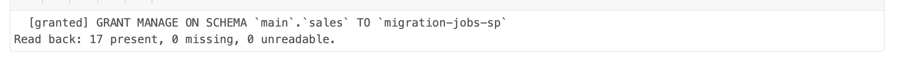

   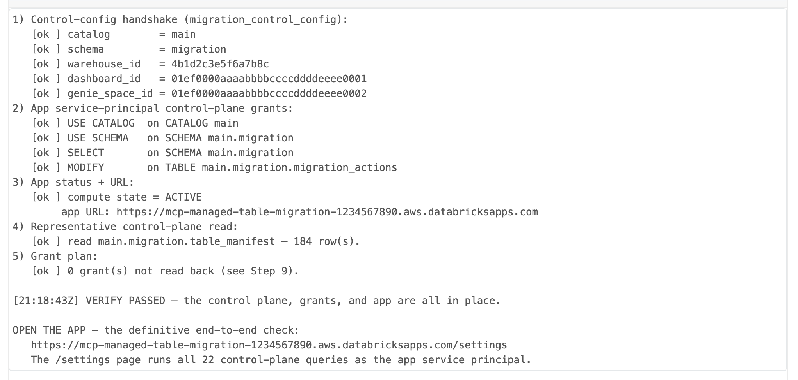

   The run ends with the app URL. Next: [Check that it worked](#check-that-it-worked).

## Install with the CLI

You need the Databricks CLI 1.3.0 or later and a profile for the workspace
(`databricks auth login --host <workspace-url> --profile <profile>`). The workspace comes from
`--profile`, so there is no host to set in `databricks.yml`.

```bash
git clone https://github.com/databricks-solutions/managed-table-migration-accelerator.git
cd managed-table-migration-accelerator

# The same settings for every command below.
export BUNDLE_VAR_warehouse_id=<warehouse-id>
# export BUNDLE_VAR_manifest_catalog=<catalog>   # only if not main.migration
# export BUNDLE_VAR_manifest_schema=<schema>

databricks bundle validate -t dev --profile <profile>
databricks bundle deploy   -t dev --profile <profile>   # jobs, dashboard, Genie handshake and the app

# Optional: can I install, and how much of the estate can I grant on? Read-only.
MTM_ACTION=check databricks bundle run install -t dev --profile <profile>

# Preview the plan for the schemas to migrate, then apply exactly that plan.
MTM_SCOPES='sales.orders,finance.*' databricks bundle run install -t dev --profile <profile>
MTM_SCOPES='sales.orders,finance.*' MTM_PLAN_ID=<plan_id> MTM_CONFIRM_GRANTS=true \
  databricks bundle run install -t dev --profile <profile>
```

Set the variables once, as above or in the `dev` target, so the deploy and every `bundle run` see
the same values: `bundle run` resolves them again, so a `--var` given only to the deploy is lost.
A run with no warehouse stops with `dashboard warehouse_id is required`; a run that resolves a
different control schema from the deploy stops with exit code `2` and names the deployed one.

On a terminal, a blank `MTM_SCOPES` with nothing stored shows a numbered list of the schemas you
can grant on and asks. In a pipeline nothing is guessed: `MTM_SCOPES` is needed until scopes are
stored. `MTM_OUTPUT=json` prints the rights, the plan and its `plan_id` as one document, and the
exit code says what happened: `0` done, `1` a no-go, `2` invalid options, `3` applied with gaps,
`4` the `plan_id` no longer matches (nothing ran), `5` waiting on a redeploy.


`databricks bundle deploy` is the only deploy command: it also deploys the app, which the Apps
platform builds from `app/`. Do not run `databricks apps deploy`. After a deploy, the app can still
be starting: `databricks apps get <app-name>` shows when it is `RUNNING`. The `Makefile` wraps the
common commands (`make validate`, `make deploy`, `make test`).

With `data_mode=real` (the default) the apply waits for `job_99_setup` and the profiling job:
expect 30 to 45 minutes, even for a few schemas. `MTM_DATA_MODE=none` skips the profiling, so the
apply finishes in a few minutes; run the profiler later from the app.

For production, set `prod_host` and the jobs' identity (`jobs_run_as`, or `prod_run_as_sp`), then
`databricks bundle deploy -t prod`. Runs are approved through job-run permissions and a person
triggering each run.

## Check that it worked

**The installer's lines.** Every run starts with one line per requirement:

- **GO**: you have it.
- **WARN**: the install goes ahead without it, and the line says what that costs. Without
  metastore admin, for example, the jobs can read the system tables only if a metastore admin
  has already granted them.
- **NO-GO**: something you cannot grant yourself. The line names who can. A NO-GO on the control
  catalog or the jobs' identity stops the install; for any other line, everything you can grant
  still applies and the rest is listed for whoever can grant it.
- **UNKNOWN**: the installer could not read the answer. It is never treated as GO.

A finished apply ends with `VERIFY PASSED` and the app URL.

**The app.** Open the app URL. The first time, the app asks you to allow it to act for you:
approve it, so its Settings page can check and grant as you. Then go to **Connection & policy**
(Settings). Every control-plane query should report healthy, and the **Permissions** panel should
list every scope with Look and Read granted (and Change, with convert rights at install). Once
profiling finishes, **Overview** shows your estate and the recommended next step.

## Carry on in the app

The app takes over once the first install has run. After the first install, **Connection & policy → Permissions** shows the same check, the stored
scopes with their live status, and the plan, for the signed-in admin. **Add schemas** widens the
scope; **Grant** runs the plan as you, with your own rights, after a confirm that lists every
statement. Lines you cannot grant name who can, with a **Copy request**.

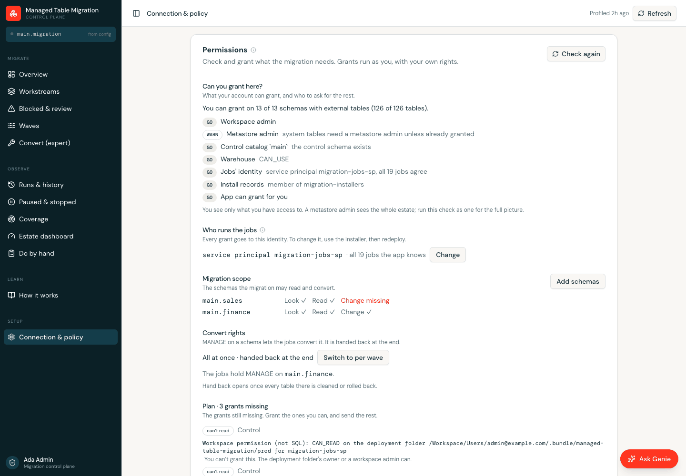

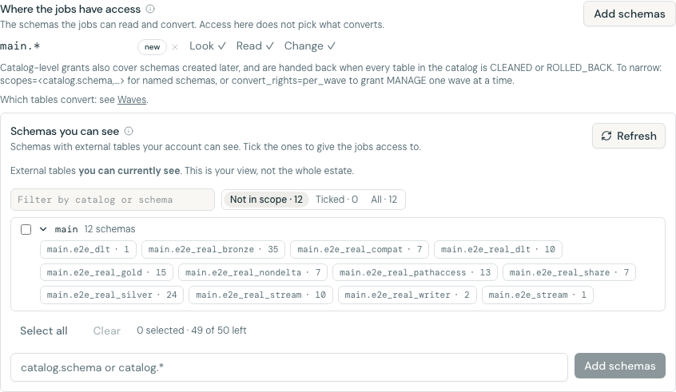

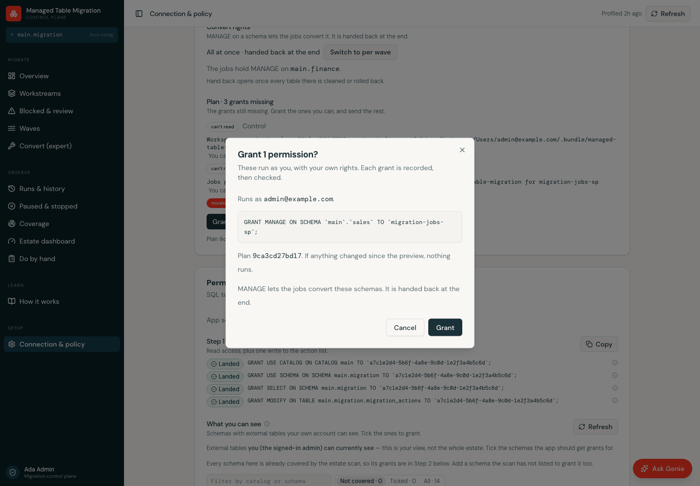

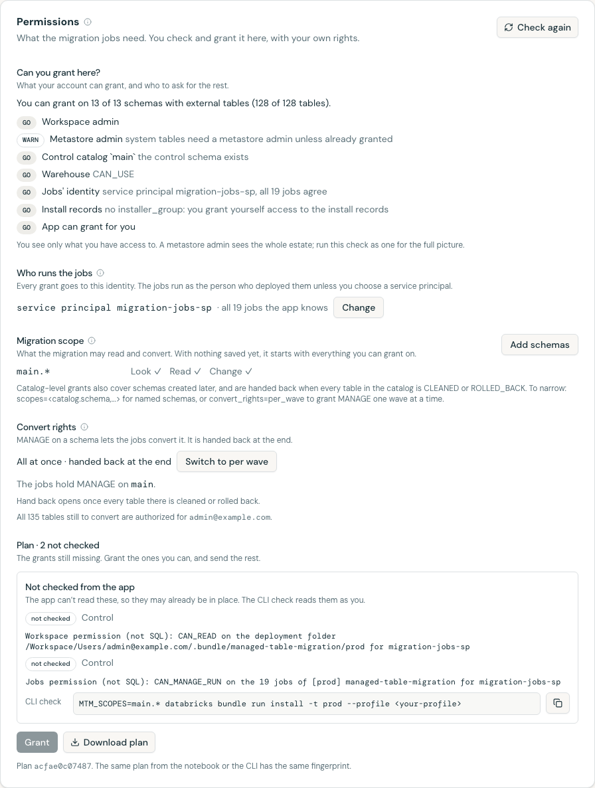

An operator without authority sees the same plan with **Copy request** in place of **Grant**:

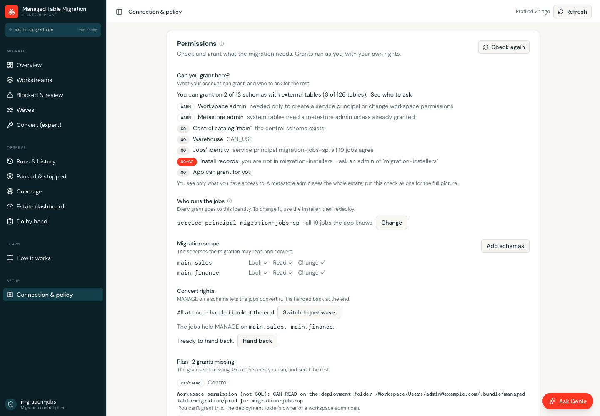

With convert rights per wave, the convert gate offers **Grant convert rights** for that wave. It
runs as you and reads the grant back. The convert itself is a separate confirm:

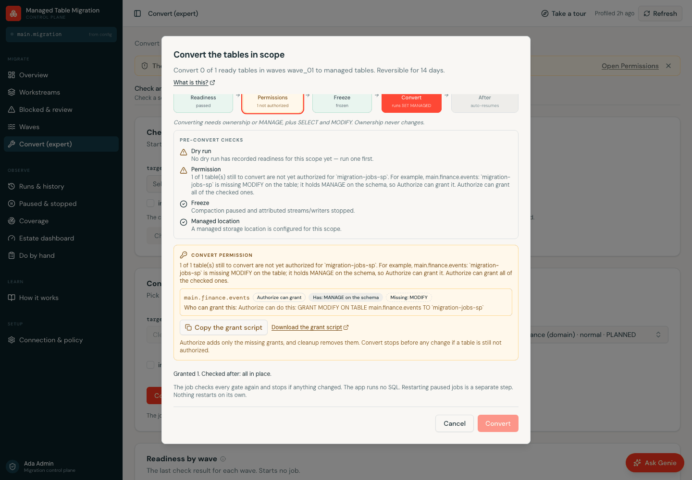

The gate's permission check updates on the next dry run or Authorize, which write the verdict the
gate reads.

If your sign-in to the app has no SQL access (a session from before the app asked for it),
Permissions says so, lists the grants the plan expects as **not checked**, and gives a CLI dry run
and the notebook path instead. To grant from the app, open it in a new private window, approve the
sign-in prompt, then press **Check again**.

### From Genie Code

`mtm_get_permissions` returns the same check and plan. `mtm_grant_permissions` and
`mtm_hand_back_convert_rights` (tier `v2`) grant or hand back as you, and refuse without
`confirm=true`:

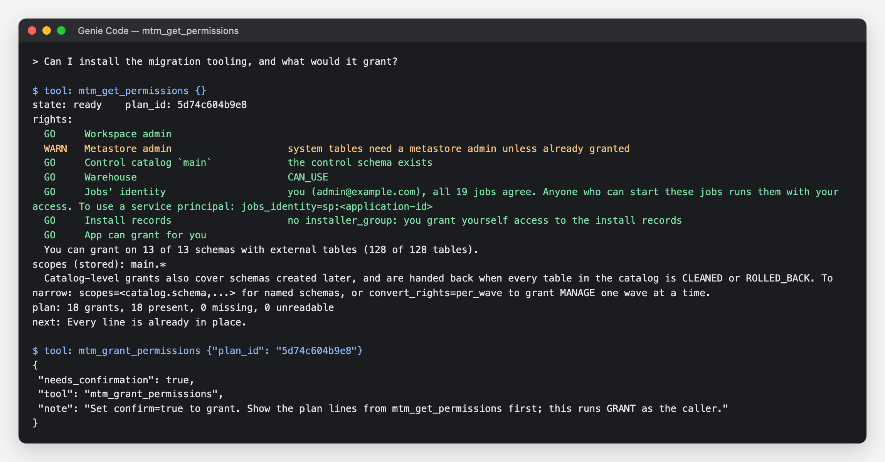

## Hand convert rights back

Once every table in a schema is `CLEANED` or `ROLLED_BACK`, cleanup (`job_07_post_convert_cleanup`)
marks its `MANAGE` ready and opens a **Hand back** item on the runbook (**Do by hand**). The jobs'
identity cannot give up its own `MANAGE`, so a person hands it back, from any door:

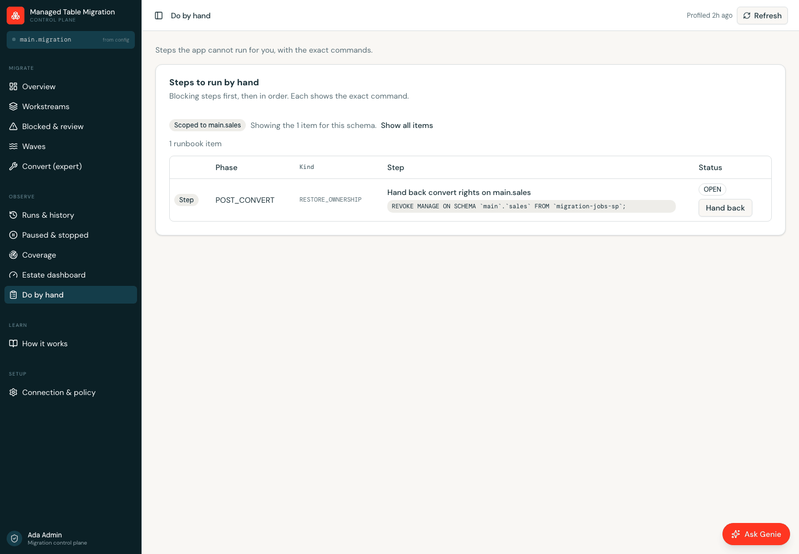

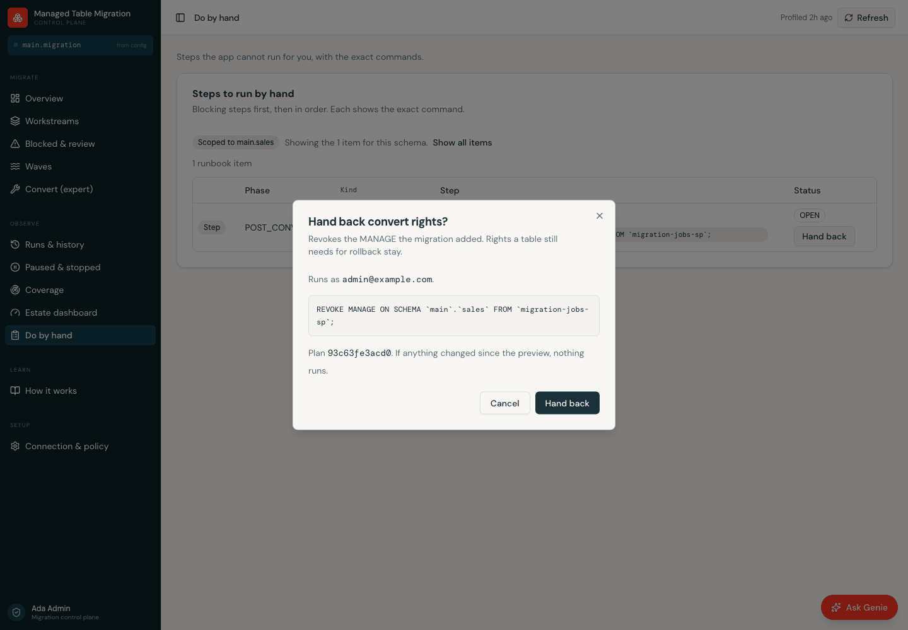

```bash
# Everything cleanup marked ready, or name the schemas to hand back now.
MTM_ACTION=revoke_convert databricks bundle run install -t <target> --profile <profile>
MTM_ACTION=revoke_convert MTM_SCOPES=sales.orders MTM_PLAN_ID=<plan_id> MTM_CONFIRM_GRANTS=true \
  databricks bundle run install -t <target> --profile <profile>
```

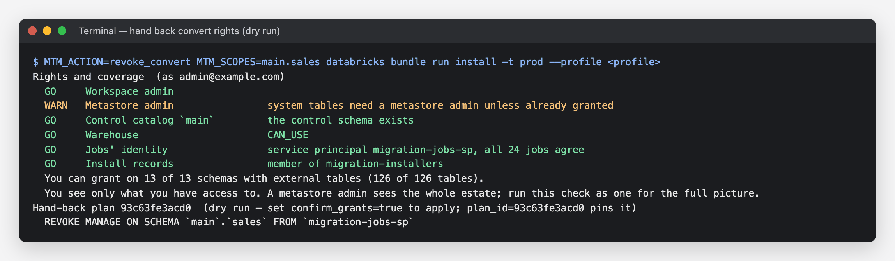

A schema with a table still inside its 14-day rollback window is refused, with the date it becomes
possible: rollback needs those rights.

## Upgrade

To move to a new version, pull it and deploy again, from the Git folder (**Pull**, then
**Deploy**) or with `databricks bundle deploy -t <target> --profile <profile>`. You do not run the
installer again unless the release notes say so.

`bundle deploy` ships new app code but does not recreate the control-plane **views**. Until
`wave_status` is recreated, app queries that read its newer columns fail with an unresolved column,
which breaks the Waves and Convert boards, the Overview wave lookups, the scope pickers and the
Settings query health list. Right after every redeploy, run the read-only conductor once:

```bash
databricks bundle run job_08_conductor -t <target> --profile <profile>
```

or press **Overview > Refresh the next step** in the app. The conductor converts nothing and never
rewrites the wave plan: it adds any new manifest columns, recreates the read views and appends a
recommendation. The first install runs it for you.

## Connect Genie Code (optional)

The deployed app is also an MCP server, so you can drive the migration from Genie Code in plain
language. No account admin and no extra resource is needed:

1. In Genie Code, open **Settings → Custom MCP server**.
2. Choose `mcp-managed-table-migration`, or paste the app's `/mcp` URL, and **Save**. Genie Code
   checks the connection before it saves.
3. Ask "Where does the migration stand?" to confirm the tools answer.

The bundle variable `mcp_tier` controls what Genie Code can do: `v2` (the default) adds the gated
tools that change things, each behind `confirm=true`; `v1` allows reads and non-mutating stages
only. If the server lists but will not save, it is a CORS preflight problem; the fix and the
governed Unity Catalog MCP Service alternative are in [Genie Code MCP](./15-genie-code-mcp.md).

## Restarting the app

The app reads its whole environment (control catalog and schema, the warehouse and every job
binding) from the bundle, applied at deploy time. `databricks apps stop` followed by `start`
restarts the container **without** that environment, and the app crashes at boot with
`MIGRATION_CATALOG is missing or invalid`. To restart the app, run `databricks bundle deploy -t
<target>` again. A new `genie_space_id` needs no restart: the app looks it up per request.

## Uninstalling

First revoke what the tool granted, then destroy the bundle. `action=uninstall` (notebook or CLI)
prints every grant the installer recorded as added and revokes them with `confirm_grants=true`. It
refuses while any table is inside its 14-day rollback window, and it never revokes a grant made
outside the tool. Your own access to the install records is listed last, to run yourself:

```bash
MTM_ACTION=uninstall databricks bundle run install -t <target> --profile <profile>
MTM_ACTION=uninstall MTM_PLAN_ID=<plan_id> MTM_CONFIRM_GRANTS=true \
  databricks bundle run install -t <target> --profile <profile>
```

Then `databricks bundle destroy -t <target>` removes the jobs, the dashboard and the app. It does not
drop the control-plane schema or its tables (the jobs create those at run time) or the Genie space
(created by `job_99_setup`), and it never touches your tables. Roll back any converted table you
want to keep EXTERNAL **before** the 14-day window closes; see
[Rollback and cleanup](./09-rollback-and-cleanup.md).

## Reference

The detail behind the steps above.

### How the installer works

The installer is one engine you can run from three places, and every place records what it did in
the same control tables, so you can start in one and finish in another:

| Run it from | Suits | How |
|---|---|---|
| **Notebook** | The first install, from the workspace with no local tools | Open `backend/notebooks/install.py`, **Run all** |
| **CLI** | The first install, scripted or repeatable | `databricks bundle run install -t <target> --profile <profile>` |
| **App Settings** | After the first install: adding schemas, convert rights per wave, handing rights back | **Connection & policy → Permissions**, as the signed-in admin |

The app cannot do the first install: until the installer has run, there are no control tables for
it to read and no grants for it to read them with.

Genie Code can also read the same check and plan, and grant behind `confirm=true`
([From Genie Code](#from-genie-code)).

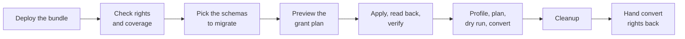

Every step is idempotent: re-running says "already done" rather than redoing work. Nothing is
granted until you confirm, and a confirm is pinned to the plan you reviewed by its `plan_id`, so a
plan that changed since the preview stops before any statement runs.

#### What the installer grants

Access is split into four sets, granted in one reviewed plan. Only the last one can change data.

| Set | Grantee | What and why |
|---|---|---|
| **Control** | The app's service principal, the jobs' identity, and the installers' group | Read the control plane, write `migration_actions`; the jobs' identity can create and run its own control schema and jobs |
| **Look** | The jobs' identity | `BROWSE` per catalog (or `READ METADATA` on the metastore) and the `system.access`, `system.compute` and `system.lakeflow` schemas: find tables, owners, grants, lineage and job history |
| **Read** | The jobs' identity | `USE SCHEMA` and `SELECT` on each schema you migrate: profile and convert need `SELECT` |
| **Change** | The jobs' identity | `MANAGE` on each schema you migrate: the convert rights. Handed back at the end |

**Convert rights, all at once or per wave.** By default (`convert_rights=all_at_once`) `MANAGE` is
granted for every chosen schema at install, so no person is needed between waves, and it is handed
back once cleanup finishes. The stricter option (`per_wave`) grants Control, Look and Read only;
before each wave converts, `action=grant_convert` (or **Grant convert rights** on the app's convert
gate) grants `MANAGE` on that wave's schemas. You can switch between the two at any time. The tool
only ever revokes what it recorded as added; a grant you made yourself is never revoked.

**The jobs' identity** is whoever the deployed jobs run as (`jobs_run_as`, the same on every job).
The installer reads it from the deployed jobs, names its kind in the plan, and refuses to go on if
the jobs disagree. A dedicated service principal is recommended for production; the
`jobs_identity` option writes the override and asks you to redeploy.

#### Installer options

The notebook widgets and the CLI read one option set. Through the bundle, each option is an
`MTM_<NAME>` environment variable (a bundle script takes no arguments). Run
`python3 backend/scripts/install.py --help` for the same options as flags.

| Option | Default | What it does |
|---|---|---|
| `action` | `install` | `install`; `check` (rights and plan only); `grant_convert` (one wave's convert rights); `revoke_convert` (hand convert rights back); `uninstall` (revoke everything the tool granted) |
| `confirm_grants` | `false` | `false` prints the plan and runs nothing; `true` applies it |
| `plan_id` | blank | Apply only if the plan still matches the one you reviewed |
| `scopes` | the stored scopes | `catalog.schema` or `catalog.*`, comma-separated: the schemas to migrate |
| `convert_rights` | `all_at_once` | `all_at_once` or `per_wave` (above) |
| `wave_id`, `plan_run_id` | blank | The wave for `grant_convert`, pinned to the wave plan you reviewed |
| `jobs_identity` | `keep` | `sp:<application-id>`, `group:<name>` or `user:<email>` to move the jobs; needs a redeploy |
| `grantee_group` | blank | Grant to a group that contains the jobs' identity instead |
| `data_mode` | `real` | After the grants: `real` profiles the estate, `none` skips it, `fixture` seeds a dev-only sample |
| `output` (CLI) | `text` | `json` prints one document for scripts and change tickets |

The catalog, schema, target, app and warehouse always come from the deploy, so the installer
cannot point at a different control plane.

### Who needs which permissions

Elevated rights are needed **once, by whoever installs**. People who run the migration day to day
need only `CAN_USE` on the app.

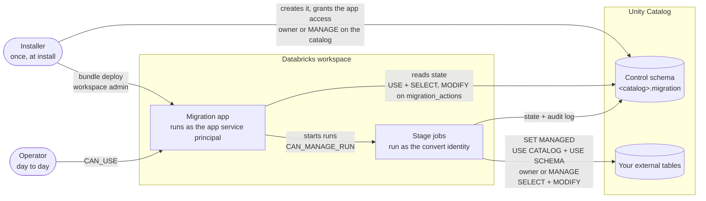

A click in the app never runs as you. The app's service principal starts the run, and the job runs
as its **convert identity**: you on `dev` and `e2e`, a service principal on `prod`. The operator's
name is recorded for the audit trail only.

What each step needs:

| Step | Who | Needs | Granted by |
|---|---|---|---|
| **Install** | Installer | Workspace admin (to bind the jobs and warehouse to the app and set job permissions); owner of, or `MANAGE` on, the control catalog | Your admins, once |
| **Provision the app** | App service principal | `USE CATALOG`, `USE SCHEMA` and `SELECT` on the control schema; `MODIFY` on `migration_actions` only | `job_99_setup`, automatically |
| **Use the app** | Operators | `CAN_USE` on the app. No data grants. | App permissions |
| **Profile, dry run, validate** | Convert identity | `USE CATALOG`, `USE SCHEMA` and `SELECT` on the target schemas | A target schema owner, or the Settings page script |
| **Freeze**, only if recommended | Convert identity | `CAN_MANAGE` on each OPTIMIZE / VACUUM job and pipeline it pauses (a workspace permission, not a grant); `MANAGE` on the schema to pause Predictive Optimization | Job and pipeline owners; a schema owner |
| **Convert and roll back** | Convert identity | Ownership **or** `MANAGE` on the table, its schema or its catalog, plus `SELECT` + `MODIFY` unless it owns the table | **Authorize** grants what is missing; cleanup revokes it |
| **Re-share**, Delta Sharing only | Convert identity | Ownership of the share (not a grant), or a provider admin runs the two `ALTER SHARE` statements from the runbook | The share owner |

How Authorize grants and cleanup revokes is pictured in
[Convert permissions and Authorize](./07b-convert-permissions.md#revoke-at-cleanup-not-unfreeze).

In detail, the four identities:

- **The installer** (deploys the bundle and provisions the app's service principal):
  - **Workspace side**: any workspace user can create an app, but binding the warehouse and the
    jobs to it needs Can Manage on each, and setting the jobs' permissions needs `CAN MANAGE` on
    every job, so in practice a workspace admin. Also write access to the deploy path.
  - **Unity Catalog side**: owner of, or `MANAGE` on, the control catalog (to create the control
    schema and grant the app SP read access) and on each target catalog or schema (to grant the
    convert identity what it needs). For a whole-estate migration a metastore admin covers all of
    it ([recommended installer](#recommended-installer)).
    Account admin is not needed unless you create or rotate the service principal.
- **The app service principal** (the app's own identity). `job_99_setup` grants it least-privilege
  access to the control plane (`USE CATALOG`, `USE SCHEMA`, `SELECT` on the control schema, and
  `MODIFY` on `migration_actions` only) and verifies each grant with `SHOW GRANTS`.
- **The convert identity** (the jobs' `run_as`, which actually runs `SET MANAGED`). Every stage job
  runs as the `jobs_run_as` variable: by default **you**, the deployer. In `prod` it is the service
  principal in `prod_run_as_sp`, normally the app SP. On each table it needs:
  - `USE CATALOG` and `USE SCHEMA`;
  - ownership **or** `MANAGE` on the table, its schema or its catalog (direct, inherited or through
    a group);
  - `SELECT` and `MODIFY`, unless it owns the table.

  **Ownership never changes.** The Authorize step (`job_03d_lease_ownership`) grants only what is
  missing when the identity can grant it itself, and the app generates a grant script, grouped by
  who must run each statement, for the rest. See
  [Convert permissions and Authorize](./07b-convert-permissions.md).
- **Operators** (the people using the app): `CAN_USE` on the app. Nothing else; the jobs run as the
  convert identity, and the operator is recorded for attribution only.

#### The app service principal's grants

`job_99_setup` resolves the app's service principal at run time and issues exactly these four
grants, then verifies each with `SHOW GRANTS` and prints the statement for any it could not land:

```sql
GRANT USE CATALOG ON CATALOG <catalog> TO `<app-sp-client-id>`;
GRANT USE SCHEMA  ON SCHEMA  <catalog>.<schema> TO `<app-sp-client-id>`;
GRANT SELECT      ON SCHEMA  <catalog>.<schema> TO `<app-sp-client-id>`;
GRANT MODIFY      ON TABLE   <catalog>.<schema>.migration_actions TO `<app-sp-client-id>`;
```

The set is deliberately narrow: never `ALL PRIVILEGES` on the schema, which would let the app
rewrite `audit_log`, `wave_plan` or `freeze_ledger`. `USE CATALOG` is the one grant that can exceed
the setup identity's authority on a shared catalog; when it is missing, a catalog owner or metastore
admin runs the printed statement once. The grantee is the service principal's client ID (a UUID in
backticks; a display name grants nothing), shown on the app's page in the workspace.

#### The Settings page checks the rest

The app's **Settings** page (**Connection & policy**) has two panels, one per identity:

- **Permissions** is for the migration jobs. It checks, grants and hands back as the signed-in admin
  ([Carry on in the app](#carry-on-in-the-app)). Its **Migration scope** part lists the schemas with
  external tables you can see: tick a schema (or type one) and its grants join the plan straight
  away, so you can grant access before the first profiler run. Nothing is ticked for you. The list
  is your visibility, not the whole estate: the profiler finds the authoritative set once the grants
  land. On a large metastore the scan stops after about 20 seconds and says how many catalogs it
  covered. Its **Convert rights** part also counts the tables still to convert that are not yet
  authorized, and downloads `convert-permissions.sql`: the grants the convert identity still needs
  per table, grouped by who must run them.
- **The app's own access** is for the app's service principal: the four control-table grants above
  (granted by `job_99_setup`), each checked with `SHOW GRANTS`, with **Copy** for the SQL.

The app never runs a `GRANT` as its own identity or changes an owner. Grants that run go through the
Permissions panel, as you, after a confirm. The full grant contract, including the `run_as` model
and the reasoning behind each tier, is in [App service principal grants](../app/docs/app-sp-grants.md).

### Configure the bundle

Set these bundle variables before deploying, either in `databricks.yml` under your target or as
`BUNDLE_VAR_<name>` environment variables. Set them the same way for `bundle run`, which resolves
them again:

| Variable | Default | Set it to |
|---|---|---|
| `warehouse_id` | blank | Your SQL warehouse ID. Required for the dashboard and Genie. |
| `manifest_catalog` / `manifest_schema` | `main` / `migration` | Where the control tables should live. |
| `dataset_catalog` / `dataset_schema` | the manifest catalog / schema | Where the dashboard and Genie read the control tables. Leave unset: they follow `manifest_catalog` / `manifest_schema`. |
| `catalog_filter` / `schema_filter` | `*` / `*` | Glob filters that limit which catalogs and schemas the profiler scans. |
| `workspace_id` | blank | Your workspace ID, so links from the app open in the right workspace. Optional. |
| `jobs_run_as` | the deployer | Who every stage job runs as: `{service_principal_name: …}`, `{group_name: …}` or `{user_name: …}`. A complex variable: set it in the target or `.databricks/bundle/<target>/variable-overrides.json` (the installer's `jobs_identity` option writes it), not `BUNDLE_VAR_*`. Required when a service principal deploys. |
| `prod_host` / `prod_run_as_sp` | placeholder / blank | `prod` target only: the prod workspace URL and the service principal application ID the prod jobs run as. |
| `prod_root_path` | `/Shared/.bundle/<bundle>/prod` | `prod` target only: the deployment folder. The default keeps existing installs in place. For a new install pick a folder only the deployers can edit; the installer warns when every workspace user can edit it. |
| `mcp_tier` | `v2` | What Genie Code may do through the app: `v2` adds the gated tools that change things; `v1` is reads and non-mutating stages only. |
| `telemetry_enabled` | `true` | `false` to turn off usage telemetry (see below). |

The `dev` target has no host: the workspace comes from `--profile`, or from the Git folder you
deploy from. Every other knob (wave sizes, scan caps, parallelism) has a safe default and is
documented in [the jobs contract](../backend/docs/contracts/jobs.md).

To keep your own settings out of the tracked `databricks.yml`, put them in a target of your own in
`databricks.local.yml` next to it. Git ignores that file, and the bundle includes it when it
exists:

```yaml
targets:
  demo:
    mode: development
    variables:
      warehouse_id: <warehouse-id>
```

## Troubleshooting

- **`dashboard warehouse_id is required`** (a deploy or a `bundle run`). The command has no
  warehouse. Set `warehouse_id` in the target, or `export BUNDLE_VAR_warehouse_id=<id>` in the
  shell you run every command from, then run it again.
- **`This target was deployed with the control schema …` / `This deployment's control schema is
  …`.** The run resolves a different control catalog or schema from the deploy. Use the values it
  names: the same variables as the deploy for the CLI, or the `catalog` and `schema` widgets in
  the notebook.
- **`Preflight failed`.** The installer cannot find the app or a job from the deploy. Deploy first,
  with the same target (`-t <target>`, or the `target` widget), then re-run.
- **The rights check says NO-GO or WARN.** Each line names what is missing and who can grant it.
  Send them the plan (the CLI's `MTM_OUTPUT=json`, or **Copy request** in the app), then re-run the
  check. Everything you can grant still applies; the rest is listed, never guessed.
- **"plan_id no longer matches".** Something changed since the preview (a grant landed, a scope was
  added). Nothing ran. Review the new plan and apply with its `plan_id`.
- **"Nothing to revoke" on a hand-back.** Cleanup has not marked the schema ready yet: every table
  in it must be `CLEANED` or `ROLLED_BACK`. The output lists what is still held. To hand a schema
  back now, name it in `scopes`.
- **Genie says it isn't set up yet.** The app reads the Genie space per request with a short
  timeout, so a cold warehouse can delay it. Once the installer has run, reopen the Genie panel
  (or reload the page) after the warehouse is warm. No redeploy is needed.
- **Control-plane reads fail with `INSUFFICIENT_PERMISSIONS`.** The app SP grants have not landed.
  Run `job_99_setup` again after the app exists. If `USE CATALOG` still fails, the catalog is a
  shared one the setup identity cannot grant on: the job prints the exact `GRANT` statement for a
  catalog owner or metastore admin to run once.
- **The profiler finds fewer tables than expected.** The profiler can only see what its identity
  has been granted. Grant `USE CATALOG`, `USE SCHEMA` and `SELECT` on the missing schemas (schema
  grain covers tables nobody has listed yet), then run the profiler again. The Settings page lists
  the tables the signed-in admin can see as a starting scope.
- **A convert refuses with a permission verdict.** Read the table's `convert_authority` row (the app
  shows it on the convert gate), run **Authorize**, and send the generated grant script for anything
  it could not grant itself. See [Convert permissions and Authorize](./07b-convert-permissions.md).
- **A convert refuses with `no_managed_location` or `managed_location_unresolved`.** Configure a
  managed location on the schema, catalog or metastore, then run the dry run again. See
  [Conversion and validation](./08-conversion-and-validation.md).
- **Permissions says your sign-in has no SQL access.** The app's session is from before it asked
  for SQL access. Open the app in a new private window, approve the sign-in prompt, then press
  **Check again**. The notebook and CLI work meanwhile.

## Usage telemetry

Each stage run and app job launch tags one call to the workspace's own control plane with
closed-vocabulary signals (stage, outcome, banded counts and the toolkit's own codes). It never
contains catalog, schema or table names, paths, identities, SQL or error messages, and it never
changes a gate. Turn it off with `telemetry_enabled: "false"` and a redeploy, or set
`DO_NOT_TRACK=1`. The full catalogue is in
[backend/docs/operations/telemetry.md](../backend/docs/operations/telemetry.md).

## Testing against your own workspace (e2e target)

The `e2e` target carries no workspace details: the host comes from `--profile` and everything else
from `BUNDLE_VAR_*` environment variables. Copy `.env.e2e.example` to `.env.e2e`, fill it in, load
it with `set -a; source .env.e2e; set +a`, and deploy with
`databricks bundle deploy -t e2e --profile <profile>`. The live e2e drivers are described in
[backend/.e2e/README.md](../backend/.e2e/README.md).
