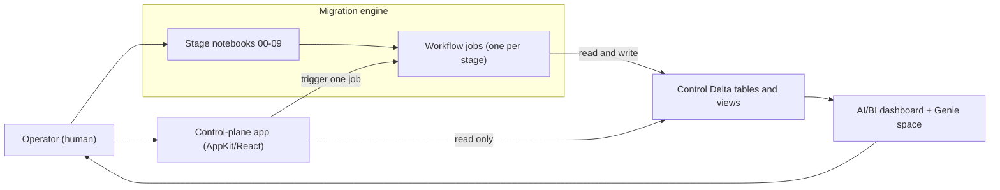
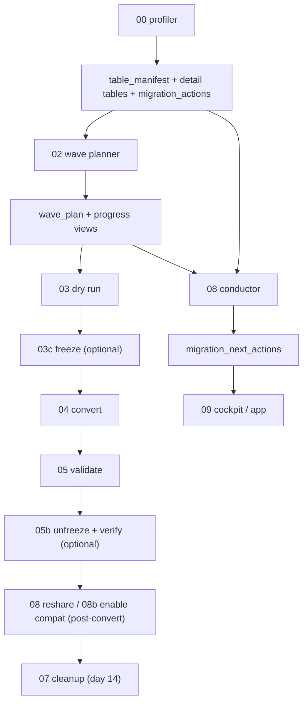

# 02 - Architecture

This page explains how the tooling is built and how the pieces fit. For engineering-depth
treatment of the same design, see
[`backend/docs/architecture.md`](../backend/docs/architecture.md); for the exact schemas and
parameters, see the contracts under `backend/docs/contracts/`.

## System context

There is one engine (the stage notebooks, wrapped as Workflow jobs) and two front doors onto
it (the interactive cockpit notebook and the app). Both front doors talk to the engine only
through the control Delta tables and the job parameters.

## Manifest-driven design

There are no hardcoded table lists anywhere. Everything is parameterised off a control
**manifest** (`table_manifest`) plus job parameters. Each stage:

- reads its scope from the manifest (or from `wave_plan` for wave-pinned stages),
- writes back **only the columns it owns**, and
- appends an `audit_log` row for every action it takes.

Re-running a stage never clobbers downstream state. The manifest also **auto-evolves**: a new
signal column is declared in `manifest.MANIFEST_COLUMNS` (and `manifest._DEFERRED_DEFAULTS`
when a later stage owns it), and `manifest._reconcile_columns` adds it via
`ALTER TABLE ... ADD COLUMNS` on the next `ensure_manifest_table` call. Existing rows
backfill `NULL`, with no recreation. The integration consequence: treat every column as
nullable and never `SELECT *` into a positional consumer.

## Pure logic, thin Spark edges

All parsing, eligibility, classification, planning, and verification logic lives as **pure
functions** in `backend/src/migration/*.py` and is unit-tested with **no cluster and no Spark
session** (`python -m pytest backend/src/tests/ -q`). Spark and Databricks SDK I/O is
confined to clearly marked "thin edge" functions at the bottom of each module and to the
notebooks. Each module owns the DDL, Spark `StructType`, row builder, and column-name tuples
for the one table or view it is responsible for, so each control object has exactly one
source of truth.

### Module map (`backend/src/migration/*.py`)

| Module | Owns / does |
|---|---|
| `manifest.py` | `table_manifest` schema, merge, auto-evolution |
| `audit.py` | `audit_log` + the state machine (`_TRANSITIONS`, `is_valid_transition`) |
| `eligibility.py` | `assess_eligibility`, sizing (`recommended_cores`/`recommended_warehouse`/`cluster_size_status`), `build_reshare_commands`, `is_compatibility_enabled` |
| `locations.py` | `location_map` + the managed-location gate (`effective_managed_location`) |
| `streaming.py` | `streaming_plan`, streaming detection |
| `external_writes.py` | external writer/reader classification, `derive_access_flags`, path-based access tiers |
| `consumer_runtime.py` | `consumer_runtime_plan`, below-floor DBR classification |
| `source_scan.py` | `path_access_locations` (tier-2 source scan) |
| `recency.py` / `windowing.py` | access-recency signals; predictive convert-window signals (advisory) |
| `compaction.py` | `compaction_sources` + OPTIMIZE/compaction attribution |
| `actions.py` | `migration_actions` work queue + the action views |
| `executor.py` | `freeze_ledger` + freeze/restore op derivation, coverage gaps |
| `verifier.py` | freeze/restart verification against platform truth |
| `lineage.py` | `wave_plan`, `comms_feed`, `assign_bucket`, `sequence_waves`, `resolve_wave_targets` |
| `progress.py` | `migration_progress` + `wave_status` views |
| `conductor.py` | `migration_next_actions` + the next-step classifier |
| `runbook.py` | `migration_runbook` view + Markdown/SQL export |
| `reshare.py` / `compat.py` | post-convert executor planners (pure) |
| `digest.py` | opt-in blocker / stale-freeze digest (pure) |
| `cleanup.py` / `validate.py` | day-14 cleanup logic; post-convert validation |
| `bootstrap.py` | `migration_control_config` + `ensure_control_plane` |

## The control tables (summarised)

The control plane is a set of Delta tables and views in one `catalog.schema`
(`manifest_catalog.manifest_schema`, defaults `main.migration`). Every stage reads and writes
them; the app reads them (and writes exactly two columns of one table). The full column
contract (schema, writer, readers, merge keys, idempotency) is authoritative in
[`backend/docs/contracts/control-tables.md`](../backend/docs/contracts/control-tables.md).
In brief:

- **`table_manifest`**: one row per EXTERNAL table, carrying its identity, size, signals,
  `eligibility`, `blockers`, and lifecycle `state`.
- **Detail tables** (keyed by `full_name`): `location_map`, `streaming_plan`,
  `consumer_runtime_plan`, `path_access_locations`, `compaction_sources`,
  `validation_results`.
- **Work + execution**: `migration_actions` (the papercut work queue), `freeze_ledger` (what
  freeze paused, for exact restore), `audit_log` (append-only history).
- **Plan + progress**: `wave_plan`, `comms_feed`, and the `migration_progress` / `wave_status`
  views.
- **Recommendation + trust**: `migration_next_actions` (append-only conductor output) and the
  `migration_runbook` view (do-it-by-hand statements).
- **Config**: the single-row `migration_control_config` handshake.

## End-to-end data flow

## One bundle, two directories

This monorepo is a **single Databricks Asset Bundle**. The root `databricks.yml` is the one
and only bundle root; it `include`s both `backend/resources/*.yml` (one Workflow job per
stage, plus the dashboard) and `app/resources/*.yml` (the app resource). It defines three
targets: `dev` (default, development mode), `e2e` (a named development-mode target for the
live e2e estate, with its workspace values supplied as `BUNDLE_VAR_*`), and `prod` (production mode). Every stage job runs as `var.jobs_run_as`
(default: the deployer; `prod`: the service principal in `prod_run_as_sp`). The `backend/` and `app/` directories share the one bundle and one
`warehouse_id`.

**Deploy with `databricks bundle deploy`, not `databricks apps deploy`.** One
`bundle deploy` deploys the jobs, the dashboard, the Genie handshake, and the app together.
The root `databricks.yml` **intentionally has no `artifacts:` block** (it carries an
explicit "there is intentionally NO `artifacts:` block" note) because the Databricks Apps
platform rebuilds `app/dist/` at deploy time. Do not add one.

## The deploy/config handshake

The bundle declares resources but cannot know the identifiers those resources acquire at
create time (`warehouse_id`, `dashboard_id`, `genie_space_id`). Those runtime handles are
written to and discovered from the single-row **`migration_control_config`** table:

- `bootstrap.ensure_control_plane(...)` idempotently creates **every** control table and view
  (empty) so the read-only dashboard and Genie space never fail with "table does not exist"
  on a fresh deploy. Both the profiler and `job_99_setup` call it first, which is what lets
  them run in either order.
- `bootstrap.write_control_config(...)` is a **partial upsert**: the profiler writes
  `catalog`/`schema`/`warehouse_id`; the setup job writes `dashboard_id`/`genie_space_id`.
  Whichever runs last never blanks the other's fields.

An external control plane (or the cockpit) resolves the live control schema by reading
`migration_control_config`, or by searching `system.information_schema.tables` for the marker
tables (`table_manifest`, `migration_next_actions`). See
[`backend/docs/architecture.md`](../backend/docs/architecture.md#config-handshake) for the
full resolution logic and the cycle rules that keep the bundle references acyclic.

## Degrade honestly

System-table and history reads can fail on grants, schema drift, or older runtimes. When they
do, the stage stamps an accurate note capturing the real error kind (for example
`history_unavailable` vs `attribution_unavailable`), leaves prior data untouched, and
continues. Lineage (`system.access.table_lineage`) is a sampled, retention-bounded (~90-day)
subset, so **"no evidence" is never treated as "safe/inactive"**.
