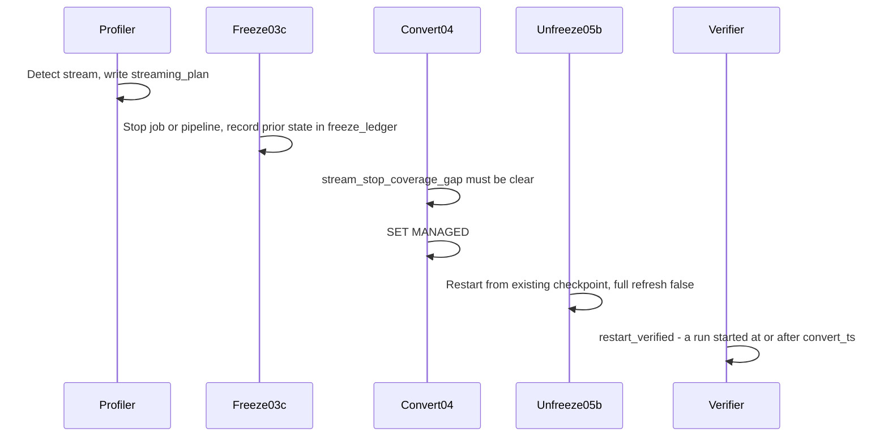

# 04 - Streaming

A streaming reader or writer of a table cannot be left running across a `SET MANAGED`:
the table's storage location changes, and Databricks requires that streaming jobs and
pipelines touching the table be **restarted** afterward. The tooling detects streaming,
brackets the convert with a stop and a restart, and machine-verifies both ends.

## Detection

Streaming detection is the pure function `streaming.streaming_plan_for_table(...)`
(`backend/src/migration/streaming.py`, around lines 141-203). It builds the restart-plan rows
for one table from three signals, in strict priority order (first match wins per source):

1. **DLT / Lakeflow pipelines from lineage.** `streaming.is_dlt_entity(entity_type)` over
   `system.access.table_lineage` -> `type = DLT` (constant `TYPE_DLT = "DLT"`), high
   confidence.
2. **`DESCRIBE HISTORY` shows a streaming write.** `streaming.is_streaming_history(...)`
   matches the operation set `STREAMING_HISTORY_OPS = {"STREAMING UPDATE"}` ->
   `type = STRUCTURED_STREAMING` (constant `TYPE_STRUCTURED_STREAMING`), `role = WRITE`, high
   confidence. When possible it is attributed to the non-DLT WRITE lineage entities.
3. **Micro-batch cadence heuristic only.** `streaming.microbatch_cadence(timestamps,
   min_commits=20, max_median_gap_seconds=300.0)`: many commits at a small, regular gap ->
   `type = UNKNOWN` (constant `TYPE_UNKNOWN`), low confidence.

Each plan row carries a `role` (`READ` / `WRITE`), an `owner`, a `job_or_pipeline_id`, and a
`confidence`. The pure `streaming.has_streaming_writer(plan_rows)` collapses the rows into the
manifest's `has_streaming_writer` flag.

The profiler edge writes `streaming_plan` **delete-then-append per batch** (crash-safe,
resumable, parallel, filter-aware; see the root README's "Streaming detection" section for
the batching knobs). Critically, **`streaming_plan` has no `catalog`/`schema` columns**: it is
keyed by `full_name` only and must be read with `scoping.read_detail_by_full_name`. Applying
a `catalog`/`schema` predicate to it throws and would silently drop every streaming action.

## The stop/restart bracket

Streaming brackets the convert as a **`STOP_STREAM` (PRE_CONVERT) + `RESTART_STREAM`
(POST_CONVERT)** action pair, emitted by `actions._restart_actions(...)`. An **unattributed**
stream (no job or pipeline id) stays **MANUAL**: it is surfaced but never auto-operated.

The freeze executor (`backend/src/migration/executor.py`) turns an attributed stop action into
a real, reversible operation:

- `OP_STOP_STREAM_JOB` (for a structured-streaming job): pause the schedule first (so it
  cannot relaunch), then cancel the active run. The **checkpoint is preserved**, never moved
  or deleted.
- `OP_STOP_PIPELINE` (for a DLT / Lakeflow pipeline): stop the pipeline.

Restore is the exact reverse (`RESTORE_START_STREAM_JOB` via `run_now`;
`RESTORE_START_PIPELINE` via a pipeline start). Pipelines are **always** restarted with
`START_PIPELINE_FULL_REFRESH = False`: a full refresh reprocesses from scratch (a data
incident), so the code forbids it.

## The convert-time gate

`04_convert` does not trust an operator's word that streams are stopped: it machine-verifies
coverage with the pure `executor.stream_stop_coverage_gap(...)` (the streaming mirror of the
compaction gate). Every **attributed** stream in the wave (`DLT` -> `OP_STOP_PIPELINE`,
`STRUCTURED_STREAMING` -> `OP_STOP_STREAM_JOB`, scoped by `full_name`) must have a real
`FROZEN` (`dry_run=false`) `STOP_*` row in `freeze_ledger`, or the convert **fails loud**
before mutating anything. This is gated by `require_streams_stopped` (default `true`).

The gate is **attributed-only**: an unattributed stream (no id, or `type=UNKNOWN`) cannot be
verified, so it is surfaced as a printed CAUTION but is **not** hard-gated (a documented
residual risk). `STOP_STREAM` itself stays non-blocking; the freeze bracket is what enforces
the stop.

## Verification

Both ends are verified against platform truth in `backend/src/migration/verifier.py`:

- **Stop verified** (`verifier.freeze_verified`): `STOP_STREAM_JOB` is verified when the job's
  `active_run_id` is `None`; `STOP_PIPELINE` is verified when the pipeline state is one of the
  stopped states (idle / stopped / failed / canceled).
- **Restart verified** (`verifier.restart_verified`): a run started **at or after**
  `convert_ts` (a genuinely new run after the conversion). Applied-but-unverified stays
  `IN_PROGRESS`; only a verified restart flips the paired `RESTART_STREAM` action to `DONE`.

## Timeline

Streaming tables are also **always isolated into their own waves** by the planner (see
[Wave planning](./06-wave-planning.md)). Column truth for `streaming_plan` and the action rows
is in
[`backend/docs/contracts/control-tables.md`](../backend/docs/contracts/control-tables.md).
