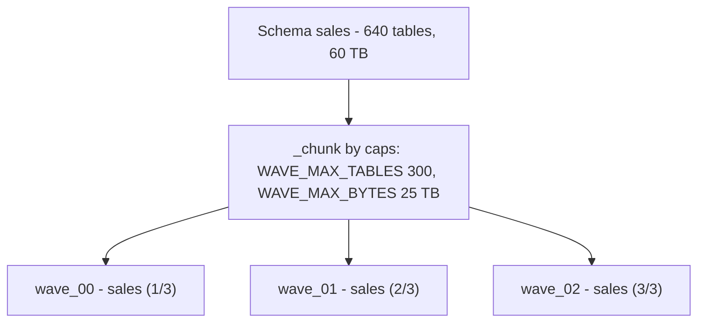

# 06 - Wave planning

The wave planner (`backend/notebooks/02_wave_planner.py`, job `job_02_wave_planner`, logic in
`backend/src/migration/lineage.py`) sequences all eligible tables into ordered, capped
**waves** and writes `wave_plan` + `comms_feed`. Convert and rollback pin to an exact
`(plan_run_id, wave_id)`, so the plan is the unit of execution. This page explains bucketing,
the crucial distinction between assignment precedence and execution order, and how one schema
fans out into several waves.

## Buckets and precedence

`lineage.assign_bucket(...)` assigns each table exactly one bucket by **first match wins**
(rank 1 is the most specialized):

1. `has_streaming` -> **`streaming`** (always isolated, since it needs a coordinated restart).
2. `needs_compatibility_mode` -> **`compat`** (external readers, post-convert work).
3. `is_delta_shared` -> **`share`** (D2D source, must be re-shared post-convert).
4. `size_band in LARGE_BANDS` (the ~10TB / >10TB bands) -> **`final_large`** (scheduled last).
5. no external consumer, `size_band == SMALL_BAND` (<=100GB), and
   `blast_radius <= PILOT_MAX_SCORE` (2.0) -> **`pilot`**.
6. everything else -> **`normal`**.

## Assignment precedence is not execution order

This is the subtlety that trips people up. `assign_bucket` precedence (above) decides **which
bucket a table lands in**. `lineage.sequence_waves(...)` decides **the order waves execute**,
and it is deliberately different:

> Execution order: **pilot -> normal -> streaming -> compat -> share -> final_large.**

So streaming is ranked first for *assignment* (to guarantee isolation) but runs *after* the
pilot and normal waves. Streaming stays isolated as its own bucket/waves regardless: a
streaming table must never land in a non-streaming wave or schema run.

## Pilot cap

`lineage.pick_pilot(...)` constrains the pilot to a single `catalog.schema` (auto-picked
as the densest pool of pilot candidates, or pinned with `pilot_schema`) and capped at
`pilot_max_tables` (constant `PILOT_MAX_TABLES = 15`). Overflow pilot-eligible tables are
demoted to `normal`, never dropped. The pilot exists only to prove the tooling on a small,
safe slice.

## Grain and chunking: how one schema becomes several waves

Non-pilot buckets are sliced by `grain_key(...)` at the `wave_grain` (default
`catalog_schema`, optionally coarser `catalog`), then each slice is chunked by `lineage._chunk(
...)` so no wave exceeds the caps:

- `WAVE_MAX_TABLES = 300`: the per-wave table count cap.
- `WAVE_MAX_BYTES = 25 TB` (`25 * 1024**4`): the per-wave byte cap.

`_chunk` starts a **new chunk** when the current chunk already holds `>= WAVE_MAX_TABLES`
tables, or when adding the next table would push the chunk over `WAVE_MAX_BYTES`. A single
table larger than the byte cap becomes its own chunk and is flagged
`exceeds_wave_byte_cap = True` (never dropped). Each chunk in a multi-chunk slice is labeled
`wave_seq_in_group` / `wave_count_in_group`, for example `sales (2/3)`.

This is exactly how one large schema becomes multiple waves:

Within each wave, tables are sorted by ascending blast radius then size; slices are ordered by
ascending average blast radius then total bytes. Each wave also carries an advisory
cluster-sizing rollup driven by its largest member (`recommended_cores` /
`recommended_warehouse` / `max_size_band`).

## Walking one schema's waves (focus mode)

The conductor writes one recommendation per scope (`group_key`) each run, so a schema the planner
split into several waves is walked one wave at a time with the same precedence the estate uses
(started wave first, then a converted wave's finish steps). Each convert / freeze covers exactly
one wave (`wave_ids` / `plan_run_id`+`wave_id`). Under `wave_grain=catalog` the focus unit is the
catalog (its pilot keeps its `catalog.schema` key). Tables discovered after the plan show as
`unplanned_tables` on the scope and keep it from reading `DONE` until a re-plan.

## Parallel-safe bulk batches

For large estates you can convert several **non-conflicting** waves at once. Alongside
`wave_plan`, the planner colors waves into **parallel-safe batches** and writes them to the
`wave_parallel_groups` control table. Two waves are kept in different batches if they share a
schema, a compaction job / Predictive-Optimization actor, or a stream; batching happens only
**within one `wave_order` risk tier** (so pilots always precede large batches); **streaming
waves stay serial singletons** (never batched); and batch size is capped by `bulk_max_parallel`
(default `4`). This is derived metadata; `wave_plan` remains the source of truth for wave
membership. The `job_11*` bulk jobs and the app's `/bulk` screen consume these batches. See
[Bulk convert](./14-bulk-convert.md).

## Schedule-aware selection

Bucketing decides *what* goes in a wave; the **writer-schedule verdict** helps decide *when* to
convert it. The profiler's schedule pass ([Discovery and signals](./03-discovery-and-signals.md#writer-attribution-and-the-schedule-verdict))
stamps each table with `writer_schedule_verdict` (`SAFE_NOW` / `WARN_WINDOW` / `MUST_STOP` /
`UNKNOWN`) and `next_scheduled_write_at`, composed from the writer jobs' real schedules, the
predictive convert window, and the `writer_schedule_safety_margin_min` headroom. This is
**advisory**: a `WARN_WINDOW` table is one whose next scheduled write lands too close to the
convert window, so the recommendation is to convert it now (before the window opens) or wait
until after - it holds the table/wave back from a "convert now" suggestion rather than blocking
it. It **never overrides the reactive convert-time gates** (recent-write, recent-compaction,
recent-vacuum, writer-stop coverage), and an unreadable schedule stays an honest `UNKNOWN` (not
a green light). The verdict surfaces per wave in `04_convert` and as dry-run Check 14.

## Plan identity and rewrite semantics

- Every planner run stamps a fresh **`plan_run_id`** (UUID) and `planned_at` on all rows and
  **fully rewrites `wave_plan`**: no stale or partial plan survives.
- `wave_id` (`wave_00`, `wave_01`, ...) is stable within a plan generation.
- Convert and rollback resolve a selector to an exact ordered `(plan_run_id, wave_id)` list via
  `lineage.resolve_wave_targets(...)`; a stale selection fails **before** any mutation
  (plan-drift guard).
- **Replanning is refused while any table is CONVERTING**: a new `plan_run_id` would
  invalidate the in-flight selectors.

## Progress views

After each plan write the planner (re)creates two views (`backend/src/migration/progress.py`):
`migration_progress` (one row per `catalog.schema`) and `wave_status` (one row per
`(plan_run_id, wave_id)` for the current plan, with a derived `wave_state`). These feed the
dashboard, the conductor, and the app.

The full `wave_plan` / `wave_status` column lists are authoritative in
[`backend/docs/contracts/control-tables.md`](../backend/docs/contracts/control-tables.md); the
planner knobs (`pilot_max_tables`, `pilot_schema`, `wave_max_tables`, `wave_max_tb`,
`wave_grain`) are documented in
[`backend/docs/contracts/jobs.md`](../backend/docs/contracts/jobs.md).
