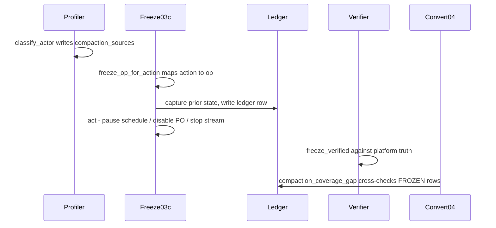

# 07 - The freeze bracket

A concurrent OPTIMIZE / compaction job, or Predictive Optimization, or a live stream, will
corrupt or race a `SET MANAGED`. A concurrent VACUUM deletes files mid-conversion and can fail
it with `FILE_VALIDATION_FAILED`. The **freeze bracket** is the tooling's answer: discover who
is writing/compacting, reversibly pause exactly those actors, convert, then restore precisely
what was changed. Everything here touches only **reversible metadata**: it never deletes
data, moves a checkpoint, full-refreshes a pipeline, VACUUMs, or runs `SET MANAGED`.

The bracket is the optional **execute tier** around convert: `03c_freeze` (left bracket) and
`05b_unfreeze_verify` (right bracket). Both default to a **dry-run** (`confirm_execute=false`).

## Discovery: compaction attribution

`backend/src/migration/compaction.py` attributes who runs OPTIMIZE (and VACUUM) by reusing the profiler's
existing `DESCRIBE HISTORY` read (widened to `job` / `notebook` / `userName` / `engineInfo` /
`operationParameters` when the runtime exposes them). `compaction.classify_actor(...)` assigns
an actor by priority:

> **PREDICTIVE_OPTIMIZATION -> JOB -> PIPELINE -> NOTEBOOK -> USER -> UNKNOWN.**

The JOB id comes from the history `job` struct. Attribution **degrades honestly**: a failed
read stamps `history_unavailable` and a runtime lacking the attribution columns stamps
`attribution_unavailable` (constants `NOTE_HISTORY_UNAVAILABLE` / `NOTE_ATTRIBUTION_UNAVAILABLE`).
Absence of evidence is never recorded as "no compaction". Results land in `compaction_sources`
plus the `has_recurring_compaction` / `last_compaction_at` manifest columns. VACUUM commits are
attributed the same way from the same read (`operation_class = VACUUM` on `compaction_sources`,
manifest `last_vacuum_at`), so a scheduled VACUUM job is a `JOB` actor paused by the same
`PAUSE_JOB` freeze as an OPTIMIZE job.

## Actions: freeze/unfreeze pairs

`actions._compaction_actions(...)` turns each attributed actor into a
**`FREEZE_COMPACTION` (PRE_CONVERT, blocking) + `UNFREEZE_COMPACTION` (POST_CONVERT)** pair:

- **Predictive Optimization** is **schema-scoped** (an `ALTER SCHEMA ... DISABLE PREDICTIVE
  OPTIMIZATION`).
- **JOB / PIPELINE** actors are **table-scoped** with a `target_id`.
- **NOTEBOOK / USER** actors cannot be safely auto-operated and stay **MANUAL** (surfaced,
  never auto-paused).

The same bracket covers two more classes of concurrent writer, each with its own PRE_CONVERT ->
POST_CONVERT pair:

- **Streams**: `STOP_STREAM` -> `RESTART_STREAM` (structured-streaming jobs and DLT/Lakeflow
  pipelines; see [Streaming](./04-streaming.md)).
- **Scheduled batch writers**: `STOP_WRITER_JOB` -> `RESTART_WRITER_JOB`, generated for the
  `SCHEDULED_JOB` / `EVENT_JOB` writer classes the profiler attributes
  ([Discovery and signals](./03-discovery-and-signals.md#writer-attribution-and-the-schedule-verdict)).
  The bracket pauses the job's schedule/trigger/continuous block and cancels active runs before
  convert, then restores from the ledger after. Ad-hoc notebook/user writers stay advisory and
  are never auto-paused.

## Mapping actions to reversible operations

`executor.freeze_op_for_action(action_row)` maps an action to a concrete op, or returns `None`
(stays MANUAL; it only auto-operates with a real attributed target):

- `FREEZE_COMPACTION` + schema PO -> `OP_DISABLE_PO`
- `FREEZE_COMPACTION` + JOB -> `OP_PAUSE_JOB`
- `STOP_STREAM` + structured-streaming job -> `OP_STOP_STREAM_JOB`
- `STOP_STREAM` + DLT/Lakeflow -> `OP_STOP_PIPELINE`
- `STOP_WRITER_JOB` + scheduled/event job -> `OP_PAUSE_WRITER_JOB`

## The freeze notebook: capture prior state first

`backend/notebooks/03c_freeze.py::_freeze_one(op)` **captures the prior state before it acts**,
so unfreeze can restore exactly:

- for a job it records `prior_pause_status` (via `executor.read_job_pause_status`);
- for a schema it records `prior_po_enabled` (via `_po_enabled_for_schema`);
- for a stream it records the prior run id and preserves the checkpoint as evidence.

Then it acts, always reversibly: `executor.set_job_pause_status(W, target_id, True)` pauses the
**schedule only** (preserving cron/timezone; a no-op if there is no schedule); PO is disabled;
a stream job is paused-then-canceled ("pause first so it can't relaunch"); a pipeline is
stopped.

`confirm_execute=false` (the default) is a **dry-run**: it writes `PLANNED` ledger rows with
the **exact statement as evidence** and makes **no API calls**. Set `confirm_execute=true` to
actually act.

## The ledger

`executor.py` owns `freeze_ledger` end to end (`ledger_key = op_kind|scope_ref|target`,
MERGE-idempotent, **never deleted**: a completed freeze flips `FROZEN -> UNFROZEN`). It
captures the prior state and the `checkpoint_location` as **evidence only, never modified**.
`LEDGER_IDENTITY_COLUMNS` and `LEDGER_MUTABLE_COLUMNS` partition the ledger's columns exactly
once (guarded by tests).

## Verify, then exact restore

Before a freeze/restart action moves to `DONE`, `verifier.freeze_verified(op_kind, platform)`
confirms it against **platform truth** (job actually paused, PO actually disabled, active run
gone, pipeline in a stopped state). Applied-but-unverified stays `IN_PROGRESS`.

Restore (`05b_unfreeze_verify`) uses `executor.restore_op_from_ledger(...)`, whose `should_act`
logic restores **exactly** what changed:

- resume a job **only if it was `UNPAUSED` before**;
- re-enable PO **only if it was `ON`** (never blanket-enable);
- always restart a stopped stream from its checkpoint;
- pipelines **always** restart with `full_refresh=False`.

Note the honest degradation: `_po_enabled_for_schema` parses `DESCRIBE SCHEMA EXTENDED`
heuristically, so `prior_po_enabled` can be `None`, in which case unfreeze will not
re-enable PO (it never guesses on ambiguous prior state).

## The convert-time coverage gate

`04_convert` machine-verifies the freeze rather than trusting it. The pure
`executor.compaction_coverage_gap(...)` cross-checks every schedulable `compaction_sources`
actor (`JOB` / schema `PREDICTIVE_OPTIMIZATION`) against `freeze_ledger` and blocks unless each
has a real `FROZEN` (`dry_run=false`) row. It is gated by `require_compaction_frozen` (default
`true`). On a gap it **fails loud**, prints the exact manual statement per uncovered unit, and
suggests `03c_freeze` as an optional next step; it never auto-runs the freeze. Manual actors
(pipeline/notebook/user) cannot satisfy ledger coverage and stay under the open-action gate.

Two sibling gates enforce the same "verify, don't trust" rule for the other writer classes.
The **stream-stop gate** cross-checks every attributed stream in the wave against the ledger
(`executor.stream_stop_coverage_gap`, skip with `require_streams_stopped=false`). The
**writer-job-stop gate** does the same for attributed schedulable writer jobs
(`SCHEDULED_JOB` / `EVENT_JOB`): `04_convert` refuses to convert unless each has a real
`FROZEN` (`dry_run=false`) `OP_PAUSE_WRITER_JOB` row, via the `WRITER_STOP_COVERAGE` gate (skip
with `require_writers_stopped=false`). Both default to `true` and, like the compaction gate,
are attributed-only (unattributed streams/writers surface as a printed CAUTION, never a silent
pass).

## The Authorize bracket (03d + the 07 revoke)

The freeze bracket is a pattern, not just a compaction fix: reversibly change platform state
around a convert, capture the prior state in a ledger, restore exactly, verify, never delete.
The **Authorize bracket** applies that same pattern to the convert permission, the other thing
a `SET MANAGED` needs. `03d_lease_ownership` (Authorize) grants the convert identity only the
privileges it is missing and can grant itself, holds them through the 14-day rollback window,
and cleanup revokes exactly those rather than `05b`. Ownership never changes. It has its own
page: [Convert permissions and Authorize](./07b-convert-permissions.md).

## Sequence

Action-queue invariants (the ownership split, the never-delete rule, `action_key`) are in
[`backend/docs/reference/action-queue.md`](../backend/docs/reference/action-queue.md); the
freeze knobs and the `03c`/`05b` parameters are in
[`backend/docs/contracts/jobs.md`](../backend/docs/contracts/jobs.md).
