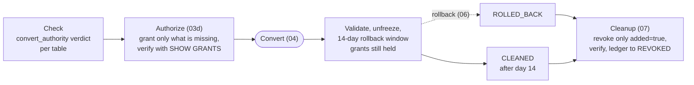
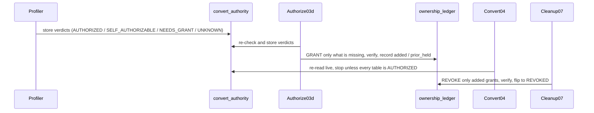

# 07b - Convert permissions and Authorize

`ALTER TABLE ... SET MANAGED` runs as the convert job's identity: its `run_as`, which in
production is the App service principal (SP). On each table that identity needs:

- `USE CATALOG` on the catalog and `USE SCHEMA` on the schema;
- **ownership or `MANAGE`** on the table, its schema, or its catalog, held directly, inherited,
  or through a group it belongs to;
- `SELECT` and `MODIFY` on the table, unless it owns the table.

**Ownership never changes.** The tooling checks these requirements, grants only what is missing
when the identity can grant it itself, and asks a named person for the rest. Rollback
(`UNSET MANAGED`) needs the same permission, so nothing is removed until the rollback window
has closed.

This is the [freeze bracket](./07-freeze-bracket.md) pattern applied to a different obstacle.
Same rules: change reversible platform state around the convert, record what changed in a
ledger, undo exactly that, verify, never delete.

## One rule, one table: convert_authority

The rule lives in one place (`backend/src/migration/authority.py`) and its verdicts are stored
in the `convert_authority` control table, one row per table, identity and evaluation. The app,
the MCP tools, Genie and the cockpits only read it. Read the latest `evaluated_at` per table.

| `status` | Meaning |
|---|---|
| `AUTHORIZED` | Every requirement is already held. Nothing to do. |
| `SELF_AUTHORIZABLE` | Something is missing, and the identity can grant all of it itself. Authorize closes it. |
| `NEEDS_GRANT` | Someone else must grant at least one privilege. |
| `UNKNOWN` | The facts could not be read, so nothing is proven. It blocks the convert. |

A table still to convert with no row has not been checked yet, and it also blocks. Each row
carries `basis` (what already satisfies ownership-or-`MANAGE`), `missing`, the exact `grant_sql`,
and `grant_requests`. Each request names its `grantors` (the owner at that level, then any
principal with `MANAGE`, then a metastore admin) and an `ask_text` sentence, which every
surface shows verbatim:

> Ask the owner of table `main_cat.sch_a.c0` (`data-owner@example.com`) to run: GRANT MANAGE ON
> TABLE main_cat.sch_a.c0 TO `migration-sp`; or ask any principal with MANAGE on it, or a
> metastore admin.

The profiler, the dry run (Check 4), the conductor, the bulk cockpit (when it runs as the
convert identity) and Authorize all re-evaluate and store verdicts. The convert re-reads them
live (see the gate below).

## Authorize: 03d

`job_03d_lease_ownership` (app alias `lease_ownership`, labelled **Authorize**; the keys are
kept from the ownership lease this replaced) is the PRE_CONVERT half. It re-checks every table
in scope, stores the verdicts, and for each `SELF_AUTHORIZABLE` table runs only the missing
`GRANT`s. A metastore admin identity grants itself automatically, behind the same
`confirm_execute`, and the audit row says so.

`confirm_execute=false` is the default and is a **dry-run**. It still re-checks and stores the
verdicts, so it doubles as **Check permissions again**, and it records each `GRANT` it would
run as a `PLANNED` ledger row. It grants nothing. With `confirm_execute=true` it grants, then
verifies the live grants before recording each one as `GRANTED`. Re-running is safe: granting
a privilege already held is a no-op.

A `NEEDS_GRANT` table stays MANUAL. Its `LEASE_OWNERSHIP` action carries the exact grant script
and who can run each statement. The app offers the same script to copy or download
(`/api/grants/convert-permissions.sql`), grouped by who must run it.

## The ledger: ownership_ledger

`ownership_ledger` is modeled on `freeze_ledger`: deterministic keys, MERGE-idempotent writes,
and rows are **never deleted**. Each Authorize grant is one `GRANT` row (`securable_type`,
`securable_name`, `privilege`, `grantee`) with two flags:

- `added=true`: Authorize ran it, so cleanup revokes it;
- `prior_held=true`: the identity already held it, so it is never revoked.

`LEASE_OWNERSHIP` (PRE_CONVERT, blocking) pairs with `RESTORE_OWNERSHIP` (POST_CONVERT). The pair
is generated from `SELF_AUTHORIZABLE` and `NEEDS_GRANT` verdicts, and the restore half (the
revoke) only when Authorize can grant the privileges itself. A grant a person runs is not
recorded as added, so no revoke is promised for it.

## Revoke at cleanup, not unfreeze

The freeze bracket restores at `05b`, right after validate. The added grants do not. They are
held through convert, validate, and the entire 14-day rollback window, because an in-window
rollback (`UNSET MANAGED`) needs the same permission.

So the revoke runs at cleanup (`job_07_post_convert_cleanup`), once a table is `CLEANED` or
`ROLLED_BACK`. It revokes only `added=true` grants, in undo order (table data privileges, table
`MANAGE`, schema, catalog). A schema or catalog grant shared by several tables is revoked once,
only after every table that recorded it is done, so a sibling still converting keeps its access.
Each revoke is audited first and verified with `SHOW GRANTS` before the ledger flips to
`REVOKED`. The rollback and cleanup flow is in [Rollback and cleanup](./09-rollback-and-cleanup.md).

Tables leased under the older ownership model (`LEASE` rows, status `LEASED`) are still
restored to their recorded `prior_owner` at cleanup. No new lease is ever taken.

## Convert rights granted at install

Authorize can grant `SELECT` and `MODIFY` only because the convert identity already holds `MANAGE`
on the schema: a job can never give itself `MANAGE`. The installer grants it, in the same reviewed
plan as the read access ([Installation](./00-installation.md#what-the-installer-grants)):

- **All at once** (the default): `MANAGE` on every schema you migrate, at install. No person is
  needed between waves.
- **Per wave** (the stricter option): `MANAGE` on one wave's schemas, just before it converts, with
  `action=grant_convert` or **Grant convert rights** on the convert gate.

Each is recorded as an `INSTALL|…` row in `ownership_ledger` (`added`, or `prior_held` when the
identity already held it). The jobs' identity cannot revoke its own `MANAGE`, so cleanup does not
revoke these rows. Once every table in the schema is `CLEANED` or `ROLLED_BACK`, cleanup marks the
row `HANDBACK_READY` and opens a **Hand back convert rights** item on the runbook, with the exact
`REVOKE`. A person hands it back from any front door (`action=revoke_convert`, the runbook's **Hand
back**, or `mtm_hand_back_convert_rights`). A schema with a table inside its 14-day window is
refused, and a grant the tool did not add is never revoked.

## The convert-time gate

`04_convert` does not trust a stored verdict. Before any `SET MANAGED` it re-reads the
permission live for every table it will convert, stores those verdicts, and stops before any
change if a table is not `AUTHORIZED`. It prints each missing `GRANT` and who can run it, and
points at Authorize as the fix. It never runs Authorize itself. The gate is
`require_ownership_leased` (default `true`; the name is kept from the lease). The gate lives
with the other convert gates in [Conversion and validation](./08-conversion-and-validation.md).

## When the conductor recommends it

The conductor recommends Authorize (`STEP_LEASE`) only when a wave has tables still to convert
that are not `AUTHORIZED` (`wave_status.open_lease > 0`), so an authorized wave never sees the
step. It also recommends it when a grant was applied but not verified, with this sentence:
"2 convert-permission grant(s) were applied but are not verified yet. Re-run Authorize to
re-check; granting again is a no-op." The app's Convert dialog and the Genie Code preflight say
the same. At estate scale, the [bulk campaign](./14-bulk-convert.md) reuses
`job_03d_lease_ownership` with a `batch_id` selector to authorize every wave in a parallel-safe
batch in one run.

## Sequence

Action-queue invariants are in
[`backend/docs/reference/action-queue.md`](../backend/docs/reference/action-queue.md); the
`03d` parameters are in [`backend/docs/contracts/jobs.md`](../backend/docs/contracts/jobs.md),
and the `convert_authority` columns in
[`backend/docs/contracts/control-tables.md`](../backend/docs/contracts/control-tables.md).
`table_owner_group` is deprecated and ignored.
