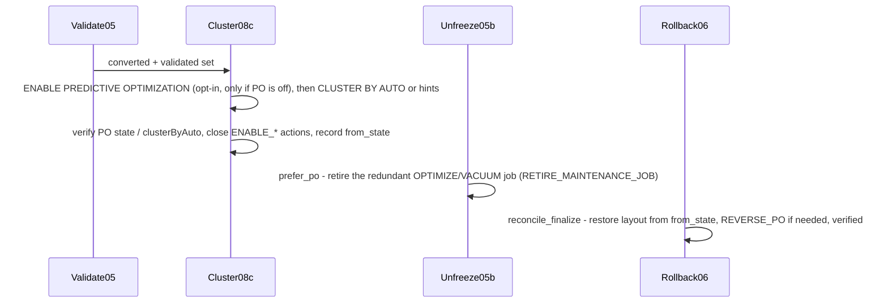

# 08c - Turn on liquid clustering

After `SET MANAGED`, Databricks automatically enables **Predictive Optimization (PO)**
on converted tables, which runs OPTIMIZE/VACUUM on your behalf. The real work in `08c_enable_optimization`
(`job_08c_enable_optimization`, POST_CONVERT, conductor title "Turn on liquid clustering") is
enabling **automatic liquid clustering** (`CLUSTER BY AUTO`) — a strategy that keeps a good layout
automatically, with or without human-picked key hints. Like every other POST_CONVERT executor it is
gated, verified, and reversible; it never runs `SET MANAGED`, deletes data, or VACUUMs.

## The clustering step in a wave's journey

`08c` is the last finish step of a wave:

```
dry-run → [freeze] → [authorize] → convert → validate → [unfreeze] → [re-share] → [compat] → [clustering] → next wave
```

The conductor recommends "Turn on liquid clustering" while `wave_status.optimize_pending` is true,
meaning the wave is fully migrated and at least one member's `table_manifest.optimize_run_at` is still NULL.
It never routes off open `ENABLE_*` action rows: a dry-run `08c` MERGEs those OPEN, and manual
auto-liquid rows stay OPEN, so routing on them would pin the wave. Every surface can launch it:

- **App.** The app binds the job as the `enable_optimization` alias. The Overview guided card
  (the *Finishing* stage) and the Waves board's fully-migrated row offer three choices:
  **Turn on liquid clustering** (`enable_po_on_convert=true`, `auto_liquid_policy=enable_eligible`,
  `confirm_execute=true`), **Review plan** (the same with `confirm_execute=false`, which stamps
  nothing and does not finish the step), and **Skip clustering for now** (`enable_po_on_convert=false`,
  `auto_liquid_policy=recommend`, `confirm_execute=true`; keeps clustering statements on the runbook
  but changes no table). Each sends the wave pin (`plan_run_id` + `wave_id`) when both are known,
  else `target_schema`.
- **MCP.** `mtm_enable_optimization` (v2 tier, mutating, `confirm=true`); the estate next step
  recommends it with `enable_po_on_convert=true`.
- **Cockpit / CLI.** `09_cockpit` `action=advance` sends `enable_po_on_convert=true` and the value
  of its `confirm_execute` widget (default `false`, a dry-run);
  `databricks bundle run job_08c_enable_optimization` works as before.

The **job defaults do not change** (`enable_po_on_convert=false`, `confirm_execute=false`): only
the guided step and the MCP next step pass `true` explicitly.

**The stamp that finishes the step.** An executed `08c` (`confirm_execute=true`) stamps
`optimize_run_at` on every in-scope converted table with no FAILED PO or auto-liquid op, which
clears `optimize_pending`. PO-unreadable (MANUAL) and manual auto-liquid tables are stamped too;
their `ENABLE_*` actions stay OPEN as runbook work but never hold the wave. A dry-run stamps
nothing, and a FAILED table stays unstamped so optimize is offered again. With
`enable_po_on_convert=false` (the Skip choice) only not-yet-stamped tables are stamped, and each
is recorded as `optimize_po_declined` ("operator declined PO", with an
`ENABLE_PREDICTIVE_OPTIMIZATION` `SKIPPED` audit row written first); a table already read as
PO-on is not a decline. `06_rollback` clears both columns, so a re-converted table is offered
optimize again. The full stamp rule is in
[`backend/docs/contracts/jobs.md`](../backend/docs/contracts/jobs.md) §15.

## Predictive Optimization and liquid clustering policies

`08c` can leave two independent finalize deltas on a converted table:

- **Predictive Optimization.** PO is turned on automatically after `SET MANAGED` unless a user
  or workspace setting disables it. `enable_po_on_convert=false` (default) is a no-op that emits
  no executable ops. With `enable_po_on_convert=true`, `08c` plans the exact `ALTER TABLE ...
  ENABLE PREDICTIVE OPTIMIZATION` ONLY for converted tables whose PO state reads as OFF. PO-on
  tables are skipped; PO-unknown tables stay **MANUAL** (never assumed on).
- **Automatic liquid clustering.** `auto_liquid_policy` (an enumeration) controls how `08c`
  handles automatic clustering. The three values are: **`enable_eligible`** (default: run
  eligible ops on the qualified set), **`recommend`** (advisory-only: record each table's exact
  statements on the runbook but change no table), **`off`** (leave clustering alone). An unknown
  value fails closed: eligible tables are treated as under `recommend` (statements recorded, nothing run).

PO ops run **first**, because auto-liquid depends on PO being effectively on.

## Liquid clustering eligibility: per-table classification

Auto-liquid is only ever applied where it is provably safe. `08c` classifies each converted table
by its live layout (from `DESCRIBE DETAIL`, `DESCRIBE TABLE EXTENDED` and recent `DESCRIBE HISTORY`),
falling back to the profiler's manifest fields when a read fails:

1. **Already on AUTO** → skipped; any open `ENABLE_AUTO_LIQUID` action is closed.
2. **Managed Iceberg** → MANUAL (Iceberg needs explicit confirmation; `CLUSTER BY AUTO` is not
   the same choice as Delta).
3. **Not Delta** → skipped (nothing to cluster).
4. **UniForm** (Iceberg reads, `data_source_format=DELTA`) → MANUAL (needs confirmation).
5. **Partition or clustering layout unreadable** → MANUAL (degraded honestly).
6. **Partitioned** → MANUAL (the statement shown is `ALTER TABLE ... REPLACE PARTITIONED BY WITH
   CLUSTER BY AUTO`, which needs DBR 18.1+ and reorganizes data — never executed by `08c`).
7. **PO off** → MANUAL (auto-clustering needs PO).
8. **Manual clustering keys** (CLUSTER BY with specific columns) → ELIGIBLE (`auto_liquid_policy`
   = `enable_eligible` only): the statement is `CLUSTER BY AUTO`, which keeps those keys as the
   starting keys; Predictive Optimization may change them later. If the table's AUTO flag cannot be
   read, it stays MANUAL instead.
9. **ZORDER hints** (found in the newest non-empty `DESCRIBE HISTORY` operationParameters.zOrderBy,
   at most 4 valid top-level clustering columns with statistics) → ELIGIBLE: the statement is a
   pair: `CLUSTER BY (hints)` followed by `CLUSTER BY AUTO`. If the platform rejects the hints
   (e.g. missing stats), `08c` falls back to plain `CLUSTER BY AUTO` and records `hints_rejected`
   on the action evidence.
10. **ZORDER but no valid hints** → ELIGIBLE: plain `CLUSTER BY AUTO`.
11. **Clean** (Delta, unpartitioned, no keys, not already auto, PO on) → ELIGIBLE: `CLUSTER BY
    AUTO`.

## Gated, verified, reversible

`confirm_execute=false` (the default) is a **dry-run**: it prints AND persists the exact
statement(s) on each action's `evidence` and runs nothing. With `confirm_execute=true` the stage
runs the statement(s), then **verifies** against platform truth before closing the paired action.
PO verification re-reads PO state via `DESCRIBE TABLE EXTENDED`; auto-liquid verification reads
`clusterByAuto` from the live table. For ZORDER hints: if the platform rejects the hint statement,
`08c` falls back to plain `CLUSTER BY AUTO` and records the fallback on the action evidence; if
AUTO itself fails, `08c` undoes the keys and reports FAILED (the step is offered again). Applied-but-unverified
stays `IN_PROGRESS`. Each table's auto-liquid is reversible per table with `ALTER TABLE ... CLUSTER BY NONE`.
Pure planner + verifier logic lives in `migration/optimization.py`; the notebook is a thin Spark edge.
Clustering adds the `clustering`, `domainMetadata`, and `rowTracking` table features; `CLUSTER BY NONE`
does not remove them (matters for external non-Databricks writers).

## Unfreeze retires the redundant job, it does not resume it (RB-M3)

The freeze bracket ([The freeze bracket](./07-freeze-bracket.md)) pauses a scheduled OPTIMIZE
or VACUUM job before convert. PO runs both OPTIMIZE and VACUUM, so once it is maintaining the
converted table, resuming either job would just double up. So `05b_unfreeze_verify` is **forward-only** under
`post_convert_maintenance_policy=prefer_po` (the only accepted value; a legacy `exact_restore`
request is coerced to `prefer_po` with a deprecation note): instead of resuming the paused
job it raises a non-blocking `RETIRE_MAINTENANCE_JOB` recommendation carrying the exact
`databricks jobs update ... pause_status=PAUSED` statement, and **never deletes the job**. If PO
was off at unfreeze, `05b` resumed the job instead; when an executed `08c` later finds that
table PO-on (verified in the same run, or already on), it raises the same recommendation (same
`action_key`, `source = 08c_enable_optimization`), still without pausing or deleting the job.
Each executed `08c` then re-reads the job of every open `RETIRE_MAINTENANCE_JOB` row in scope (read-only)
and closes the row `DONE` once the job is deleted, paused, or has no schedule or trigger; a job that
is still scheduled, or unreadable, keeps it OPEN. `RETIRE_MAINTENANCE_JOB` is advisory: it is
listed in the runbook but never holds a wave. When PO is off or unknown it falls back to resuming
(never leaving a table unmaintained). The model is: **freeze pauses what can harm the migration;
unfreeze restarts forward-looking; rollback restores exactly.**

## Rollback reverses these deltas (RB-M2)

Because `08c` leaves one-way deltas, `06_rollback` reverses them so a rolled-back table returns
to its exact pre-migration posture. `08c` records the table's layout before any `08c` changes in
each audit row (`from_state`). With `reconcile_finalize=true` (default) rollback, after
`UNSET MANAGED` and the exact-restore pass, reverses the table-grain finalize deltas: `REVERSE_PO`
(`DISABLE PREDICTIVE OPTIMIZATION`) if PO was OFF before `08c`, and `REVERSE_AUTO_LIQUID` which
reads `from_state` and returns the table to its exact prior clustering state (no clustering → `CLUSTER BY NONE`,
manual keys → `CLUSTER BY (those keys)`, a failed pair's leftover keys removed, partitioned or
already-AUTO → MANUAL; unreadable live layout → MANUAL). Each reversal is verified by a live re-read,
and open `ENABLE_*` finalize actions are obsoleted. The two are reversed **independently**, so PO
enabled by *inheritance* (no per-table `ALTER`) does not mask the auto-liquid reversal. See
[Rollback and cleanup](./09-rollback-and-cleanup.md).

## Sequence



The full `08c` parameters (`enable_po_on_convert`, `auto_liquid_policy`, `confirm_execute`),
the `05b` `post_convert_maintenance_policy` knob, and the `06` `reconcile_finalize` /
`restore_prior_state` knobs are authoritative in
[`backend/docs/contracts/jobs.md`](../backend/docs/contracts/jobs.md); the manifest layout
columns and the `migration_actions` kinds are in
[`backend/docs/contracts/control-tables.md`](../backend/docs/contracts/control-tables.md) and
[`backend/docs/reference/action-queue.md`](../backend/docs/reference/action-queue.md).
