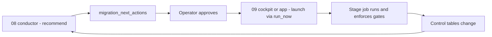

# 10 - Cockpit and conductor

Once the estate is profiled and planned, you drive the whole migration from one place. Three
additive pieces sit over the engine jobs, none of which ever runs `SET MANAGED`: the
**conductor** recommends, the **operator** approves, and the **cockpit** (or the app) launches.
This page covers that loop plus the runbook and digest trust surfaces. It also describes the
**app-free bulk cockpit** for driving a parallel-safe *batch* of waves.

## The conductor: the brain (read-only)

`backend/src/migration/conductor.py` (run by `job_08_conductor` /
`backend/notebooks/08_conductor.py`) rolls up estate state and recommends the single next step:

1. `summarize_estate(migration_progress_rows)` rolls up per-schema progress.
2. `resolve_next_step(estate, wave_status_rows, ...)` is the single decision path. It returns
   one of the closed set of step kinds (`conductor.ALL_STEP_KINDS`): `STEP_REPLAN` /
   `STEP_PREP` / `STEP_CONVERT` / `STEP_VALIDATE` / `STEP_RESUME` / `STEP_FREEZE` /
   `STEP_LEASE` / `STEP_UNFREEZE` / `STEP_RESHARE` / `STEP_COMPAT` / `STEP_OPTIMIZE` /
   `STEP_ACTIONS` / `STEP_BLOCKED` / `STEP_DONE`.

### One schema at a time, and team priorities

Each run also writes **one recommendation per schema** (`migration.focus.resolve_scoped_steps` →
`migration_next_actions_by_scope`, same `as_of`): the same `resolve_next_step` over that schema's
own waves, with commands pinned to the wave. The cockpit with `target_schema=<catalog.schema>`,
the app's **Work on another schema** view and Genie Code's `mtm_get_next_step(target=…)` read it,
so every interface names the same step and wave for the same schema.

**Team priorities** (`focus.resolve_with_pins`) are an ordered list of pinned schemas. The estate
pick is: replan → a started wave → a converted wave's finish steps → the first pinned schema whose
own step is on the happy path → the default pick. With no pins it is exactly `resolve_next_step`.
A blocked / held / unplanned / orphaned pin is skipped (its status is on `focus_pins`); a pin clears
itself when every wave of its schema is `DONE`. Change them with `job_08_conductor`
`pin_action=add|remove|move|clear` (one schema per call; `add` needs `pin_reason`), from the app's
Team priorities panel, or Genie Code's `mtm_set_focus_pins`.

### One wave end to end

The conductor walks **one wave through its whole journey** before it moves to the next:

```
dry-run → [freeze] → [authorize] → convert → validate → [unfreeze] → [re-share] → [compat] → [optimize] → next wave
```

Bracketed steps are recommended only when they apply; otherwise they are skipped silently. The
precedence in `resolve_next_step` is:

1. `STEP_REPLAN` (no plan yet, or no profiled schemas).
2. A wave already in flight: the lowest-ordered wave that has started converting is resumed,
   validated, or converted the rest of the way, even ahead of a lower-ordered READY wave.
3. The **finishing wave**: `pick_finishing_wave` returns the lowest-ordered fully-migrated wave
   still in `AWAITING_ACTIONS`, and `post_convert_step` names its next finish step, in order:
   unfreeze (`05b`) → re-share (`08`) → compat (`08b`) → "Turn on liquid clustering" (`08c`).
   This preempts a wave that has not started converting, and the `done` verdict.
4. Otherwise `classify_next_step` picks the next READY / PLANNED wave (`prep`, `freeze`, `lease` (Authorize),
   `convert`, `actions`, `blocked`, or `done`).

This is **recommendation order only**. No convert gate reads it, and an operator can still start
the next wave from Waves or Convert. Finish steps are never excluded by `include_streaming`,
because a converted streaming wave still owes its restarts.

What counts as a finish step:

- `unfreeze` only when a real (`dry_run=false`) freeze left restore work open. A skipped or
  dry-run-only freeze leaves nothing to unfreeze.
- `reshare` / `compat` while an `OPEN` / `IN_PROGRESS` `RESHARE_D2D` / `ENABLE_COMPAT` action is
  open. One the tool cannot close (no attributable share, no Compat location chosen yet) can be
  set aside with `08` / `08b` `finish_action=defer` and a reason: it becomes `DEFERRED`, stops
  holding the wave, stays in `migration_runbook`, and `finish_action=reopen` brings it back.
- "Turn on liquid clustering" (`08c`, step kind `optimize`) while `wave_status.optimize_pending`
  (a member's `table_manifest.optimize_run_at` is NULL). An executed `08c` stamps the tables and
  the wave finishes. See [Post-convert maintenance policy](./08c-post-convert-maintenance.md).

`ENABLE_*`, `RETIRE_MAINTENANCE_JOB`, and `RESTORE_OWNERSHIP` actions (cleanup's work, after the
14-day window) never hold a wave. Only `wave_status.open_post_convert_holding` does.

Only `STEP_CONVERT` and `STEP_RESUME` are in `_MUTATING_STEPS`. The bracket, finish, and prep
steps are optional and non-mutating at the conductor; each job they launch is dry-run by default
and re-checks its own gates. A fully-converted awaiting wave is never routed to a `PRE_CONVERT`
step: a pre-convert action still open on it is an orphaned bracket.

The conductor writes one **append-only** row to `migration_next_actions` carrying the step, its
full implications (mutation, reversibility, ETA + max downtime, blast radius, post-actions), a
prior-activity narrative (`build_activity_summary`), and the exact command. It never mutates a
table.

## The cockpit: the human launcher (interactive)

`backend/notebooks/09_cockpit.py` is an interactive notebook, not a Workflow job. You open
it and "Run all" to get the briefing, then approve the recommendation:

- `action=show` (default) shows the briefing only: what has been done, where the estate is, the
  recommended next step and its full implications, and a reference legend.
- `action=advance` approves the recommendation and launches the matching deployed job via
  `jobs.run_now` (with a duplicate-trigger guard and a clickable run link). Convert/resume
  require `confirm_convert=true` (the mutation gate); compat needs a location; optimize sends
  `enable_po_on_convert=true` and the wave pin. Freeze and unfreeze launch with
  `confirm_execute=true`; re-share, Compat and optimize honour the cockpit's `confirm_execute`
  widget (default `false`, a dry-run). When there is
  no recommendation yet, `advance` launches `job_08_conductor` first to compute one.
- `action=advanced` with a `manual=` mode covers the rare operations:
  `replan` / `rollback` / `cleanup` / `export_runbook` / `digest`. There is no
  `manual=conductor` (advance already runs the conductor when needed).

The cockpit never runs `SET MANAGED` inline; it only launches deployed jobs.

## The bulk cockpit: the app-free batch launcher

`backend/notebooks/11_bulk_cockpit.py` (deployed as `job_11e_bulk_cockpit`) is the bulk twin
of `09_cockpit`. Where `09_cockpit` drives one recommended wave, the bulk cockpit reflects
each parallel-safe batch (`wave_parallel_groups` ⋈ `wave_status`, plus open-freeze counts
from `freeze_ledger_open`) and, on `action=advance`, launches the single recommended next step
(`batch_readiness` → `next_bulk_step`) via `jobs.run_now`: a `job_11*` job, or Authorize
(`03d`) or a finish step (`08` / `08b` / `08c`) with `batch_id`. With `batch_id` blank it marks
the recommended batch (`recommended_batch`: finish the started batch first). Like `09_cockpit`, it
is read-only: the mutation lives in the launched job, and each launch is a separate,
deliberate SR11 step (nothing auto-sequences). It is the app-free path for
[Bulk convert](./14-bulk-convert.md); the app's `/bulk` screen is its UI peer.

## The recommend / approve / launch loop



Every stage that moves a wave along ends with a read-only `recompute_next_step` task
(`run_job_task` → `job_08_conductor`, `run_if: ALL_DONE`): `03c`, `03d`, `04`, `05`, `05b`, `06`,
`08`, `08b`, `08c`, and the bulk `11`, `11b`, `11c`, `11d` (and `02` runs a `conductor` tail).
So the recommendation moves on to the next finish step, the next wave, or `done` by itself, and
the loop closes.

## The runbook: do it by hand

`backend/src/migration/runbook.py::build_runbook(...)` is the trust surface: anything the tool
can do, an operator can do by hand. It UNIONs, phase-ordered
`PRE_CONVERT` -> `CONVERT` -> `POST_CONVERT`:

- open `migration_actions` (their `remediation_sql` / `remediation_api`),
- `freeze_ledger` `PLANNED` / `FROZEN` ops (the exact freeze statement plus the paired restore
  statement from `executor.op_statement` / `restore_statement`), and
- managed-location / dry-run **blockers** (a precise remediation per code, e.g. the exact
  `ALTER CATALOG ... SET MANAGED LOCATION` DDL).

It surfaces as the `migration_runbook` view (created by `bootstrap.ensure_control_plane`), the
dashboard's Runbook page, and a read-only export from the cockpit
(`action=advanced`, `manual=export_runbook`, `runbook_volume_path=<UC Volume dir>`) that writes
an ordered, commented `.sql` + `.md` to a UC Volume. It never executes anything. In dry-run,
`03c` / `05b` print and persist the exact statement (ledger `evidence`) instead of calling
the API.

## The digest: opt-in blocker / stale-freeze rollup

`backend/src/migration/digest.py::build_digest(...)` is a thin, off-by-default read-only rollup
for operators/on-call: what still blocks a convert (the genuinely pending, blocking
runbook entries: action/blocker sources only; freeze-ledger entries are reported separately)
and what has been frozen too long (FROZEN ledger rows older than the threshold, via
`executor.freeze_staleness`, default 72h). It is pure (no network); delivery is the cockpit
`manual=digest` mode, which prints it and optionally writes a plain-text copy to a UC Volume.
Nothing here executes or mutates.

The `migration_next_actions` and `migration_runbook` column contracts are in
[`backend/docs/contracts/control-tables.md`](../backend/docs/contracts/control-tables.md).
