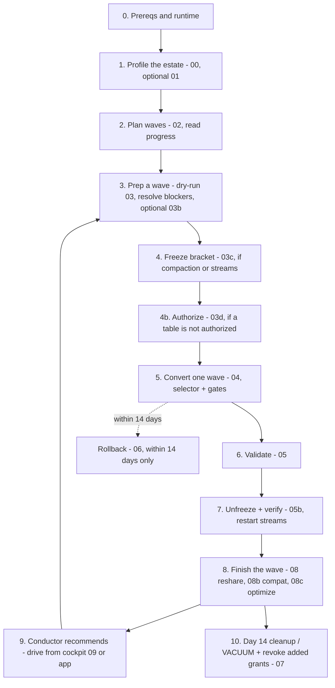

# 13 - Estate migration playbook

This ties every stage together into the step-by-step runbook for migrating an estate safely
at scale. It assumes the bundle is deployed (see
[Using the notebooks](./11-using-notebooks.md) for `bundle deploy`). The same principles hold
throughout: pilot first, isolate streaming, convert one wave (or one parallel-safe batch) at a
time, dry-run before execute, and trust only machine-verified gates.

## The loop

**One schema at a time.** Steps 3–8 run per wave. When a schema has several waves, walk them in
the order the conductor gives for that schema (the app's **Work on another schema**, or the cockpit
with `target_schema`): it resumes a started wave first and finishes a converted wave's restarts,
re-share, external readers and optimize before the next one. To have the whole team take some
schemas first, pin them (Team priorities / `job_08_conductor pin_action=add`); pins rank after work
already in flight and never skip a gate.

## The steps

**0. Prereqs and runtime.** Confirm the runtime floor: `SET MANAGED` /
`TRUNCATE UNIFORM HISTORY` need DBR 17.3 LTS+ or Serverless; all stage jobs run serverless, which
satisfies this. Confirm a managed storage location is configured (schema -> catalog ->
metastore). It is a fail-closed gate. Install with the installer (the `install.py` notebook or
`databricks bundle run install`): it runs `job_99_setup` for you (control plane, Genie space, App SP
grants), grants the jobs what they need, profiles and verifies. See
[Installation](./00-installation.md) and
[Overview](./01-overview.md#non-negotiable-set-managed-facts).

**1. Profile the estate.** Run `job_00_profiler` (read-only) to discover every EXTERNAL table,
set the risk flags, and seed the action queue. Optionally run `job_01_source_scan` for the
tier-2 path-access detail. See [Discovery and signals](./03-discovery-and-signals.md).

**2. Plan waves.** Run `job_02_wave_planner`. It buckets and slices tables into capped waves,
stamps a `plan_run_id`, and rebuilds the `migration_progress` / `wave_status` views. Read
those to see per-schema and per-wave standing. See [Wave planning](./06-wave-planning.md).

**3. Prep a schema/wave.** Run `job_03_dry_run` on the schema you intend to convert; it
advances passing tables to `DRY_RUN_OK` and marks the rest `BLOCKED` with a remediation. Work
the action queue / runbook to clear blockers (path access, external writers, managed
location). Optionally re-scan compaction with `job_03b_compaction_scan` (read-only) so
freeze knows what to pause. See [Conversion and validation](./08-conversion-and-validation.md).

**4. Freeze the bracket.** If the wave has attributed compaction jobs, Predictive Optimization,
or streams, run `job_03c_freeze` (dry-run first, then `confirm_execute=true`). It reversibly
pauses exactly those actors and records prior state in `freeze_ledger`. See
[The freeze bracket](./07-freeze-bracket.md).

**4b. Authorize.** If `convert_authority` says a table in the wave is not `AUTHORIZED` (the
job's `run_as` lacks `USE CATALOG` / `USE SCHEMA`, ownership or `MANAGE`, or `SELECT` /
`MODIFY`), run `job_03d_lease_ownership` (Authorize; dry-run first, then
`confirm_execute=true`). It grants only the missing privileges the identity can grant itself
and records each in `ownership_ledger`; anything else is a grant script naming who must run it.
The grants are **held through convert, validate, and the 14-day window** and revoked only at
cleanup (`07`), not at `05b`, because in-window rollback needs the same permission. Ownership
never changes. See [Convert permissions and Authorize](./07b-convert-permissions.md).

**5. Convert one wave.** Run `job_04_convert` with a selector and the gate flag, e.g.
`--params target_schema=<catalog.schema>,confirm_compaction_paused=true`. Waves are atomic and
resumable; the job re-asserts the managed-location, recent-OPTIMIZE, compaction-coverage,
stream-stop, and convert-permission (`require_ownership_leased`, default `true`) gates and
**fails closed** on a gap. Convert one wave at a time; keep streaming isolated (opt in with
`bucket=streaming` or `include_streaming=true`).

`job_04_convert` has two tasks: `select_waves` resolves the selector into an ordered
`(plan_run_id, wave_id)` list pinned to the current plan, and a `for_each` runs the converter once
per wave at concurrency 1. What that guarantees:

- **No implicit convert-all.** One selector is required: `target_schema`, `bucket`, or `wave_ids`
  (exclusive with the other two). A selector that matches no wave fails.
- **Atomic waves.** The converter takes the whole remaining wave or fails before mutating anything
  (`convert_max_tables_per_wave`, default `300`, guards this).
- **Resumable.** Only waves with a remaining `DRY_RUN_OK` or `CONVERTING` member are runnable, so an
  interrupted run resumes cleanly, and a fully-migrated scope is an idempotent no-op.
- **Plan-drift guard.** `select_waves` and `04_convert` both require the exact
  `(plan_run_id, wave_id)` in the current plan; a stale selection fails before mutation.
- **Streaming safety belt.** Beyond skipping streaming waves by default, the converter fails loud
  if a streaming table ever appears in a non-streaming wave.
- **Already-managed reconciliation.** A table that is already `MANAGED` advances to `CONVERTED`
  with an audit row, without re-running `SET MANAGED`.

The CLI `--params` list is comma-separated, so a value cannot contain a comma: pass one wave per
call (`--params wave_ids=<wave_id>,confirm_compaction_paused=true`), or set several `wave_ids`
from the Jobs UI.

**5b. Scale up with a parallel-safe batch (optional).** For a large estate, convert a whole
**batch** of non-conflicting waves at once instead of one at a time. The wave planner colors
waves into batches in `wave_parallel_groups` (one risk tier, streaming isolated, capped by
`bulk_max_parallel`); the `job_11*` bulk jobs fan the freeze/convert/validate/unfreeze stages
out over the batch as separate, deliberate launches. Every per-wave gate still applies. See
[Bulk convert](./14-bulk-convert.md).

**6. Validate.** Run `job_05_validate` to advance `CONVERTED -> VALIDATED` and write
`validation_results`.

**7. Unfreeze + verify.** Run `job_05b_unfreeze_verify` to restore exactly from the ledger
(paused stays paused, PO back only if it was on, streams from their checkpoint, pipelines
without full refresh) and to restart streams. It verifies each restore against platform truth
and auto-closes the paired POST_CONVERT actions.

**8. Finish the wave.** Each step runs only where it applies, in this order after unfreeze:
`job_08_reshare` REMOVE+ADDs each converted D2D table back into its share WITH HISTORY;
`job_08b_enable_compat` (needs a human-supplied empty external location) enables Compatibility
Mode for external read-only consumers; `job_08c_enable_optimization` turns on Predictive
Optimization (`enable_po_on_convert=true`) and automatic liquid clustering on the eligible clean
set. All three are dry-run by default. A re-share or Compat step the tool cannot close yet (no
attributable share, no location chosen) can be set aside with `finish_action=defer` and a
`defer_reason`: it becomes `DEFERRED`, stops holding the wave, stays on the runbook, and
`finish_action=reopen` brings it back. The optimize step can also skip clustering for now (an
executed run with `enable_po_on_convert=false`, `auto_liquid_policy=recommend`, changes no table,
keeps statements on the runbook). See [Post-convert maintenance policy](./08c-post-convert-maintenance.md).

**9. Let the conductor drive.** `job_08_conductor` recommends the single next step into
`migration_next_actions`, and it **finishes the current wave first**: a converted wave's
remaining unfreeze → re-share → Compat → optimize steps come before a wave that has not started
converting (a recommendation, not a gate). Drive from the cockpit (`09_cockpit.py`,
`action=advance`) or the app, approving each step. See
[Cockpit and conductor](./10-cockpit-and-conductor.md#one-wave-end-to-end).

**10. After 14 days, clean up.** `job_07_post_convert_cleanup` VACUUMs PO-disabled tables once
past the 14-day window (never inside it) and, gated by its own `confirm_execute`, **revokes the
grants Authorize added** once a table is `CLEANED` (a privilege held before is never revoked).
**Rollback (`job_06_rollback`) is available only within those 14 days**, is manual, and is pinned
to one wave with a written reason (`--params plan_run_id=<uuid>,wave_id=<wave_id>,reason="<why>"`).
See [Rollback and cleanup](./09-rollback-and-cleanup.md).

## Why the discipline

- **Pilot first** proves the tooling on a small, low-blast-radius, single-schema slice before
  anything precious moves.
- **Streaming isolation** guarantees a coordinated stop/restart and never mixes a stream into a
  batch wave.
- **One wave at a time** keeps blast radius bounded and every run resumable. At scale, a
  **parallel-safe batch** widens throughput without loosening this: batched waves are proven
  non-conflicting, streaming stays serial, and every per-wave gate still fires
  ([Bulk convert](./14-bulk-convert.md)).
- **Dry-run before execute** (the `confirm_execute=false` default on the executor stages) lets
  you review the exact statements before any API call.
- **Machine-verified gates** mean convert trusts the `freeze_ledger` and platform truth, not an
  operator's assertion. It fails closed on a coverage gap.

The exact parameters for every stage are in
[`backend/docs/contracts/jobs.md`](../backend/docs/contracts/jobs.md); the column contract is in
[`backend/docs/contracts/control-tables.md`](../backend/docs/contracts/control-tables.md).
